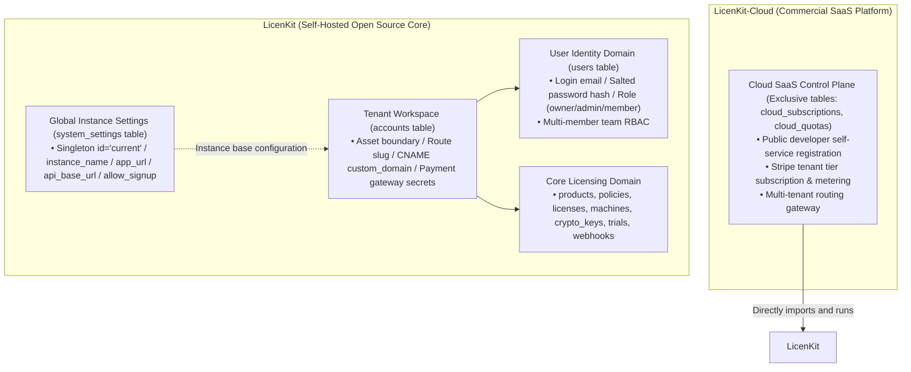
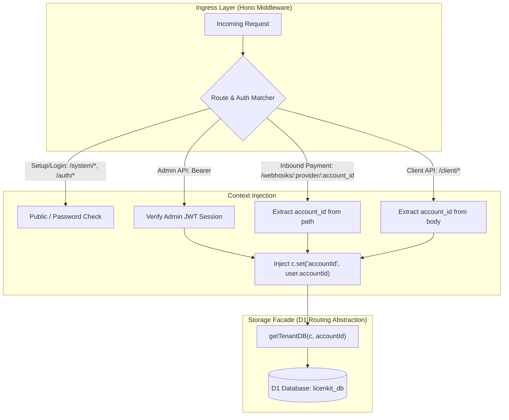
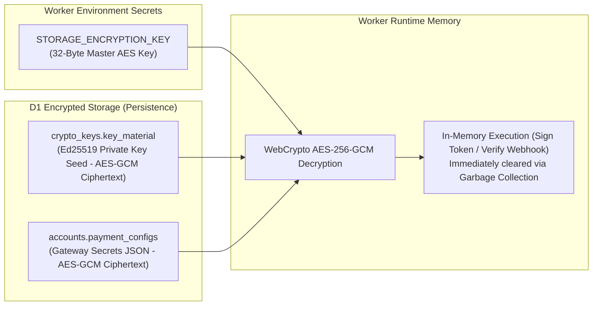
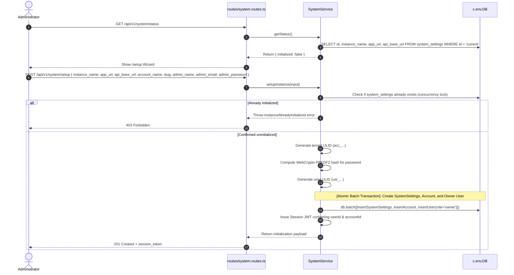
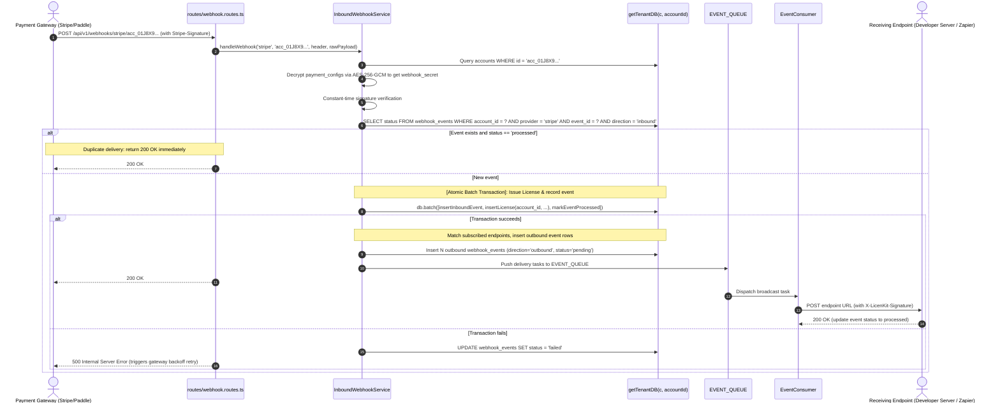
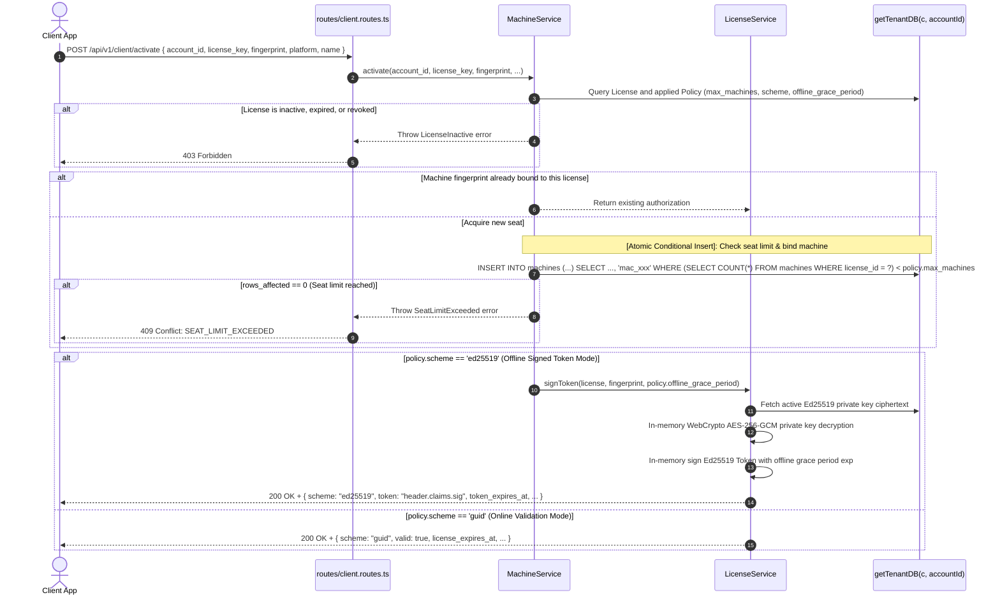

# LicenKit Backend Architecture & Core System Design Specification

> **Technology Stack**: TypeScript + Hono + Drizzle ORM + Cloudflare Workers + Cloudflare D1 (SQLite) + Cloudflare KV + Cloudflare Queues  
> **Positioning**: A modern API-First licensing hub. Offers an open-source self-hostable version (LicenKit) with out-of-the-box initial setup and multi-user administration, architecturally structured for zero-code-change adoption into enterprise commercial SaaS (`LicenKit-Cloud`).

---

## 1. System Architecture & Domain Layering (LicenKit vs LicenKit-Cloud)



### 1. Conceptual Decoupling: System vs Tenant vs User
- **`system_settings` Table (System Instance Configuration - Singleton `id = 'current'`)**:
  - Encapsulates self-hosted instance runtime parameters: `instance_name`, `app_url` (frontend dashboard URL), `api_base_url` (backend API URL), and `allow_signup` (public registration toggle);
  - **Dynamic Base URLs and Single-Domain Defaults**:
    - **Default Mode (Same-Origin Deployment, 90% use cases)**: When `api_base_url` is NULL or empty, it automatically inherits `app_url`. API routes mount under **`${app_url}/api/v1/*`**, and the SPA is served at root `/*`. This guarantees zero CORS friction;
    - **Separated Deployment Mode (10% use cases)**: When deploying frontend (e.g. Vercel) and backend (Cloudflare Workers) across different domains, explicitly configuring `api_base_url` mounts the API under **`${api_base_url}/api/v1/*`**, and the Worker automatically whitelists `app_url` in CORS preflight responses;
  - **Decoupled Notifications**: Zero raw SMTP or heavy email dependencies. All fulfillment notifications are pushed into asynchronous queues and broadcast via outbound webhooks (`/api/v1/admin/webhooks`) for external execution (e.g. Resend / Zapier);
- **`accounts` Table (Tenant / Team Workspace)**:
  - Root owner of software assets: products, policies, licenses, machines, crypto keys, and outbound webhooks;
  - Supports white-label `custom_domain` routing;
  - Holds encrypted payment gateway configurations (`payment_configs`, AES-256-GCM ciphertext);
- **`users` Table (Natural Person Administrators)**:
  - Login identities for the management console, tied to an `account_id`;
  - Stores `email`, salted `password_hash`, and `role` (`owner`, `admin`, `member`).

---

### 2. Storage Facade Design (`getTenantDB`)



- **LicenKit (Self-Hosted)**: `getTenantDB(c, accountId)` returns `c.env.DB` directly for zero-overhead single-database operations;
- **LicenKit-Cloud (Commercial SaaS)**: `getTenantDB` routes queries dynamically to dedicated or partitioned D1 database bindings without touching business logic.

---

### 3. Envelope Encryption & Zero Plaintext Persistence



- **Envelope Encryption**: Gateway secrets and Ed25519 private key seeds are strictly encrypted with `STORAGE_ENCRYPTION_KEY` using **AES-256-GCM** before write;
- **Zero Plaintext Persistence**: Database leaks expose zero usable private keys or gateway signing secrets;
- **Security Rule**: Storing private keys (plaintext or ciphertext) in global distributed KV edge caches is strictly prohibited.

---

## 2. Monorepo Codebase Organization

LicenKit uses a decoupled **Monorepo** structure separating the core licensing engine from the web admin dashboard:

```text
licenkit/
├── apps/
│   ├── server/                  # [LicenKit Server] Licensing Core Engine (Cloudflare Worker)
│   │   ├── src/
│   │   │   ├── index.ts         # Worker entrypoint (Hono app & Queue Consumer)
│   │   │   ├── types.ts         # Global runtime bindings (DB, KEYS_KV, EVENT_QUEUE, Secrets)
│   │   │   ├── domains/         # Core business domains
│   │   │   │   ├── system/      # System settings & Setup wizard
│   │   │   │   ├── auth/        # User authentication & RBAC
│   │   │   │   ├── account/     # Tenant accounts & custom domain
│   │   │   │   ├── policy/      # Licensing policies & duration rules
│   │   │   │   ├── licensing/   # Licenses, machines, and trial tracking
│   │   │   │   └── webhook/     # Inbound & outbound webhook processing
│   │   │   ├── queue/           # Outbound queue consumer & exponential retry
│   │   │   ├── infra/           # WebCrypto cryptography, KV caching, D1 facade
│   │   │   ├── middleware/      # SetupGuard, SessionAuth, ErrorHandler
│   │   │   └── routes/          # API routes (/api/v1/*)
│   │   ├── wrangler.jsonc       # Worker configuration
│   │   └── package.json
│   │
│   └── web/                     # [LicenKit-Web] Admin Console SPA (React 19 / Tailwind v4)
│       ├── src/
│       │   ├── pages/           # /setup, /login, /dashboard...
│       │   ├── components/      # UI components and modals
│       │   └── lib/api-client.ts# Standard API client with dynamic base URL support
│       ├── vite.config.ts       # Build configuration
│       └── package.json
```

- **Single-Deployment Packaging**: Running `pnpm build && wrangler deploy` compiles the web SPA into `apps/web/dist` and mounts it directly as Worker Static Assets.
- **Independent Customization**: Developers can fork `apps/web` and configure `VITE_API_BASE_URL` to integrate with existing internal portals.

---

## 3. Core Business Sequence Diagrams

### 1. Initial Setup Wizard Flow



---

### 2. Inbound Payment Webhook Fulfillment & Outbound Queue Broadcast



---

### 3. Client Machine Hardware Activation & Seat Preemption


