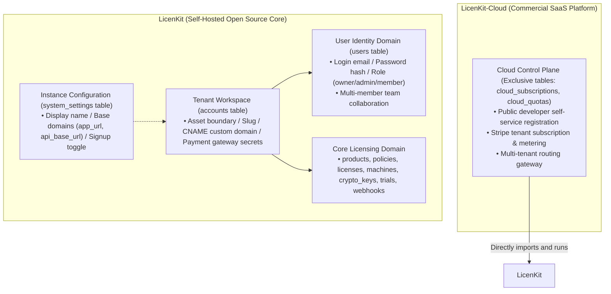
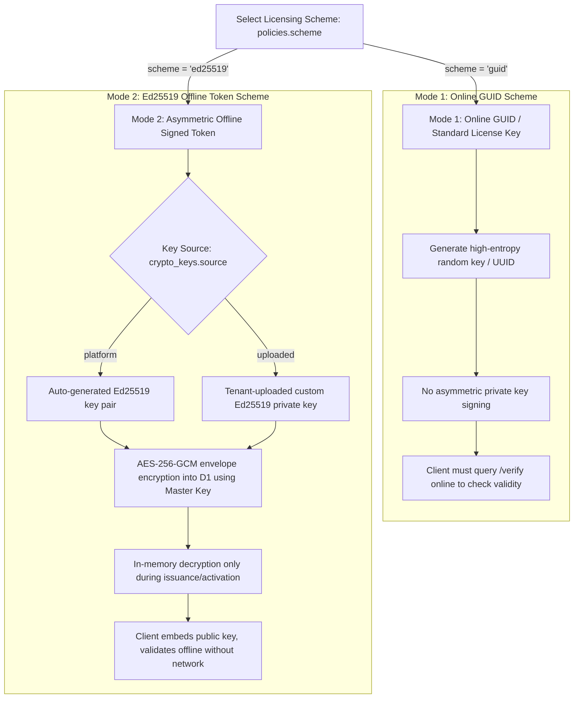
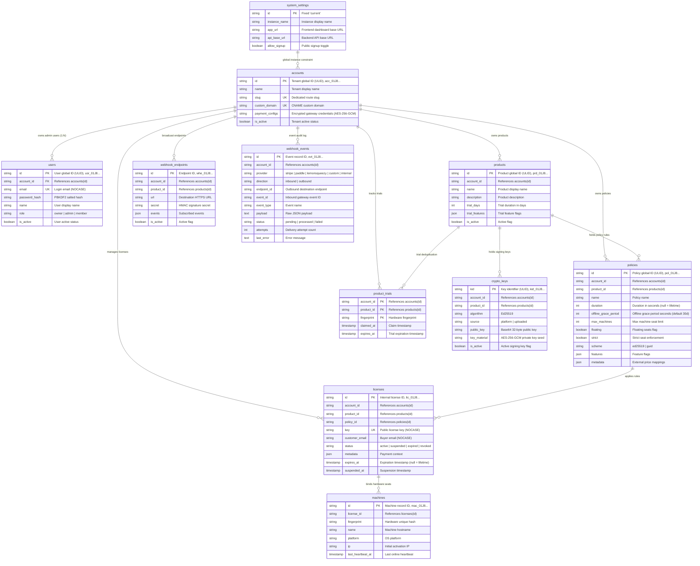

# LicenKit Database & Core Cryptographic Architecture Specification

> **Target Infrastructure**: Cloudflare D1 (SQLite) + Cloudflare KV (`KEYS_KV`) + Cloudflare Queues (`EVENT_QUEUE`)  
> **Design Vision**: An API-First, self-hostable open-source licensing engine (LicenKit). Includes a system configuration table (`system_settings`) for dynamic domain routing (`app_url` / `api_base_url`) and a zero-friction initial setup wizard. Natively designed to support future enterprise SaaS (`LicenKit-Cloud`) multi-tenancy reuse.

---

## 1. System Architecture & Domain Layering (LicenKit vs LicenKit-Cloud)

The system is structured across two architectural layers:



### 1. Conceptual Decoupling: System Settings vs Tenant Account vs User
- **System Settings (`system_settings`)**:
  - Global singleton record (`id = 'current'`);
  - Manages global display name, frontend dashboard base URL (`app_url`, e.g. `https://license.screenstudio.com`), backend API base URL (`api_base_url`, e.g. `https://api.screenstudio.com`), and open signup policy (`allow_signup`, default `FALSE`);
  - **Single-Domain Default vs Separated Path Rules**:
    - **Default Same-Origin Deployment (90% of use cases)**: If `api_base_url` is NULL or empty, the system automatically inherits `app_url`. API routes are served under `${app_url}/api/v1/*`. Frontend and backend share the exact same origin, eliminating all CORS issues;
    - **Separated Deployment (10% of use cases)**: If the admin hosts frontend and backend on separate domains (e.g. frontend on Vercel `https://license.screenstudio.com` and backend on Cloudflare Workers `https://api.license.screenstudio.com`), `api_base_url` is explicitly specified. API routes mount under `${api_base_url}/api/v1/*`, and the Worker injects `app_url` into the allowed CORS origin header;
  - Base domains can be updated dynamically in the dashboard without redeploying Worker code.
  - **Decoupled Notifications & Email**: Zero direct dependency on raw SMTP. Customer notifications and fulfillment events are dispatched via outbound webhooks (`/api/v1/admin/webhooks`) to external services or Resend.
- **Tenant Workspace (`accounts`)**:
  - Represents the legal entity/organization owning products, policies, licenses, machine seats, and payment gateway secrets;
  - Holds envelope-encrypted payment gateway credentials (`payment_configs`, AES-256-GCM ciphertext);
  - **Custom Domain (`custom_domain`)**: Defaults to instance domain in self-hosted mode; supports CNAME white-labeling in SaaS mode.
- **User Administrator (`users`)**:
  - Represents dashboard login credentials belonging to an `account_id`;
  - Initial setup (`/setup`) atomically creates 1 Account and the primary Owner User. Prepared natively for RBAC and multi-member team management.

### 2. Setup State Machine
- When uninitialized (`accounts` table empty): System reports `initialized: false` and redirects to `/setup`;
- Admin provides `app_url` (and optional `api_base_url`), tenant name, and owner user details: The system executes an **atomic batch transaction** to create `system_settings`, `accounts`, and the Owner `users` record, issuing an initial session JWT;
- After setup is complete, the setup wizard is permanently locked (`403 FORBIDDEN`), and subsequent logins authenticate via `/api/v1/auth/login`.

---

## 2. License Key Modes & Cryptography

LicenKit offers two configurable licensing modes determined by `policies.scheme`:



### 1. Online GUID Mode (`scheme = 'guid'`)
- **Use Cases**: SaaS products, heavily connected desktop plugins, internal enterprise tools.
- **Generation**: Formatted random UUIDs or strings (e.g. `LK-7B9A-4C2E-8F1D-3A5B`).
- **Cryptography**: Keyless symmetric generation, zero asymmetric overhead.
- **Verification**: Client must contact `/api/v1/client/validate` over the network.

### 2. Asymmetric Offline Token Mode (`scheme = 'ed25519'`)
- **Use Cases**: High-security desktop software and standalone applications requiring offline functionality and tamper protection.
- **Key Ownership**:
  1. **Platform Generated (`source = 'platform'`)**: System creates a dedicated Ed25519 key pair when a product is added.
  2. **Tenant Uploaded (`source = 'uploaded'`)**: Tenant imports an existing OpenSSL-generated Ed25519 private key with challenge signature verification.
- **Envelope Encryption**: Regardless of source, the private key seed is encrypted with `STORAGE_ENCRYPTION_KEY` using **AES-256-GCM** before persistence in D1. Decrypted only in Worker memory during issuance, and never written to distributed KV.

---

## 3. Offline Token Structure & Claims Specification

Under `scheme = 'ed25519'`, the server signs a compact, standardized 3-part token:
$$\text{SignedToken} = \text{Base64Url}(\text{Header}) \text{ . } \text{Base64Url}(\text{Claims}) \text{ . } \text{Base64Url}(\text{Signature})$$

### 1. Header
```json
{
  "alg": "Ed25519",
  "kid": "kid_01J8X9N4K1L2M3N4P5Q6R7S8T9"
}
```

### 2. Claims Payload
| Field | Type | Example | Description |
| :--- | :--- | :--- | :--- |
| `lic_id` | `string` | `"lic_01J8X9N6D1E2F3G4H5I6J7K8L9"` | Internal license global ULID |
| `sub` | `string` | `"SCR-8820-ABCD-9901"` | Public license key |
| `acc` | `string` | `"acc_01J8X9N2R4Z7QW8M3P5V1Y6T2C"` | Owning tenant ID |
| `prd` | `string` | `"prd_01J8X9N3A1B2C3D4E5F6G7H8J9"` | Target product ID |
| `pol` | `string` | `"pol_01J8X9N5U1V2W3X4Y5Z6A7B8C9"` | Applied policy ID |
| `fp` | `string` | `"sha256:d8e8fca2..."` | **Bound hardware fingerprint hash** (validated locally by client) |
| `iat` | `number` | `1757923200` | Issued timestamp (Unix seconds) |
| `exp` | `number` | `1760515200` | **Offline token expiration timestamp** (Unix seconds, governed by grace period) |
| `fea` | `string[]` | `["4k_export", "unlimited_recording"]` | Enabled feature flags |

> **Offline Grace Period Calculation**:  
> $$\text{exp} = \min(\text{license.expires\_at} \text{ ?? } \infty, \; \text{now()} + \text{policy.offline\_grace\_period})$$  
> Both lifetime licenses (`expires_at = null`) and subscriptions respect `offline_grace_period`. When the token nears `exp`, the client silently connects to `/client/validate` to renew the token.

---

## 4. Database Topology (ER Diagram)

LicenKit is composed of **1 system settings table, 1 tenant table, 1 user table, and 7 business domain tables**:



---

## 5. Key Indexes & Constraint Rationale

Complete DDL definitions can be found in [`docs/schema.sql`](../schema.sql).

1. **Custom Domain Unique Index**:
   - `CREATE UNIQUE INDEX idx_accounts_custom_domain ON accounts(custom_domain);`
   - Enables fast tenant resolution when requests arrive based on the `Host` header.
2. **Tenant Scoping Indexes**:
   - Core tables enforce indexes on `account_id` for tenant data isolation and index traversal performance.
3. **Inbound Webhook Deduplication Index**:
   - `CREATE UNIQUE INDEX idx_webhook_events_inbound_dedup ON webhook_events(account_id, provider, event_id) WHERE direction = 'inbound';`
   - Guarantees strict deduplication across `(account_id, provider, event_id)` dimensions to prevent replay vulnerabilities.
4. **Single-Machine Trial Deduplication Composite Key**:
   - `PRIMARY KEY (account_id, product_id, fingerprint)`
   - Ensures each machine claims a trial for a given product at most once, zeroing out writes to the commercial `licenses` table.
5. **Machine Seat Partial Unique Index**:
   - `CREATE UNIQUE INDEX idx_machines_license_fingerprint ON machines(license_id, fingerprint);`
   - Re-activating the same license on the same machine is strictly idempotent and does not consume additional seat counts.

---

## 6. Cloudflare Workers Configuration Reference (`wrangler.jsonc`)

```jsonc
{
  "$schema": "node_modules/wrangler/config-schema.json",
  "name": "licenkit-server",
  "main": "src/index.ts",
  "compatibility_date": "2026-09-01",
  "compatibility_flags": ["nodejs_compat"],

  "vars": {
    "APP_ENV": "development",
    "BASE_URL": "http://localhost:8787"
  },

  // 1. D1 Database binding
  "d1_databases": [
    {
      "binding": "DB",
      "database_name": "licenkit_db",
      "database_id": "local-db-id",
      "migrations_dir": "migrations"
    }
  ],

  // 2. Cloudflare KV binding
  "kv_namespaces": [
    {
      "binding": "KEYS_KV",
      "id": "local-keys-kv-id"
    }
  ],

  // 3. Cloudflare Queues binding
  "queues": {
    "producers": [
      {
        "binding": "EVENT_QUEUE",
        "queue": "licenkit-event-queue"
      }
    ],
    "consumers": [
      {
        "queue": "licenkit-event-queue",
        "max_batch_size": 10,
        "max_batch_timeout": 5,
        "max_retries": 5,
        "dead_letter_queue": "licenkit-event-dlq"
      }
    ]
  }
}
```
