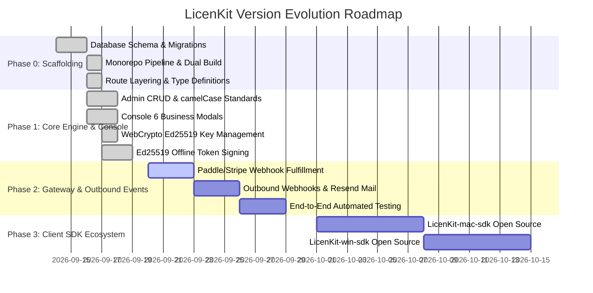

# LicenKit Development Plan & Work Breakdown Structure (Roadmap & WBS)

> **Project Positioning**: Modern API-First pure licensing hub.  
> **Open Source Self-Hosted**: `LicenKit` (Current Monorepo: TypeScript + Cloudflare Workers + D1 + Queues + React 19 + Tailwind v4).  
> **Commercial SaaS**: `LicenKit-Cloud` (Future managed platform importing and running the core engine).  
> **Client Ecosystem**: `LicenKit-mac-sdk`, `LicenKit-win-sdk`, and multi-platform client repositories.

---

## 1. Project Phase & Current Status

> [!IMPORTANT]
> **Engineering Status Clarification**:
> - **Phase 0 (Monorepo Scaffolding & Toolchain Pipeline)**: **100% Completed** (Directory layout, Drizzle ORM 11 tables, build pipeline, and dual-package linkage).
> - **Phase 1 (Core Licensing Lifecycle & Dashboard UI)**: **100% Completed**. Product, policy, and license lifecycle management (advanced pagination/filtering, issuance, suspension, revocation, one-click key rotation, machine unbinding), WebCrypto native Ed25519 key generation/import, AES-256-GCM envelope encryption, outbound queue worker with HMAC signing, and 6 high-fidelity dashboard business modals.
> - **Current Focus (Phase 2 Entry)**: **Paddle & Stripe Inbound Webhook Verification & Automated Fulfillment**, followed by end-to-end integration tests.

---

## 2. Module Inventory & Status Matrix

| Module ID | Module Name | Core Responsibility | Priority | Status | Associated Code & Directory |
| :--- | :--- | :--- | :---: | :---: | :--- |
| **M01** | **System & Setup Wizard** | First-run setup wizard, `system_settings` singleton, zero-CORS dynamic domain routing, live config updates | **P0** | **Completed** | `server/src/routes/system.routes.ts` `server/src/routes/admin/settings.routes.ts` `web/src/pages/SetupPage.tsx` |
| **M02** | **Auth & RBAC** | Admin users, WebCrypto PBKDF2 password hashing, Session JWT issuance & Bearer middleware, multi-role team management & operation audit | **P0** | **Completed** (remaining M02.6 invite) | `server/src/routes/auth.routes.ts` `server/src/routes/admin/users.routes.ts` `server/src/routes/admin/audit.routes.ts` `web/src/pages/DashboardPage.tsx` |
| **M03** | **Products & Cryptography** | Software product catalog, WebCrypto Ed25519 key pair generation, AES-256-GCM private key envelope encryption, key import verification | **P0** | **Completed** | `server/src/infra/crypto/` `server/src/routes/admin/products.routes.ts` `web/src/components/modals/CreateProductModal.tsx` |
| **M04** | **Policies Engine** | Lifetime/subscription duration, hardware seat limit (`maxMachines`), offline grace period, `ed25519` vs `guid` schemes | **P0** | **Completed** | `server/src/routes/admin/policies.routes.ts` `web/src/components/modals/CreatePolicyModal.tsx` `web/src/components/modals/EditPolicyModal.tsx` |
| **M05** | **Licenses Lifecycle** | Formatted key generator (`LIC-XXXX-XXXX-XXXX-XXXX`), manual issuance, suspension/reinstate/revocation, key rotation, seat unbinding | **P0** | **Completed** | `server/src/routes/admin/licenses.routes.ts` `web/src/components/modals/IssueLicenseModal.tsx` `web/src/components/modals/LicenseDetailModal.tsx` |
| **M06** | **Client Activation & Anti-Abuse** | Machine fingerprint binding, atomic seat preemption, heartbeat keep-alive, Ed25519 signed token issuance, trial anti-abuse (`product_trials`) | **P0** | **Completed** | `server/src/routes/client.routes.ts` `server/src/infra/crypto/index.ts` |
| **M07** | **Inbound Webhooks & Fulfillment** | Paddle, Stripe & Lemon Squeezy webhook handlers, signature verification, 3D idempotent deduplication, automated license issuance | **P0** | **Completed** | `server/src/routes/webhook.routes.ts` `server/src/routes/admin/settings.routes.ts` |
| **M08** | **Outbound Queues & Broadcast** | Pushes business events to Cloudflare Queues; delivers to Resend / Zapier / custom endpoints with HMAC signatures and exponential backoff | **P1** | **Completed** | `server/src/queue/consumer.ts` `server/src/routes/admin/webhooks.routes.ts` |
| **M09** | **Web Dashboard UI** | Dark-mode high-fidelity SPA console, Paddle/Stripe tab switching, 6 full-featured business modals, advanced search & filtering | **P1** | **Completed** | `web/src/pages/DashboardPage.tsx` `web/src/components/modals/*` `web/src/lib/api-client.ts` |
| **M10** | **Client SDKs** | Native client libraries for macOS (Swift), Windows (C#), and cross-platform CLI | **P2** | **In Progress** (CLI Ready) | `apps/cli/` Independent repositories (`LicenKit-mac-sdk`, etc.) |

---

## 3. Work Breakdown Structure (WBS)

### Module M01: System & Setup Wizard
- [x] **M01.1** `system_settings` singleton table design (`id = 'current'`);
- [x] **M01.2** `GET /api/v1/system/status` health check & setup detection endpoint;
- [x] **M01.3** `POST /api/v1/system/setup` atomic batch initialization;
- [x] **M01.4** `setupGuard` concurrency locking (prevents re-initialization with 403);
- [x] **M01.5** Dynamic base domain resolution: defaults to `app_url` with zero CORS when `api_base_url` is omitted;
- [x] **M01.6** Dynamic instance parameter updates (`PUT /api/v1/admin/settings`);
- [x] **M01.7** Domain and environment security health diagnostics tool (`GET /api/v1/admin/settings/env-check`).

---

### Module M02: Auth & RBAC
- [x] **M02.1** `users` table with case-insensitive unique email index;
- [x] **M02.2** WebCrypto PBKDF2-HMAC-SHA256 salted password hashing & constant-time comparison;
- [x] **M02.3** WebCrypto HMAC-SHA256 Session JWT issuance & validation (7-day duration);
- [x] **M02.4** `sessionAuth` middleware injecting authenticated context;
- [x] **M02.5** Team member management & 4-tier RBAC matrix (Owner/Admin/Member/Viewer, `PATCH /api/v1/admin/users/:id` & dashboard integration);
- [ ] **M02.6** Member invitation workflow via outbound webhooks;
- [x] **M02.7** Detailed audit log for administrative actions (`audit_logs` 12-table model, DB pushdown filtering, sensitive redaction, dashboard timeline stream & detail modal).

---

### Module M03: Products & Cryptography Engine
- [x] **M03.1** `products` and `crypto_keys` relational modeling;
- [x] **M03.2** WebCrypto Ed25519 key pair generator (raw 32-byte public key & PKCS#8 private key);
- [x] **M03.3** AES-256-GCM envelope encryption using `STORAGE_ENCRYPTION_KEY`;
- [x] **M03.4** Automatic generation and activation of initial Ed25519 key pair on product creation;
- [x] **M03.5** Custom private key seed upload with challenge-signature verification;
- [x] **M03.6** One-time secure private key download with dismissal confirmation modal;
- [ ] **M03.7** Smooth key rotation and phased deprecation mechanism;
- [x] **M03.8** Public verification key endpoint (`GET /api/v1/client/products/:id/pubkey`).

---

### Module M04: Policies Engine
- [x] **M04.1** `policies` table design;
- [x] **M04.2** Dual scheme support: `ed25519` (offline token) vs `guid` (online check);
- [x] **M04.3** Commercial duration modes: lifetime (`duration = null`) and subscriptions;
- [x] **M04.4** Offline grace period configuration (`offlineGracePeriod`, default 30 days);
- [x] **M04.5** Hardware seat constraints (`maxMachines`) and strict overflow blocking;
- [x] **M04.6** Feature flags array and gateway price ID association;
- [ ] **M04.7** Floating seats rule engine (Phase 3: dynamic release based on heartbeat timeout).

---

### Module M05: Licenses Lifecycle
- [x] **M05.1** `licenses` table design with case-insensitive key index;
- [x] **M05.2** 16-character formatted key generator (`LIC-XXXX-XXXX-XXXX-XXXX`);
- [x] **M05.3** Manual license issuance workflow with validation and custom expiry;
- [x] **M05.4** License state machine: `active` -> `suspended` -> `revoked`;
- [x] **M05.5** Advanced pagination and search filters in admin dashboard;
- [x] **M05.6** One-click key rotation (`rotate-key`) with atomic machine seat clearing;
- [x] **M05.7** Hardware seat inspection and manual unbinding (`DELETE /api/v1/admin/licenses/:id/machines/:machineId`);
- [x] **M05.8** Batch license issuance (max 10/batch, 100 unused quota cap with truncation, 30-day auto-revoke) and CSV export.

---

### Module M06: Client Activation & Anti-Abuse
- [x] **M06.1** `machines` table design with `(license_id, fingerprint)` unique constraint;
- [x] **M06.2** Client machine activation and seat preemption (`POST /api/v1/client/activate`);
- [x] **M06.3** Online validation and heartbeat renewal (`POST /api/v1/client/validate`);
- [x] **M06.4** Client-initiated deactivation (`POST /api/v1/client/deactivate`);
- [x] **M06.5** Anonymous trial anti-abuse (`POST /api/v1/client/trial`);
- [x] **M06.6** Offline Ed25519 token assembly and cryptographic signing;
- [ ] **M06.7** Abnormal activation risk flagging and audit alerts.

---

### Module M07: Inbound Payment & Fulfillment
- [x] **M07.1** Encrypted `accounts.payment_configs` store (AES-256-GCM);
- [x] **M07.2** Universal webhook endpoint with 3D deduplication (`(account_id, provider, event_id)`);
- [x] **M07.3** Paddle Billing official signature verification (`Paddle-Signature`);
- [x] **M07.4** Stripe official signature verification (`Stripe-Signature`);
- [x] **M07.5** Paddle `transaction.completed` event handling and automatic license fulfillment;
- [x] **M07.6** Stripe `checkout.session.completed` event handling and automatic fulfillment;
- [x] **M07.7** Subscription cancellation and refund handlers (`subscription.canceled` -> revoke license);
- [x] **M07.8** **Lemon Squeezy automatic fulfillment** (`order_created` -> match policy via `variant_id` pushdown and issue license; `subscription_cancelled` -> revoke license, with 3D deduplication).

---

### Module M08: Outbound Queues & Event Broadcast
- [x] **M08.1** Pure webhook architecture established, removing all raw SMTP dependencies;
- [x] **M08.2** `webhook_endpoints` management routes (`/api/v1/admin/webhooks`);
- [x] **M08.3** `webhook_events` audit table and query API;
- [x] **M08.4** Cloudflare `EVENT_QUEUE` binding and consumer processor;
- [x] **M08.5** Outbound HMAC-SHA256 request signing (`X-LicenKit-Signature`);
- [x] **M08.6** Exponential backoff delivery retries (up to 3 attempts);
- [x] **M08.7** Automatic event triggering across all core domain actions;
- [x] **M08.8** Admin console webhook configuration modal and test delivery button.

---

### Module M09: Web Dashboard UI
- [x] **M09.1** React 19 + Vite + Tailwind CSS v4 foundation;
- [x] **M09.2** Unified API client with automatic JWT injection and zero-CORS adapter;
- [x] **M09.3** `SetupPage` first-run wizard;
- [x] **M09.4** `LoginPage` administrator authentication;
- [x] **M09.5** `DashboardPage` with dark-mode interface and Paddle/Stripe tabs;
- [x] **M09.6** Product creation/editing modals with one-time private key download;
- [x] **M09.7** Policy creation/editing modals;
- [x] **M09.8** License issuance modal and advanced filtering toolbar;
- [x] **M09.9** `LicenseDetailModal` showing bound machine hardware fingerprints;
- [x] **M09.10** System settings and payment gateway credential updates;
- [x] **M09.11** Outbound webhook endpoint management modal.

---

### Module M10: Client SDK Ecosystem
- [ ] **M10.1** **`LicenKit-mac-sdk`** (macOS / iOS Swift Package Manager):
  - Hardware fingerprint extraction via IOKit (`IOPlatformUUID`);
  - CryptoKit native Ed25519 verification & Keychain storage;
  - Offline grace period management and silent background validation.
- [ ] **M10.2** **`LicenKit-win-sdk`** (Windows C# / C++):
  - Hardware fingerprint extraction via WMI / SMBIOS;
  - CNG / BouncyCastle Ed25519 verification;
  - Encrypted local cache protection.
- [x] **M10.3** **`LicenKit-cli`** (Cross-platform CLI tool in `apps/cli`):
  - Built with native WebCrypto Ed25519 pure algorithm on Node.js 20+, zero external C++ crypto bindings;
  - Cross-platform hardware fingerprinting (macOS IOKit UUID / Windows MachineGuid / Linux machine-id);
  - Provides `licenkit activate <key>` (online seat binding), `validate` (heartbeat keep-alive), `verify-token` (zero-network offline mathematical verification with anti-copy protection), `deactivate` (seat release) and `info` (device fingerprint and status).

---

## 4. Milestones & Roadmap

### Phase 0: Engineering Foundation (100% Done)
- **Goal**: Architecture, database models, Monorepo scaffolding, and local/production build pipelines.

### Phase 1: Core Licensing Lifecycle & Dashboard UI (100% Done)
- **Goal**: Product management, policy configuration, license lifecycle, offline Ed25519 token signing, and client fingerprint binding.

### Phase 2: Commercial Gateway Verification & Outbound Broadcasts (Next)
- **Goal**: Full integration with Paddle and Stripe webhooks for automated key issuance, and outbound queue event delivery.

### Phase 3: Client SDK Ecosystem
- **Goal**: Production-ready client integration libraries across macOS, Windows, and CLI environments.
