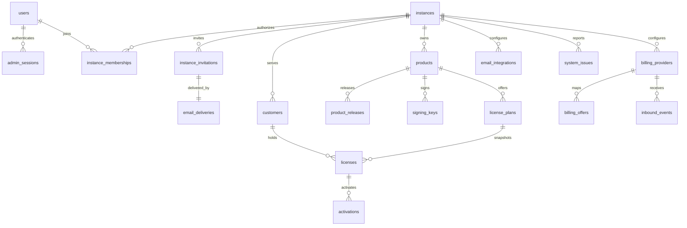

# V1 数据模型

本文描述当前初始 Schema 的职责和不变量。字段、索引和 Trigger 的可执行来源是 `apps/server/drizzle/0000_v1_initial.sql` 与 `apps/server/src/infra/db/schema.ts`；`docs/internal/schema.sql` 是同步的审阅副本。

## 1. 设计目标

1. User 是全局登录身份，Instance 是租户，Membership 是授权关系。
2. 自部署产品只开放一个 Instance，但所有 Instance 业务表、查询、唯一约束和外键都按多租户隔离。
3. Setup、邀请接受、Magic Link 消费、支付履约等跨表操作由 D1 原子批次和数据库约束共同保证。
4. 敏感明文只在必须的短生命周期内存在；数据库保存 Hash 或加密载荷。
5. 初始 migration 只建空 Schema，不创建占位 User、Instance 或完成标记。
6. 当前主线不迁移旧数据库，也不保留旧字段、路径、Claim 或环境变量别名。

## 2. 关系总览

## 3. 部署、身份与成员

### 3.1 `deployment_bootstrap`

只表达一份 D1 是否完成首次 Setup：

| 字段 | 约束 |
| --- | --- |
| `singleton_key` | 主键，固定为 `deployment` |
| `completed_at` | 非空时间 |

初始 migration 后表为空。Setup 原子批次最后插入固定单例行；主键竞争保证并发提交最多一个成功。记录创建后不由应用更新或删除。

完成标记存在时还必须满足：恰好一个自部署 Instance、至少一个 User，以及该 Instance 至少一个 active Owner Membership。标记和关系不一致必须返回明确部署状态错误，不能自动补写。

### 3.2 `users`

| 字段 | 约束 |
| --- | --- |
| `id` | 主键 |
| `email` | 非空、`NOCASE`、全局唯一 |
| `password_hash` | 非空 |
| `name` | 非空 |
| `created_at` / `updated_at` | 非空时间 |

User 不保存 Instance 外键、角色或全局状态。当前自部署版不提供邮箱修改。

### 3.3 `instances`

| 字段 | 约束 |
| --- | --- |
| `id` | 主键 |
| `name` | 非空 |
| `slug` | 非空、全局唯一、小写字母/数字/短横线 |
| `site_url` | 非空 URL |
| `status` | `active/suspended/archived` |
| `created_at` / `updated_at` | 非空时间 |

当前自部署不提供状态修改入口。`site_url` 拒绝 credentials、query 和 fragment；自部署 Setup 要求它与当前受信 Origin 同源。

### 3.4 `admin_sessions`

Session 只绑定 `user_id`：

- `session_token_hash` 和 `csrf_token_hash` 各自唯一；
- 保存过期、最后使用和撤销时间；
- 不保存 Instance 或角色；
- 密码修改在同一批次撤销该 User 除当前 Session 外的其他 Session。

### 3.5 `instance_memberships`

复合主键为 `instance_id + user_id`。

| 字段 | 约束 |
| --- | --- |
| `role` | `owner/admin/member/viewer` |
| `status` | `active/disabled/removed` |
| `joined_by_invitation_id` | 可空；与 `instance_id` 组成复合外键 |

Setup Owner 的 `joined_by_invitation_id` 为空；邀请加入或 `removed` 后重新加入必须引用同一 Instance 内已经接受的 Invitation。

数据库 Trigger `trg_instance_memberships_last_owner_update` 和 `trg_instance_memberships_last_owner_delete` 阻止失去最后一个 active Owner，错误码为 `LAST_ACTIVE_OWNER_REQUIRED`。应用层先查再写不能替代该约束。

### 3.6 `instance_invitations`

Invitation 保存 `instance_id`、规范化邮箱、目标角色、Token Hash、状态、邀请者、接受者、Delivery、过期时间和终态时间。

约束：

- Token Hash 全局唯一；
- 同一 Instance 和邮箱最多一个 pending Invitation；
- `delivery_id` 必须指向同一 Instance 的 Invitation Delivery；
- `pending` 只能进入 `accepted/revoked/expired`；
- 接受时 `accepted_by_user_id/accepted_at` 非空，撤销时 `revoked_at` 非空；
- `trg_instance_invitations_terminal_guard` 负责过期、重复消费和终态组合检查；
- 接受、Membership、新 User/Session（如需要）和审计位于同一个 D1 批次。

## 4. Customer 与授权

### 4.1 `customers`

Customer 使用 `instance_id + email` 大小写不敏感唯一。状态为 `active/disabled`。所有反向引用必须同时携带 `instance_id`。

### 4.2 `customer_login_challenges`

保存 Customer Magic Link 的 Token Hash、过期、消费/撤销时间、Delivery 与请求 IP。Token Hash 唯一；`instance_id + customer_id` 复合外键防止跨 Instance 关联。

`trg_customer_login_challenges_terminal_guard` 使重复、过期、撤销和并发消费以 `CUSTOMER_LOGIN_CHALLENGE_NOT_CONSUMABLE` 中止。消费批次必须按 Challenge 主键执行终态更新，不能通过带状态条件且影响 0 行的更新跳过 Trigger。

### 4.3 `customer_sessions`

Customer Session 保存 `instance_id + customer_id`、Token Hash、过期、最后使用和撤销时间。所有查询先确定 Instance，再匹配 Hash，并重新检查 Instance 与 Customer 状态。

### 4.4 `products`

Product 在 Instance 内以 `slug` 唯一，包含：

- `billing_environment`；
- `payment_grace_seconds`，非负且默认 `0`；
- 设备试用开关、时长和功能数组；
- `active/archived` 状态。

### 4.5 `product_releases`

`instance_id + product_id + version + platform` 唯一。`artifact_sha256` 必须是 64 位小写十六进制。发布身份不可修改，正常产品流程不删除 Release。

### 4.6 `signing_keys`

Signing Key 必须属于同一 Instance 的 Product。算法固定为 Ed25519；来源为 `generated/uploaded`；状态为 `active/retired/revoked`。每个 Product 同时最多一个 active Key。

### 4.7 `license_plans`

Plan 通过复合外键属于同一 Instance 的 Product，保存修订和完整条款快照。

- `license_model`：`perpetual/fixed_term/subscription`；
- `credential_mode`：`opaque/signed`；
- 非订阅 Plan 的 `payment_grace_seconds` 必须为 `0`；
- 订阅 Plan 创建时由 Trigger 从 Product 固化宽限期；
- Opaque 凭证的 Token TTL 为 `0`，Signed 凭证的 Token TTL 大于 `0`。

### 4.8 `licenses`

License 通过复合外键同时约束 Customer、Product、Plan 和可选 Billing Provider 的 Instance 归属。它保存 Plan 修订与条款快照，而不是运行时回查可变 Plan。

关键约束：

- Registration Key 只保存 `key_hash`；
- 支付来源以 `instance_id + provider + external_transaction_id` 幂等；
- 买断与固定期限 `renewal_mode='none'`；
- 手动订阅仅允许手动/API 来源；支付订阅仅允许支付来源；
- 只有支付型订阅可以保存非零宽限期；
- License 创建时由 Trigger 从 Plan 固化 `payment_grace_seconds`。

### 4.9 `activations`

Activation 使用复合外键归属同一 Instance 的 License。Machine Token 与设备指纹只保存 Hash；同一 License 和设备最多一个 active Activation；数据库 Trigger 执行席位上限。

### 4.10 `trial_claims`

`instance_id + product_id + fingerprint_hash` 唯一，保证同一设备不能重复领取同一 Product 试用。领取时固化功能与绝对过期时间。

### 4.11 `license_key_rotations`

记录注册码版本轮换和原因。旧 Key 失效、License 版本增加、新 Delivery 与审计必须原子提交。

## 5. 支付数据

### 5.1 `billing_providers`

以 `instance_id + provider + environment` 唯一，保存客户端 Token 和加密的 Webhook/API Secret。Sandbox 和 Live 使用相同模块与接口，只由配置区分。

### 5.2 `billing_customers`

以 `instance_id + billing_provider_id + external_customer_id` 唯一。`customer_id` 可以在尚未安全匹配时为空；`link_status` 明确记录 `pending/linked/email_mismatch/needs_attention`，不能用错误归一化丢掉原因。

### 5.3 `billing_offers`

把外部 Price 精确映射到同一 Instance 的 Product、Plan 和 `one_time/subscription` 购买类型。一个 Provider Price 在 Instance 内只能有一个 Mapping。

### 5.4 `billing_checkout_verifications`

只用于管理员 Sandbox 闭环验证。验证身份不可变，并与 draft Sandbox Mapping 和一次验证 License 关联；它不是生产履约捷径。

### 5.5 `billing_subscriptions`

以 `instance_id + provider + external_subscription_id` 唯一，并与一个 License 一一对应。保存 Provider 状态、周期、下次扣款、取消计划和支付方式试用字段。

### 5.6 `billing_adjustments`

保存退款、拒付等 Provider 调整事实和人工复核结果。外部 Adjustment 在 Instance/Provider 内唯一；自动动作、人工结论和原始 Provider 状态分别保存。

### 5.7 `inbound_events`

保存 Webhook 事件身份、来源对象、事件发生时间、处理状态、重试租约、错误细节和加密载荷保留时间。

- 事件幂等必须包含 `instance_id`；
- 状态为 `pending/processing/processed/failed/needs_attention`；
- 处理器按 Instance 领取和更新，不能只用 Event ID；
- 敏感载荷到期后清除，但保留事件身份和处理事实。

## 6. 邮件数据

### 6.1 `email_integrations`

每个 Instance 最多一个 active Integration。当前 Provider 为 Resend；凭据加密保存；自动尝试总次数在 `1..20`，默认 `4`（含第一次尝试）。

### 6.2 `email_template_bindings`

以 Instance、Integration、通知类型唯一，保存变量合同版本和 Provider Template 引用。模板正文不进入 LicenKit 数据库。

### 6.3 `email_deliveries`

Delivery 在调用 Provider 前创建。关键字段包括：

- `recipient_type`：`customer/instance_invitation`；
- 收件邮箱快照；
- 加密变量、发送期限和变量清理时间；
- 状态、尝试次数、下一次尝试、租约；
- Provider Message ID、accepted 时间和原始错误详情。

`accepted` 表示 Provider 接受请求，不表示送达。已过期/取消的 Delivery 必须清除变量；accepted 后按保留期限清除变量。人工再次发送创建新的 Delivery，不篡改旧尝试事实。

## 7. System Issue 与审计

### 7.1 `system_issues`

每条 Issue 的 `instance_id` 非空，分类限于 `billing/webhook/email`。去重身份包含 Instance、分类、来源、操作和错误码；重复发生累计次数并更新最近时间。

Issue 只聚合业务错误，不代替业务对象状态，不保存 Deployment 级异常，也不作为业务操作门禁。

### 7.2 `audit_logs`

`scope_type` 为 `identity/instance`：

- identity：`instance_id` 为空，actor 必须是 User；
- instance：`instance_id` 非空，actor 可以是 User、Customer 或 System。

详情使用经过必要脱敏的 JSON。审计只追加，不存储明文 Token、密码、Secret 或完整敏感 Provider 载荷。

## 8. 多租户约束

所有 Instance 业务表遵守：

1. 行保存非空 `instance_id`；
2. 查询显式包含 `instance_id`；
3. 业务唯一索引包含 `instance_id`；
4. 关联对象使用 `instance_id + object_id` 复合外键；
5. 幂等、租约、状态更新和删除都不能只按对象 ID；
6. Webhook 先由 `instance_slug` 解析 Instance，再在该边界内选择 Provider；
7. Scheduled Worker 可以跨 Instance 发现任务，但必须逐 Instance 分页处理。

仅凭全局唯一 ID 仍然不能省略 Instance 条件；复合条件同时承担隔离证明和代码审计线索。

## 9. 迁移策略

当前项目按全新项目处理：

- 唯一初始 migration 直接建立目标 Schema；
- 空库应用后保持未初始化；
- 不回填旧表或旧字段；
- 不提供双读、双写或协议兼容层；
- 本地验证不能代替真实远程 D1 验证。

每次 Schema 变更至少检查：migration 可在空 SQLite/D1 执行、`foreign_key_check` 无结果、`integrity_check` 为 `ok`、Drizzle 声明与 SQL 一致，以及关键 Trigger 的成功、失败和并发边界。
