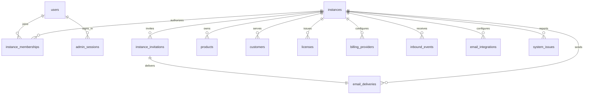

# User、Instance 与多租户边界重构设计

日期：2026-09-21

状态：已实现，尚未部署

适用范围：LicenKit 自部署版当前主线；定义兼容未来 SaaS 的核心数据边界，但不在本次实现 SaaS 控制面

## 1. 问题场景

当前实现把登录账户、授权业务空间和物理部署混在 `accounts` 与 `system_settings` 中：

- `accounts` 同时承担登录身份容器、租户和全部业务资源的归属；
- `accounts.slug` 实际用于定位授权业务空间；
- `users` 必须归属 Account，邮箱只在 Account 内唯一，角色也固化在 User 上；
- Product、Customer、License、支付和邮件等业务表以 `account_id` 隔离；
- 管理员登录要求 `accountSlug + email + password`；
- `system_settings(id='current')` 同时保存实例信息、Setup 状态和 Scheduler 最近运行信息。

从产品场景看，真正需要表达的是：

```text
User 是登录身份。
Instance 是一套独立的授权业务空间，也是租户隔离边界。
一个 User 可以在一个或多个 Instance 中担任不同角色。
```

Account 在这个关系中没有独立的数据、行为或权限职责。继续保留它只会让 User、Instance 和业务表多经过一层没有业务含义的归属关系。

## 2. 已确认的产品决策

1. 删除 `accounts`，不再把 Account 作为目标模型的一部分。
2. User 是全局管理员身份，使用邮箱和密码登录；显示名称不参与认证，目标模型不保存全局 `status`。
3. Instance 是租户，也是 Product、Customer、License、支付、邮件和公开路由的业务隔离边界。
4. User 与 Instance 是多对多关系，通过 `instance_memberships` 保存角色和状态。
5. 一个 User 可以是多个 Instance 的 Owner、Admin、Member 或 Viewer；一个 Instance 可以有多个 Owner。
6. Instance Owner 只能邀请成员、调整 Membership 角色、暂停或恢复 Membership、软移除 Membership；不能修改其他 User 的显示名称、邮箱、密码或全局身份。
7. Membership 状态为 `active/disabled/removed`：`disabled` 是可恢复的暂停，`removed` 是保留历史的软删除；重新加入必须再次接受邀请。
8. 邀请通过独立的 `instance_invitations` 表达，并必须使用当前 Instance 的邮件配置发送 Magic Link；接受邀请前不创建 User 或 Membership，新用户自己设置密码，已有 User 先证明自己的身份。
9. 自部署无论版本都只开放一个 Instance；未来 SaaS 可以在同一部署承载多个 Instance。
10. 核心数据模型按多租户设计，自部署只在产品入口和运行约束上限制 Instance 数量。
11. 管理员登录只使用邮箱和密码，实例标识不属于登录凭据。
12. Instance 内部 ID 与公开实例标识是两个字段：数据库和对外 JSON 使用 `instance_id/instance_slug`，TypeScript、Swift 等代码内部使用 `instanceId/instanceSlug`。
13. 首次 Setup 使用三个独立布局：验证 Token、创建首位管理员用户、创建首个 Instance。
14. 三个布局只是用户流程；最终以一个 D1 原子批次创建 User、Instance、Owner Membership、Session、Setup 审计和 Deployment Bootstrap 完成凭据。
15. `deployment_bootstrap` 使用固定单例键和完成时间表达整个 D1 已完成首次 Setup，不保存随机 `bootstrap_id`、Token Hash 或可变状态。
16. 删除 `system_settings`；实例名称、实例标识和 Site URL 直接进入 `instances`，不增加 `instance_settings`。
17. 不保留独立的 `scheduler_health`，不因 Scheduler 状态或 System Issue 禁止管理员操作产品。
18. `system_issues` 只记录可归属明确 Instance 的业务错误；Deployment 级异常由部署平台界面和运行日志反馈，不写入业务数据库。
19. 删除 `default_subscription_payment_grace_seconds`；每个 Product 自己设置支付宽限期，默认 `0`，并在创建订阅 Plan 和签发 License 时逐级固化。
20. 当前项目按全新项目处理：删除旧 Schema 和公开合同后重建，不提供旧数据迁移、旧字段别名或协议兼容层。
21. 当前自部署版不实现 User 邮箱修改，`users.email` 在 Profile 中只读；未来邮箱修改属于注册平台的全局身份流程，由 Platform 邮件通道验证新邮箱，不使用任何 Instance 的邮件配置。修改密码后撤销该 User 的其他 Admin Session。
22. 当前自部署不提供 Instance 状态修改能力。唯一 Instance 在当前产品中保持 `active`；`suspended/archived` 的修改主体和恢复流程留给未来 SaaS 控制面定义。
23. 本次只移动角色的存储和读取边界，不修改 Owner、Admin、Member、Viewer 的现有业务权限矩阵。

## 3. 领域边界

### 3.1 Deployment（部署）

已经运行的 LicenKit Worker、D1、静态管理端和绑定资源。Deployment 是运行环境，不是租户，也不是管理员身份。

- 自部署：一个 Deployment 只允许一个 Instance；
- 未来 SaaS：一个 Deployment 可以承载多个 Instance。

### 3.2 User（管理员用户）

使用邮箱和密码登录管理端的全局身份。User 保存显示名称、规范化邮箱和密码 Hash，不保存全局状态或某个 Instance 的角色。

同一邮箱只对应一个 User。User 可以通过 Membership 加入多个 Instance。

User 在当前自部署版只能修改自己的显示名称和密码；邮箱作为全局登录身份只读。Instance Owner 不能修改其他 User 的身份资料或凭证；它只能管理当前 Instance 的邀请和 Membership。

显示名称可以直接修改。修改密码必须验证当前凭据，并在同一原子写入中替换密码 Hash、写入全局身份审计并撤销该 User 除当前请求 Session 外的其他 Admin Session。被撤销的 Session 不能继续访问该 User 所属的任何 Instance。

未来如果实现 User 邮箱修改，必须由注册平台提供独立的全局身份邮件通道、验证记录和审计边界，不能选择某个 Instance 的 Email Integration 发送全局身份邮件。这些能力不在本次实现范围，因此本次不提供修改邮箱的 API 或界面。

User 与购买、获取 License 的 Customer 是两套身份，不能因为邮箱相同而自动合并。

### 3.3 Instance（实例/租户）

一套独立的 LicenKit 授权业务空间。以下对象都必须归属明确的 Instance：

- Product、Release、License Plan 和 Signing Key；
- Customer、License、Activation 和 Trial Claim；
- Billing Provider、支付价格映射、Subscription 和 Adjustment；
- Webhook Inbound Event；
- Email Integration、Template Binding 和 Delivery；
- Customer Session、System Issue 和实例业务审计。

实例标识是 URL-safe 的公开短标识，用于 Customer Portal、Magic Link、Webhook 等路由。它不是用户名、密码或内部主键。

### 3.4 Instance Membership（实例成员关系）

Membership 表达某个 User 在某个 Instance 中的权限：

```text
owner / admin / member / viewer
```

角色属于 User 与 Instance 的关系，不能放在 `users.role`。同一 User 可以在不同 Instance 中拥有不同角色。

Membership 状态表达成员在当前 Instance 的访问状态：

```text
active    正常访问
disabled  暂停访问，可以恢复
removed   已软移除，重新加入必须再次接受邀请
```

Instance 的 Owner 也通过 Membership 表达，不增加 `instances.owner_user_id`。这样可以支持多个 Owner，并避免 Owner 字段与成员表发生漂移。

### 3.5 Instance Invitation（实例邀请）

Invitation 表达 Instance Owner 邀请某个邮箱加入当前 Instance 的待确认事实。邀请只保存规范化邮箱、目标角色、Token Hash、有效期和状态，不允许 Owner 为受邀者设置密码，也不在接受前创建占位 User。

- 新邮箱接受邀请时，由受邀者创建自己的 User 和密码；
- 已存在的全局 User 接受邀请前必须先登录或完成等价身份确认；
- 接受邀请时原子创建或恢复 Membership，并把邀请标记为已接受；
- 撤销和过期的邀请不能创建 Membership；
- 对 `removed` Membership 的重新加入必须产生并接受一条新邀请。

邀请邮件使用与 Customer Magic Link 相同的一次性邮件链接机制，但不共用业务记录：

- Customer Magic Link 继续使用 `customer_login_challenges`，消费结果是 Customer Session；
- Instance Invitation 使用 `instance_invitations`，消费结果是创建或恢复 Membership，必要时同时创建 User 和 Admin Session；
- 两者共用同一个一次性链接组件：密码安全随机 Token、只保存 Hash、可信 Origin 与路径构造、URL Fragment、页面立即清理 Fragment、用户明确操作后 POST 消费、过期/撤销/一次性消费守卫以及敏感值不进入日志或浏览器持久化；
- 两者不共用 Customer Session、Membership 状态机、公开请求端点或数据表，不把 Customer 与 User 合并为同一身份。

这里的“共用”要求落到同一份服务端领域组件，而不是分别实现两套相似代码。业务调用方只提供链接路径、有效期、Delivery 收件人类型以及成功消费后要原子写入的业务语句；Token 生成与 Hash、可信链接构造、明文保管边界、终态争用失败方式和错误分类由共享组件统一。任何安全或原子性修复必须同时作用于两条流程。

浏览器侧使用同一交互合同：从 Fragment 读取 Token、立即清理地址栏、只在页面内存保管、由明确 POST 消费。Customer Site 由使用方实现，而邀请页属于 LicenKit Admin，因此本次不虚构一个两边已经能够直接依赖的前端包；如果未来发布 Web Helper/SDK，再把这段合同收敛为同一份客户端实现。在此之前，以两端合同测试保证机制一致，不能让 Admin 邀请页改用 Query Token、GET 消费或浏览器持久化。

## 4. 目标关系与产品形态



核心基数：

```text
User     N ─── N Instance（通过 InstanceMembership）
Instance 1 ─── N 业务对象
```

### 4.1 核心模型是否支持多租户

支持。Instance 就是租户，所有业务对象、查询、唯一约束和复合外键都以 `instance_id` 为边界。

但“核心模型支持多租户”不等于“当前自部署产品开放多租户”：

| 层次 | 本次目标 |
| --- | --- |
| 数据模型 | 支持多个 Instance 和 User/Instance 多对多 Membership |
| 自部署产品 | 只允许首次 Setup 创建一个 Instance，不提供第二个 Instance 的创建或切换入口 |
| SaaS 控制面 | 本次不实现注册、创建多个 Instance、跨 Instance 切换、平台计费和配额；自部署成员邀请属于本次范围 |

因此产品定位是：

```text
同一套多租户核心模型

自部署：Deployment 1 ─── 1 Instance
SaaS：  Deployment 1 ─── N Instance
```

## 5. 旧模型删除与新模型重建

当前项目按全新项目处理，不迁移旧数据库，也不保留旧协议兼容层。本节只定义哪些旧概念需要删除、哪些新概念取代它们；不表示要复制或回填旧数据。

### 5.1 `accounts`

目标模型删除整张表，不保留 Account 兼容实体或别名。新建 `instances` 时使用新的 Instance ID、名称、标识、Site URL、状态和时间，不复用旧 Account 数据。

| 当前字段 | 新模型处理 | 原因 |
| --- | --- | --- |
| `id` | 删除；新建 `instances.id` | 不保留旧协议或数据兼容 |
| `name` | 删除；新建 `instances.name` | 目标模型没有独立 Account/Organization |
| `slug` | 由新的 `instances.slug` 取代 | 真实语义是公开实例标识 |
| `status` | 由新的 `instances.status` 取代 | 状态属于业务空间 |
| `default_subscription_payment_grace_seconds` | 删除 | 宽限期由 Product 自己设置，默认 `0` |
| `created_at` / `updated_at` | 删除；新 Instance 生成自己的时间 | 不迁移旧生命周期 |

### 5.2 `users`

| 当前字段 | 处理 |
| --- | --- |
| `account_id` | 删除 |
| `email` | 改为全局大小写不敏感唯一 |
| `password_hash` | 保留 |
| `name` | 保留，作为显示名称 |
| `role` | 从 User 移到 `instance_memberships.role` |
| `status` | 删除；访问状态进入 `instance_memberships.status` |

### 5.3 `system_settings`

`system_settings` 整表删除，不迁移旧行。新模型按以下归属重新创建数据和运行规则：

| 当前字段 | 新模型处理 | 原因 |
| --- | --- | --- |
| `instance_name` | 由 `instances.name` 取代 | 是实例身份 |
| `site_url` | 由 `instances.site_url` 取代 | 是实例的 Customer Site 地址 |
| `app_url` | 由 `instances.admin_api_url` 取代 | 是实例的 LicenKit Admin/API Origin |
| `api_base_url` | 不再持久化 | 从 `instances.admin_api_url` 加 `/api/v1` 派生 |
| `initialized_at` | 由 `deployment_bootstrap.completed_at` 取代 | Setup 完成是 Deployment 级一次性事实，不是 Instance 设置 |
| `scheduler_last_success_at` | 删除 | 不参与业务判断，不再维护独立健康状态 |
| `scheduler_last_duration_ms` | 删除 | 当前产品不需要持久化本轮调度耗时 |

不新增 `instance_settings`。当前属于 Instance 的配置直接放进 `instances`，没有独立生命周期就不拆表。

`deployment_bootstrap` 是独立的一次性完成闩锁，不属于 `instances` 或 `system_settings`。初始 migration 只建空表，成功 Setup 才在完整原子批次的最后写入固定单例行。

### 5.4 Scheduler 当前字段的业务场景

当前 Cloudflare Cron 每分钟触发一次 Scheduled Worker：

1. 并行处理到期的支付入站事件；
2. 并行处理待发送或重试的邮件；
3. 前两项返回后，并行清理过期支付事件敏感载荷和已接受邮件的过期敏感变量；
4. 四个顶层函数都正常返回后，才记录时间和耗时。

当前字段的准确含义是：

```text
scheduler_last_success_at
= 最近一次四个顶层函数均未抛出未捕获异常时的记录时间

scheduler_last_duration_ms
= 该次 Worker 从开始到记录前的总耗时
```

它们不读取 `system_issues`。如果某个顶层函数抛出未捕获异常，字段保留上一次的值；读取方以“最近成功时间是否早于三分钟前”判断 Scheduler 是否过期。

“完整成功”不表示每一笔业务都成功。支付事件进入 `failed`/`needs_attention`、邮件进入失败或重试状态时，只要任务已记录结果并正常返回，最近成功时间仍会更新。因此这组字段不能代替具体错误，也不应成为 Readiness 或支付价格映射激活门禁，目标模型将其删除。

### 5.5 业务表

当前实例业务表中的 `account_id` 全部改为 `instance_id`，至少包括：

- `customers`
- `products`、`product_releases`、`signing_keys`、`license_plans`
- `licenses`、`activations`、`trial_claims`、`license_key_rotations`
- `billing_providers`、`billing_customers`、`billing_offers`、`billing_subscriptions`、`billing_adjustments`
- `billing_checkout_verifications`、`inbound_events`
- `email_integrations`、`email_template_bindings`、`email_deliveries`
- `customer_login_challenges`、`customer_sessions`
- 实例范围的 `system_issues` 和 `audit_logs`

不同时保留可独立修改的 `account_id + instance_id`，避免两个归属字段发生漂移。

## 6. 目标数据模型

以下是全新 Schema 合同，不表示当前代码或 migration 已经实现。

### 6.1 `users`

| 字段 | 约束 | 用途 |
| --- | --- | --- |
| `id` | 主键 | User 内部 ID |
| `email` | 非空、大小写不敏感、全局唯一 | 登录邮箱 |
| `password_hash` | 非空 | 服务端密码 Hash |
| `name` | 非空 | 显示名称 |
| `created_at` | 非空时间 | 创建时间 |
| `updated_at` | 非空时间 | 更新时间 |

User 不保存全局角色或全局状态。当前版本不实现平台封禁、全局停用或删除 User；User 是否能进入某个 Instance 完全由当前 Membership 决定。

User 只能通过自己的 Profile 流程修改显示名称和密码；当前邮箱只读。Instance Owner 不能修改其他 User 的身份字段，也不能通过吊销全局 Session 影响其在其他 Instance 的访问。

### 6.2 `instances`

| 字段 | 约束 | 用途 |
| --- | --- | --- |
| `id` | 主键 | Instance 内部 ID |
| `name` | 非空 | 实例显示名称 |
| `slug` | 非空、URL-safe、唯一 | 界面名称“实例标识” |
| `site_url` | 非空 URL | 产品站与 Customer Portal 基础地址 |
| `admin_api_url` | 非空、唯一规范 Origin | LicenKit 管理后台与 API 地址 |
| `status` | `active/suspended/archived` | 实例状态 |
| `created_at` | 非空时间 | 创建时间 |
| `updated_at` | 非空时间 | 更新时间 |

当前公开路由只携带实例标识，因此 `slug` 必须全局唯一。未来如果改为自定义域名或另一种路由合同，再单独调整唯一性，不能提前放宽。

`site_url` 必须拒绝 credentials、query 和 fragment；公开 API 把它命名为 `customer_site_url`。`admin_api_url` 必须是规范 Origin，并与实际访问 Setup 的 Worker Origin 完全一致。两者可以跨 Origin，但必须保持同协议、同可注册站点。Setup 在写入前按包含私有后缀的 Public Suffix List 判断该边界并拒绝跨站组合，不进入第三方 Cookie 模式。

当前自部署不提供 Instance 状态修改 API 或界面。Setup 创建的唯一 Instance 保持 `active`；管理端可以展示状态，但不能由 Instance Owner 将其改为 `suspended` 或 `archived`。这两个状态只作为未来 SaaS 控制面的预留合同，本次不定义修改主体、恢复入口或平台权限。

### 6.3 `instance_memberships`

| 字段 | 约束 | 用途 |
| --- | --- | --- |
| `instance_id` | 复合主键、外键 | Instance |
| `user_id` | 复合主键、外键 | User |
| `role` | `owner/admin/member/viewer` | 该 User 在该 Instance 的角色 |
| `status` | `active/disabled/removed` | 正常、暂停或软移除 |
| `joined_by_invitation_id` | 可空、复合外键 | 最近一次通过哪条 Invitation 创建或重新加入；Setup Owner 为空 |
| `created_at` | 非空时间 | 创建时间 |
| `updated_at` | 非空时间 | 更新时间 |

约束和服务规则：

- `instance_id + user_id` 唯一；
- `active` 允许访问，`disabled` 是可恢复的暂停，`removed` 是保留历史的软删除；
- 每个 active Instance 至少保留一个 `role=owner AND status=active` 的有效 Owner；
- 不能降级、暂停或软移除最后一个有效 Owner；
- 数据库使用 `BEFORE UPDATE OF role, status` Trigger 检查 Owner 不变量：当旧记录是 active Owner、更新后不再是 active Owner，且当前 Instance 不存在其他 active Owner 时，以原始错误码 `LAST_ACTIVE_OWNER_REQUIRED` 中止语句；
- 数据库使用同等约束阻止删除最后一个 active Owner；正常产品流程不物理删除 Membership，只修改为 `removed`；
- Owner 检查不能在应用层先查询、再单独更新。Membership 修改、审计写入和相关 Session 处理进入同一个 D1 原子批次，Trigger 失败时整批回滚；
- 权限判断每次读取当前 Membership，不能只信任 Session 或客户端提交的角色；
- 创建者身份记录在审计日志中，不作为当前所有权事实；
- 创建 Membership 或将 `removed` Membership 恢复为 `active` 时，必须同时写入一条当前仍为 `pending`、未过期、邮箱与 User 一致且角色与新 Membership 一致的 `joined_by_invitation_id`；唯一例外是首次 Setup Owner，数据库只在 `deployment_bootstrap` 为空、整张 Membership 表为空、新记录为 `role='owner' AND status='active'` 时允许 `joined_by_invitation_id` 为空。其他情况由 Trigger 以保留原始原因的错误码中止语句；
- `disabled -> active` 是 Owner 对现有 Membership 的恢复，不需要新 Invitation；`removed -> active` 必须通过新 Invitation，不能由 Owner 直接改回 `active`；
- “每个 active Instance 至少一个 active Owner”在当前自部署产品中由 Setup 原子批次与 Owner Trigger 共同保证。Owner Trigger 本身只阻止丢失已有的最后一个 Owner；未来 SaaS 新建或重新激活 Instance 时，仍必须在同一原子流程中创建 Owner，不得把 Trigger 描述成已能单独保证该创建不变量。

### 6.4 `instance_invitations`

| 字段 | 约束 | 用途 |
| --- | --- | --- |
| `id` | 主键 | Invitation 内部 ID |
| `instance_id` | 非空、外键 | 目标 Instance |
| `email` | 非空、大小写不敏感 | 被邀请邮箱 |
| `role` | `owner/admin/member/viewer` | 接受后创建的 Membership 角色 |
| `token_hash` | 非空、唯一 | 一次性邀请 Token Hash |
| `status` | `pending/accepted/revoked/expired` | 邀请生命周期 |
| `invited_by_user_id` | 非空 | 发起邀请的 Owner |
| `accepted_by_user_id` | 可空 | 接受邀请的全局 User |
| `delivery_id` | 非空、复合外键 | 发送该邀请 Magic Link 的 Email Delivery |
| `expires_at` | 非空时间 | 过期时间 |
| `accepted_at` | 可空时间 | 接受时间 |
| `revoked_at` | 可空时间 | 撤销时间 |
| `created_at` | 非空时间 | 创建时间 |
| `updated_at` | 非空时间 | 更新时间 |

邀请规则：

- 只有当前 Instance 的 active Owner 可以创建和撤销邀请；
- 同一 Instance 和规范化邮箱最多存在一条未完成邀请；
- Owner 创建邀请时，Invitation、它的 Email Delivery 和审计必须在同一 D1 原子批次持久化；如果当前 Instance 没有可用邮件配置，Delivery 进入 `waiting_configuration`，邀请仍保持 `pending`，界面明确展示未发送状态，不丢弃邀请事实；
- 邀请使用 Instance 的 active Email Integration 与 `instance.member_invited@1` Template Binding 发送。Delivery 的 `send_expires_at` 等于 Invitation 的 `expires_at`，过期后不得继续发送；
- 自部署邀请地址由 Instance 的 `admin_api_url` 生成固定管理端路径 `/admin/invitations/accept#token=...`，不能使用 Customer `instances.site_url`；
- 邀请 Token 只保存 Hash，明文只存在于创建请求内存和加密的 Delivery 变量中，不返回给 Owner，不进入 URL Query、日志、审计或分析事件；
- 邀请落地页从 URL Fragment 读取 Token 后立即使用 `history.replaceState` 清理地址栏；页面在 Token 存在期间不加载分析、广告或其他第三方资源，只有用户明确操作后的 POST 才能消费 Token；
- 落地页只在当前页面内存中持有 Token，不写入 Cookie、Local Storage、Session Storage 或前端日志。已有 User 尚未登录时，在同一落地流程中完成邮箱和密码登录，登录成功后再用内存中的 Token 发起接受请求；不得把 Token 拼入登录 URL、跨页跳转参数或持久化存储。新 User 在同一落地流程中设置密码并接受邀请；
- Invitation 的创建由 active Owner 鉴权保护，不复制 Customer Magic Link 面向公开邮箱请求的 Turnstile、邮箱枚举防护和冷却流程；复用范围是 Token、可信链接、Delivery、消费与敏感信息边界，不是复用 Customer 特有的请求条件；
- 新邮箱接受时由受邀者设置自己的密码，再原子创建 User、Membership 并消费邀请；
- 已存在 User 接受时必须先建立有效 Admin Session，且邀请邮箱必须等于该 User 当前规范化邮箱；邮箱只读，本次不存在“待验证新邮箱”状态；
- 接受、撤销和过期互斥；重复或并发消费最多一次成功；
- 数据库只允许 `pending -> accepted/revoked/expired`，`accepted/revoked/expired` 都是不可再次转换的终态；`BEFORE UPDATE OF status` Trigger 必须检查旧状态、新状态、过期时间和 accepted 字段组合，非法转换以保留原始原因的错误码中止；
- 接受流程可以先用 Token Hash 读取候选 Invitation，但在 D1 批次内必须按已解析的 Invitation 主键执行不带状态条件的终态更新，让 Trigger 在并发撤销、过期或重复消费时真正抛错。不能把 `UPDATE ... WHERE status = 'pending'` 影响 `0` 行当作事务失败；
- 接受 Invitation、创建或恢复 Membership、写入 `joined_by_invitation_id`、创建新 User 和 Admin Session（如需要）以及写入审计必须处于同一个 D1 原子批次。若撤销先提交，接受批次必须因 Trigger 失败并整体回滚；若接受先提交，后续撤销必须失败；
- 创建同邮箱的新 Invitation 前，可以在同一原子批次中把已经超过 `expires_at` 的 pending Invitation 转为 `expired`，再由唯一约束保证同一 Instance 和规范化邮箱最多只有一个仍有效的 pending Invitation；
- 重新发送不复用旧 Token：在同一原子批次中将旧 pending Invitation 转为 `revoked`、结束其尚未完成的 Delivery，再创建新 Invitation、新 Token 和新 Delivery；旧链接立即失效，历史记录保留；
- Invitation 进入 accepted、revoked 或 expired 时，其尚未被 Provider 接受的 Delivery 必须进入对应终态并清除敏感变量；已被 Provider 接受的 Delivery 保留 accepted 事实，按既有保留期清除变量；
- Owner 不能通过邀请流程为受邀者设置或重置密码。

### 6.5 Email Delivery 的收件人边界

邀请引入后，`email_deliveries` 不能再假设每封邮件都属于 Customer。目标 Schema 增加有限枚举的 `recipient_type`：

```text
customer
instance_invitation
```

规则：

- 所有 Delivery 仍必须有非空 `instance_id`，继续使用当前 Instance 的 Integration 和 Binding；
- `recipient_type='customer'` 时 `customer_id` 非空，并通过复合外键保证 Customer 属于同一 Instance；
- `recipient_type='instance_invitation'` 时 `customer_id` 必须为空，`instance_invitations.delivery_id` 通过 `instance_id + delivery_id` 复合外键指向该 Delivery；
- `recipient_email` 仍是业务事件发生时确定的快照，Invitation 邮件必须与 `instance_invitations.email` 一致；
- `recipient_type` 只表达当前两种已经存在的业务主体，不预留自由字符串的多态关联；未来 Platform 全局身份邮件使用独立的 Platform Delivery 边界，不进入 Instance Email Delivery。

### 6.6 `admin_sessions`

Session 直接绑定 `user_id`，删除 `account_id`。Session 只证明 User 身份，不固化跨 Instance 角色。目标字段至少包含：

| 字段 | 约束 | 用途 |
| --- | --- | --- |
| `id` | 主键 | Admin Session ID |
| `user_id` | 非空、外键 | 全局 User |
| `session_token_hash` | 非空、唯一 | HttpOnly Session Token Hash |
| `csrf_token_hash` | 非空、唯一 | 与该 Session 绑定的 CSRF Token Hash |
| `expires_at` | 非空时间 | 过期时间 |
| `last_seen_at` | 可空时间 | 最近成功使用时间 |
| `revoked_at` | 可空时间 | 吊销时间 |
| `created_at` | 非空时间 | 创建时间 |

自部署登录后自动进入唯一 Instance。未来 SaaS 的实例选择只改变当前请求目标，不改变邮箱和密码认证合同。Membership 被暂停或软移除后，即使 Session 本身仍有效，也不能继续访问该 Instance。

User 成功修改密码时，服务端撤销该 User 除当前请求 Session 外的全部 Admin Session。Session 是全局身份凭据，因此撤销范围不能按 Instance 缩小；被撤销的 Session 不能继续访问该 User 所属的任何 Instance。

继续保留当前 Session 安全合同：

- Admin Session Cookie 使用 host-only、`Secure`、`HttpOnly`、`SameSite=Lax`；CSRF Cookie 使用 host-only、`Secure`、`SameSite=Lax`，允许同源管理端读取；
- 服务端只保存两个 Token 的 Hash，不把明文 Session 或 CSRF Token 写入日志、审计或分析事件；
- Cookie 鉴权的 POST/PUT/PATCH/DELETE 同时要求精确 Origin、`X-CSRF-Token` Header 与 CSRF Cookie 常量时间相等，并确认 CSRF Token Hash 属于当前 Session；
- 每个业务请求通过 `session_token_hash` 读取未吊销、未过期 Session，再读取目标 Instance 的当前 active Membership；Session 中不存储可长期信任的 Instance ID 或角色。

### 6.7 `deployment_bootstrap`

`deployment_bootstrap` 只表达当前 D1 是否已经成功完成首次 Setup：

| 字段 | 约束 | 用途 |
| --- | --- | --- |
| `singleton_key` | 主键，固定为 `deployment` | 保证整张表最多只有一条完成记录 |
| `completed_at` | 非空时间 | 原子批次成功提交的时间 |

规则：

- 初始 migration 后表为空，表示尚未完成 Setup；
- 成功 Setup 在原子批次的最后插入 `singleton_key='deployment'`；
- 固定主键保证最多一个 Setup 批次能够插入完成记录；其他批次失败并回滚该批次此前的全部写入；
- 表中不保存随机 `bootstrap_id`、Setup Token Hash、User、Instance、Session 或状态字段；
- 记录一旦创建，应用层不更新或删除；数据库迁移版本继续由 migration 机制管理；
- 若批次失败后重新读取到完成记录，接口返回 `SETUP_ALREADY_COMPLETED`；若仍无完成记录，则保留并返回原始失败信息，不能把其他数据库错误归一化为并发冲突。

这里不需要随机 `bootstrap_id`，因为一份 D1 数据库本身就是该完成事实的作用域，固定单例键已经提供唯一性。

该设计依赖 D1 `batch()` 的事务合同：批次内任一语句失败会中止或回滚整个批次，见 [Cloudflare D1 `batch()` 官方文档](https://developers.cloudflare.com/d1/worker-api/d1-database/#batch)。

### 6.8 `system_issues`

System Issue 是管理端唯一的 Instance 业务错误告警来源，不控制业务流程。每条 Issue 的 `instance_id` 必须非空，不保存 `scope_type`，错误身份至少包含 Instance、分类、来源、操作和原始错误码，用于去重和累计次数。

规则：

- 保存原始错误码和经过必要脱敏的诊断详情；
- 同一错误再次出现时累计次数、更新时间并重新变为待处理；
- Billing Event、Email Delivery 等业务对象继续保存自己的状态和最后错误；Issue 只是聚合告警，不替代原始记录；
- 管理员标记 Issue 已处理，不修改业务对象，也不跳过其重试或恢复流程；
- Issue、Scheduler 状态和告警组件不禁用产品操作；数据关系、权限和输入合法性约束仍必须执行。

只有能够归属明确 Instance 的 Billing、Webhook、Email、Delivery 和业务任务错误才进入 `system_issues`。Worker 部署、资源绑定、Cron 顶层异常、数据库整体不可用等 Deployment 级错误由 Cloudflare 部署界面和运行日志反馈，不写入业务数据库，也不转化成产品操作门禁。

当前自部署产品明确接受：Scheduler 完全停跑时，只通过 Cloudflare Cron Events 和 Workers Logs 发现，管理端不保存或展示最近调度成功时间。因此部署合同必须在根 `wrangler.jsonc` 显式开启 Workers Observability，并在远程验收中检查 Cron Trigger 与 Cron Events；不能只因为代码中存在 `scheduled()` 处理器就认定调度已经运行。

### 6.9 支付宽限期

`products` 新增：

| 字段 | 约束 | 用途 |
| --- | --- | --- |
| `payment_grace_seconds` | 非空非负整数，默认 `0` | 该 Product 新建支付订阅 Plan 使用的宽限期 |

现有 `license_plans.payment_grace_seconds` 和 `licenses.payment_grace_seconds` 继续作为条款快照：

- Product 创建时默认为 `0`；
- 创建订阅 License Plan 时固化当前 Product 值；
- 非订阅 Plan 固定为 `0`；
- 支付型订阅 License 从 Plan 固化该值；
- Product 后续修改不追溯已有 Plan 或 License；
- Plan 后续修改不追溯已签发 License。

### 6.10 业务隔离约束

所有实例业务表同步修改：

- 面向某个 Instance 的业务查询条件包含 `instance_id`；
- 唯一索引以 `instance_id` 开头或显式包含它；
- 复合外键保证关联对象属于同一 Instance；
- 幂等键、Webhook 映射和调度领取不能跨 Instance；
- Provider、Customer、Product、Plan、License 和 Delivery 的关联不能只按对象 ID 猜测归属。

受信任的 Scheduled Worker 是上述“固定 Instance 业务查询”的唯一系统边界例外。它可以先在持久层查询存在到期任务的 active Instance，以 Instance ID 分页，再对每个 Instance 使用 `instance_id + object_id + status/lease` 完成领取和更新。不允许把全表取回应用内存过滤，也不允许后续更新只使用对象 ID。该跨 Instance 发现能力只属于部署内部调度代码，不对 Admin、Customer、Client 或 Webhook API 开放。

`audit_logs` 不再保存 `account_id`，并增加非空 `scope_type`：

```text
identity
instance
```

- `scope_type='identity'` 时 `instance_id` 必须为空、`actor_user_id` 必须非空，用于登录、登出、显示名称和密码变更等全局身份事件；
- `scope_type='instance'` 时 `instance_id` 必须非空，用于实例业务、Invitation 和 Membership 事件；Setup 完成审计写入新创建的 `instance_id` 和首位 Owner 的 `actor_user_id`；
- 对 identity scope，本次只持久化审计记录，不新增全局审计界面或列表 API；未来只能由当前 User 读取自己的 identity 审计，或由 Platform 控制面在平台权限内读取。Instance Owner 只能读取当前 Instance 的 instance 审计，不能因为某 User 是当前成员而读取该 User 的全局登录或凭据变更记录；
- Check 约束必须验证 `scope_type`、`instance_id` 和 actor 的合法组合，不依赖应用层把空 `instance_id` 自行解释为全局事件。

## 7. 三步 Setup

### 7.1 页面一：验证部署 Token

业务场景：只有持有部署 Secret 的人才能开始初始化；未通过验证的人不应看到或提交管理员和实例信息。

页面只展示：

- `INITIAL_SETUP_TOKEN`
- “验证并继续”按钮

请求：

```http
POST /api/v1/setup/verify-token
Content-Type: application/json

{
  "setup_token": "..."
}
```

服务端必须：

1. 校验精确 Origin；
2. 确认 `deployment_bootstrap` 没有完成记录，且 User、Instance 和 Membership 全部为空；
3. 确认 Secret 已配置；
4. 常量时间比较 Token；
5. 返回 `Cache-Control: no-store`；
6. 不写数据库、不写包含 Token 的审计或日志、不回显 Token。

前端只在当前页面内存中保存 Token。刷新或关闭标签页后必须重新输入，不能写入 URL、Local Storage、Session Storage、Cookie 或分析事件。

最终提交必须再次验证 Token 和未初始化状态，因为验证与提交之间可能发生并发 Setup 或 Secret 变化。

### 7.2 页面二：创建首位管理员用户

业务场景：创建可以登录管理端的首个身份，不同时创建任何业务实例数据。

字段：

- 显示名称；
- 邮箱；
- 密码。

邮箱和密码用于登录；显示名称只用于界面、成员列表和审计展示。此页只在前端收集和校验，不单独持久化。

### 7.3 页面三：创建首个 Instance

业务场景：创建当前自部署唯一的授权业务空间，并把第二步 User 设置为 Owner。

字段：

- 实例名称；
- 实例标识；
- Site URL。

实例标识帮助文案：

> 用于 Customer Portal、Magic Link 和支付 Webhook 等地址。只能包含小写英文字母、数字和短横线，例如 `tidest`。

最终一次提交完整输入：

```http
POST /api/v1/setup
Content-Type: application/json

{
  "setup_token": "...",
  "user": {
    "name": "Owner Display Name",
    "email": "owner@example.com",
    "password": "..."
  },
  "instance": {
    "name": "Tidest Licensing",
    "slug": "tidest",
    "admin_api_url": "https://license.tidest.app",
    "customer_site_url": "https://tidest.app"
  }
}
```

服务端重新验证全部输入和 Token，在一个 D1 原子批次中创建：

1. 首位 User；
2. Instance；
3. User 对该 Instance 的 Owner Membership；
4. Admin Session；
5. `instance.setup_completed` 审计记录；
6. `deployment_bootstrap` 固定单例完成记录。

任一步失败全部回滚。并发最终提交只能有一个成功；其他批次无法插入固定单例行并整体回滚，服务端重新读取完成记录后返回 `SETUP_ALREADY_COMPLETED`。

整个 D1 批次提交成功后，HTTP 响应才设置浏览器 Session Cookie。Cookie 不属于数据库事务；如果响应中断导致 Cookie 未写入，Setup 仍然成功，管理员可以通过正常登录重新建立 Session。

`deployment_bootstrap` 固定单例行是 Setup 完成凭据。完成状态还必须满足：恰好一个 Instance、至少一个 User，且该 Instance 至少有一个 active Owner Membership。完成记录存在但关系不完整，或完成记录不存在但发现非空的初始化关系时，返回明确的部署状态不一致错误，不能自动补写完成记录。

## 8. 登录、Session 与请求上下文

### 8.1 自部署登录场景

请求：

```json
{
  "email": "owner@example.com",
  "password": "..."
}
```

服务端按规范化邮箱查询全局 User 并验证密码。登录成功后：

1. 确认自部署数据库恰好存在一个 active Instance；
2. 查询该 User 对唯一 Instance 的 active Membership；
3. 没有 active Membership 时拒绝进入实例；
4. 建立只绑定 User 的可吊销 Session。

业务 API 请求上下文包含：

```text
userId
instanceId
instanceRole
```

权限判断使用数据库中的当前 Membership，不使用客户端提交的 Instance ID 或 Session 中长期缓存的角色。

### 8.2 未来 SaaS 登录场景

邮箱和密码认证合同不变。登录后根据 active Membership 列出 User 可进入的 Instance，再由用户选择当前 Instance。

实例列表、切换器和创建接口属于未来 SaaS 控制面，不在本次自部署界面预留不可用入口。当前自部署只实现唯一 Instance 内的成员邀请。

### 8.3 Customer Session

Customer 属于 Instance。Customer Login Challenge、Customer Session 和 Cookie 中的业务选择器必须使用 `instance_id + token_hash` 查询，并重新检查 Instance 与 Customer 状态。

Customer 页面 Origin 来自请求 Admin/API Origin 所匹配 Instance 的 `site_url`。跨 Origin Customer Auth、读取和写入接口都要求请求 Origin 精确匹配；浏览器普通同 Origin GET 不携带 Origin，仅当请求 URL Origin 与该 Customer Site Origin 完全相同时允许该 Header 缺失。写请求始终要求 Origin。仅 Customer API 返回 credentialed CORS。Session、Instance 与 CSRF Cookie 保持 API Host 的 `__Host-`、Secure、HttpOnly、SameSite=Lax 合同。Magic Link 消费响应返回 CSRF Token；页面刷新通过受 Session 与 Cookie Hash 保护的 Bootstrap 接口取回同一个 Token。只有最终返回 2xx 的请求 best-effort 更新 `last_seen_at`；遥测更新失败记录独立错误链路但不覆盖业务响应，重定向、业务错误、鉴权、Origin、CSRF 或最近认证失败不更新。

一次性链接正式环境始终要求 HTTPS。为使本地配置与邮件链路一致，同一构造、prepare 和 dispatch 模块仅在 `ENVIRONMENT` 明确非 `production` 且 hostname 精确为 `localhost` 或 `127.0.0.1` 时允许 HTTP；普通域名、其他 `127/8` 地址与 IPv6 loopback 不放行。

管理员 User 与 Customer 不共用 Session、密码或 Membership。

## 9. 公开合同与命名

Instance ID 与 Instance Slug 是两个不同标识：

- `instance_id` 是稳定、不面向人类阅读的内部 ID，用于数据关联、客户端配置和签名 Token；
- `instance_slug` 是 URL-safe 的公开实例标识，用于 Customer Portal、Magic Link 和支付 Webhook 路由。

数据库与对外 JSON 统一使用 `snake_case`：

```text
account_id        -> instance_id
account_slug      -> instance_slug
VITE_LICENKIT_ACCOUNT_SLUG -> VITE_LICENKIT_INSTANCE_SLUG
```

TypeScript、Swift 等代码内部使用各自语言惯用的 `camelCase`：

```text
accountId         -> instanceId
accountSlug       -> instanceSlug
```

当返回完整 Instance 对象时，不重复添加前缀：

```json
{
  "instance": {
    "id": "ins_01...",
    "slug": "tidest"
  }
}
```

至少覆盖：

- Client API 请求与响应中的 `account_id`；
- Customer Magic Link 请求与消费；
- `/customer/{instance_slug}/auth`；
- 支付 Webhook 路径；
- 邮件合同中的访问 URL；
- Customer Site 配置；
- CLI `--account -> --instance`；
- `LICENKIT_ACCOUNT_ID -> LICENKIT_INSTANCE_ID`；
- SDK `accountID -> instanceID`；
- Signed License Token Claim `acc -> ins` 及对应错误码；
- Cookie 名称、服务端上下文、测试与示例；
- API 文档和部署文档。

不保留旧字段别名或双写。管理员登录不接受实例标识。

## 10. 管理端信息架构

自部署管理端提供：

- Instance：实例名称、实例标识、Site URL 和只读状态；当前自部署不提供状态修改；
- Members：邀请成员、查看当前 Membership、调整 Owner/Admin/Member/Viewer 角色、暂停、恢复和软移除成员；
- Profile：当前 User 的显示名称和密码管理，邮箱只读；
- System Issues：当前 Instance 的完整问题列表。

主要页面顶部共用 Instance 告警组件：

- 展示最近待处理 Issue、最近发生时间和待处理数量；
- 点击进入完整问题列表；
- 告警不禁用按钮或替管理员决定产品操作。

自部署不显示 Instance 切换器或“新建 Instance”入口。

Members 页面不提供修改其他 User 显示名称、邮箱、密码、全局状态或全局 Session 的能力。被暂停或软移除的 Membership 立即失去当前 Instance 访问权，但不影响该 User 在其他 Instance 的身份与权限。

本次重构不修改四种角色对现有业务接口的权限范围。实现时沿用当前路由已经声明的 Owner、Admin、Member、Viewer 权限矩阵，只把角色来源从 `users.role` 改为当前 Instance 的 active Membership；任何权限扩大或收缩都必须作为独立产品决策处理。

## 11. 数据库与公开合同重建

当前项目按全新项目处理。实现时删除旧数据库和旧 migration 历史，以目标 Schema 重新生成初始 migration；不为 `accounts`、`system_settings`、旧 User 归属或 `account_*` 公开合同编写迁移、兼容读取、双写或回填逻辑。

### 11.1 Schema 重建

新的初始 Schema 必须直接包含：

- `users`、`instances`、`instance_memberships` 和 `instance_invitations`；
- 空的 `deployment_bootstrap` 单例表；
- 只绑定 `user_id` 的 `admin_sessions`；
- 全部使用 `instance_id` 的业务表、索引、复合外键和 Trigger，包括能区分 Customer 与 Instance Invitation 收件人的 Email Delivery；
- 带 `scope_type` 字段组合约束的全局身份与 Instance 审计；
- `instance_id` 非空的 `system_issues`；
- Product、Plan 和 License 的支付宽限期快照规则；
- 不含 `accounts`、`system_settings`、`users.status`、Scheduler 健康字段和 Deployment Issue 范围。

空数据库应用初始 migration 后保持未初始化，不创建 Bootstrap 完成记录、占位 User、Instance、Membership 或 Invitation。首次 Setup 在同一个 D1 批次中原子创建完整初始关系和固定单例完成记录。

### 11.2 公开合同重建

Admin、Customer、Client、Webhook、CLI、SDK、环境变量、Signed License Token、Cookie、测试和文档一次性切换到 Instance 命名，不接受旧 `account_id`、`account_slug`、`accountId`、`accountSlug` 或 `acc` Claim。

### 11.3 验证边界

不做旧数据迁移不等于可以跳过数据库验证。新的初始 migration 必须：

1. 在全新本地 D1 执行；
2. 验证所有表、索引、Trigger、Check 和复合外键；
3. 执行 `PRAGMA foreign_key_check` 与 `PRAGMA integrity_check`；
4. 在可丢弃或 staging 远程 D1 执行完整 migration；
5. 验证 Setup、登录、邀请、Membership、Client、Customer、Webhook、Scheduler 和 Admin 接口。

## 12. 实现阶段

### 阶段一：Schema 重建

- 重写初始 migration，直接建立 `users`、`instances`、`instance_memberships`、`instance_invitations` 和空的 `deployment_bootstrap`；
- 删除 `accounts`、`system_settings`、`users.status` 和 Scheduler 健康字段；
- 把全部业务表的主隔离键改为 `instance_id`；
- 为 Membership 增加可验证邀请来源，为 Invitation 增加终态 Trigger 与 Delivery 关联，并让 Email Delivery 支持 Customer 和 Instance Invitation 两种明确收件人类型；
- 为 `admin_sessions` 保留 Session/CSRF Hash、过期、吊销和唯一约束，为 `audit_logs` 增加 identity/instance scope 约束；
- 把 `system_issues` 限定为 `instance_id` 非空的 Instance 级问题；
- 加入 Product、Plan 和 License 的支付宽限期快照规则；
- 在全新本地 D1 和可丢弃或 staging 远程 D1 验证完整初始 Schema。

### 阶段二：服务端上下文与权限

- 管理员认证只按全局邮箱查询 User；
- 引入 Instance 解析和 active Membership 授权，不再检查全局 User 状态；
- 保留精确 Origin、Session 绑定 CSRF、Token Hash、过期和吊销检查，不把角色固化进 Session；
- 把成员邀请、角色调整、暂停、恢复和软移除限定为 Instance Membership 管理；
- 先修正现有 Customer Magic Link 消费：并发失败必须在 D1 批次内由数据库约束或 Trigger 抛错并整体回滚，不能在提交后检查条件写入的 `0` 行结果；验证失败方没有 Session、审计或 Delivery 副作用后，再抽取 Customer Magic Link 与 Instance Invitation 共用的一次性邮件链接组件，同时保留各自的业务表、终态和消费结果；
- 修改 Admin、Customer、Client、Webhook、Scheduler 和 Delivery 查询边界；Scheduled Worker 先在持久层分页发现有到期任务的 Instance，再使用完整 `instance_id` 键领取；
- 在调度任务边界把可归属到 Instance 的可观察错误写入 `system_issues`；
- Deployment 级失败只保留在部署平台界面和日志中，不写入业务数据库；
- 删除 Scheduler 对 Readiness 和支付价格映射激活的影响。

### 阶段三：Setup 与管理端

- 实现 Token 独立验证；
- 实现三布局 Setup、固定单例完成凭据和最终原子提交；
- 登录改为邮箱和密码；
- 实现邀请 Magic Link 的创建、投递、落地、接受、撤销与重新发送，以及 Membership 的角色调整、暂停、恢复和软移除；
- 增加 Instance、Members、Profile 页面和 Instance Issue 告警组件；Profile 邮箱只读，不增加修改邮箱 API；
- 自部署不暴露多 Instance 创建和切换入口。

### 阶段四：公开合同与文档

- 数据库列和对外 JSON 中的 `account_id`、`account_slug` 全面改为 `instance_id`、`instance_slug`；
- TypeScript、Swift 等代码内部的 `accountId`、`accountSlug` 全面改为 `instanceId`、`instanceSlug`；
- 同步更新 API Client 类型、CLI、环境变量、SDK、Signed License Token Claim、Cookie、测试和界面文案；
- 在根 `wrangler.jsonc` 显式配置 Workers Observability，并把远程 Cron Trigger、Cron Events 和 Workers Logs 的检查加入部署验收；
- 更新 `docs/zh-CN` 和 `docs/internal`；
- 删除把 Account 描述成用户容器或租户的旧结论。

## 13. 验证要求

### 13.1 Setup

- 错误 Token 不能进入创建 User 页面，也不能留下数据库记录；
- Token 正确后刷新必须重新验证；
- User 或 Instance 字段非法时不产生半初始化数据；
- 初始 migration 后 `deployment_bootstrap` 为空；
- 成功 Setup 后只有一条 `singleton_key='deployment'` 的完成记录，且时间非空；
- 两个并发最终 Setup 只有一个成功；
- 成功后再次验证或提交返回 `SETUP_ALREADY_COMPLETED`；
- 原子批次任一步失败时，User、Instance、Membership、Session、审计和完成记录全部不存在；
- 批次失败后只有在重新读取到完成记录时才转换为 `SETUP_ALREADY_COMPLETED`，否则保留原始错误；
- Token 和密码不进入数据库明文字段、URL、日志、审计或错误回显。

### 13.2 身份与权限

- 管理员只用邮箱和密码登录；
- 邮箱大小写归一后全局唯一；
- User 只能修改自己的显示名称和密码；当前邮箱在 Profile 中只读，不存在修改邮箱 API；
- 密码修改成功后，该 User 除当前请求 Session 外的其他 Admin Session 全部失效；
- Admin Session 只保存 Session/CSRF Token Hash，两者全局唯一；过期或已吊销 Session 不能访问任何 Instance；
- 所有 Cookie 鉴权状态写入继续验证精确 Origin、CSRF Header/Cookie 一致性和当前 Session 的 CSRF Hash；
- Instance Owner 不能修改其他 User 的身份资料、密码、邮箱或全局 Session；
- User 没有目标 Instance 的 active Membership 时不能访问；
- User 在 Instance A 是 Owner、在 Instance B 是 Viewer 时分别获得对应权限；
- 暂停、软移除 Membership 或修改角色后，目标 Instance 的权限立即生效，其他 Instance 不受影响；
- `removed` Membership 不能直接恢复为 active，必须通过一份新的有效邀请重新加入；
- 对最后一个 active Owner 的降级、暂停和软移除必须由原子校验拒绝；
- 两个 Owner 并发降级、暂停或软移除对方时，最多一个操作成功，另一个返回 `LAST_ACTIVE_OWNER_REQUIRED`，最终仍保留至少一个 active Owner；
- `users` 不存在全局状态字段，访问状态只由目标 Instance 的 Membership 决定。

### 13.3 成员邀请

- 只有 active Owner 可以创建和撤销邀请；
- 创建邀请会在同一原子批次中创建 `instance.member_invited@1` Email Delivery，Token 不会返回给 Owner；
- 邀请 Delivery 使用 Instance 邮件配置；无可用配置时进入 `waiting_configuration`，配置修复后仍走同一 Dispatcher 与 Scheduler；
- 邀请链接使用 `/admin/invitations/accept#token=...`，Token 不进入 Query、Referer、日志、审计或浏览器持久化；GET 和邮件扫描器预取不能消费 Token；
- 邀请接受前不创建占位 User 或 Membership；
- 新用户接受邀请时自己设置密码，邀请人不能代设或修改；
- 已有 User 接受邀请时必须先建立有效 Admin Session，且邀请邮箱与其归一化邮箱一致；
- 同一 Instance 和归一化邮箱同时最多存在一个有效待接受邀请；
- 同一邀请并发接受时只能有一次成功创建或恢复关系；
- 撤销与接受并发时按数据库提交顺序产生唯一结果：撤销先提交则接受失败，接受先提交则撤销失败；
- 邀请终态更新不使用“条件更新 `0` 行后在 batch 外判断”的模式；并发失败方必须在 D1 批次内由 Trigger 抛错并回滚 Membership、User、Session、Delivery 和审计等全部副作用；
- Invitation 已 accepted、revoked 或 expired 后不能再次转换状态；
- 被软移除的成员必须通过新邀请重新加入，旧邀请不能重复使用；
- 重新发送会撤销旧 pending Invitation 并结束旧 Delivery，新建 Invitation、Token 和 Delivery；旧链接立即失效；
- Customer Magic Link 与 Instance Invitation 的共享组件测试覆盖 Token 生成/Hash、可信 Fragment URL、落地页清理、POST 消费和敏感信息边界；两个业务流程分别测试自己的状态转换与产出；
- 两个并发 Customer Magic Link 消费只能创建一个 Customer Session，失败方不得额外写入审计、修改 Delivery 或留下其他副作用；Invitation 消费必须满足同等原子保证。

### 13.4 多租户隔离

即使自部署界面只开放一个 Instance，测试必须建立至少两个 Instance 证明核心隔离：

- 所有面向某个 Instance 的业务查询包含 `instance_id`；
- 复合外键拒绝跨 Instance 关联；
- User A 不能仅凭对象 ID 访问无 Membership 的 Instance B；
- Magic Link、Customer Session、Webhook 和邮件只解析目标 Instance；
- Product slug 和业务幂等键按 Instance 作用域判断；
- Scheduler 不跨 Instance 错误领取或更新任务；
- Scheduled Worker 可以在持久层分页发现有到期任务的 Instance，但每一次领取、状态更新、幂等和关联查询都必须使用完整 `instance_id` 键；
- Provider、密钥、Customer、License 和 Delivery 不能跨 Instance 复用。

### 13.5 Instance 状态与既有权限

- 当前自部署的唯一 Instance 保持 `active`，管理端不提供暂停或归档操作；
- Instance Owner 不能通过业务 API 修改 Instance 状态；
- `suspended/archived` 的修改主体和恢复流程不在本次实现；
- Owner、Admin、Member、Viewer 对现有业务接口的权限范围不因本次重构改变；
- 每个业务路由仍必须声明允许角色，并从当前 active Membership 读取角色。

### 13.6 System Issue 与 Scheduler

- Billing、Webhook、Email 和 Scheduled Worker 中可归属到具体 Instance 的可观察错误进入 `system_issues`；
- `system_issues.instance_id` 始终非空，不存在 Deployment 范围或空租户问题；
- 真正的 Deployment 级失败只在 Cloudflare 等部署平台的界面和日志中反馈，不写入 `system_issues`；
- 同一错误再次出现时累计次数、更新时间并重新标记待处理；
- 每个任务边界保留原始错误码和必要诊断，不能统一成“调度失败”；
- Instance 告警组件展示当前 Instance 最近待处理问题并能进入完整列表；
- System Issue 不禁用产品操作；
- Scheduler 最近成功时间不再持久化，也不影响 Readiness 或支付价格映射激活；
- 根 `wrangler.jsonc` 显式开启 Workers Observability，远程验收能在 Cloudflare Cron Events 与 Workers Logs 中确认 Scheduled Worker 触发和错误；管理端不复制该健康状态；
- 管理员标记 Issue 已处理不修改原业务对象。

### 13.7 支付宽限期

- 新建 Product 默认为 `0`；
- 新建订阅 Plan 固化当前 Product 值；
- 修改 Product 不改变已有 Plan 或 License；
- 非订阅 Plan 和不适用宽限期的 License 保持 `0`。

### 13.8 Schema 与公开合同重建

- 全新数据库可以从零完成初始 migration，不依赖旧 Schema 或回填脚本；
- 初始 Schema 不包含 `accounts`、`system_settings`、`users.status`、Scheduler 健康字段或 Deployment Issue 范围；
- 数据库和对外 JSON 不再出现旧 `account_id`、`account_slug`；
- 代码内部、CLI、环境变量、SDK 和 Signed License Token 不再接受旧 Account 命名或兼容别名；
- `PRAGMA foreign_key_check` 无结果；
- `PRAGMA integrity_check` 返回 `ok`；
- 本地 D1 成功后，在可丢弃或 staging 远程 D1 执行完整初始 migration 和接口验证；
- 未完成远程验证前不能描述为数据库重建方案已就绪。

## 14. 验收标准

重构完成必须同时满足：

1. `accounts`、`system_settings` 和 `users.status` 已删除；
2. User 是全局登录身份，邮箱全局唯一，身份资料只由本人修改；
3. Instance 是唯一业务租户边界；
4. User 与 Instance 通过 Membership 建立多对多角色关系，并支持 `active`、`disabled`、`removed` 状态；
5. Instance Owner 只能邀请成员、调整角色、暂停、恢复或软移除 Membership；
6. 邀请独立存在，通过当前 Instance 的邮件配置发送 Magic Link，接受前不创建占位 User 或 Membership；
7. 自部署只开放一个 Instance，但核心隔离测试覆盖多个 Instance；
8. 管理员登录不再要求 slug；
9. 数据库与对外 JSON 使用 snake_case，代码内部使用 camelCase，且 ID 与 slug 含义不混用；
10. 三步 Setup 使用固定单例 `deployment_bootstrap` 完成凭据，并与 User、Instance、Owner Membership、Session 和 Setup 审计在同一 D1 批次中原子提交；
11. 所有业务表、查询、唯一约束和外键以 `instance_id` 隔离；
12. Product 宽限期默认 `0`，并按 Plan、License 逐级固化；
13. 不存在独立 `scheduler_health` 或基于运行告警的业务门禁；
14. `system_issues` 只记录 Instance 级问题，Deployment 级失败只在部署平台界面和日志反馈；
15. 错误码、必要原始诊断、审计和幂等链路没有被归一化或丢弃；
16. 全新本地和远程 D1、服务端、Admin 和文档验证全部通过，不保留旧合同兼容别名；
17. 当前自部署不存在 User 邮箱修改 API 或界面，Profile 邮箱只读；密码修改会撤销其他全局 Admin Session；
18. 当前自部署不能修改 Instance 状态，现有四角色业务权限矩阵保持不变；
19. Customer Magic Link 与 Instance Invitation 使用同一个一次性邮件链接组件，但保留独立表、状态机和消费结果；
20. Invitation 的接受/撤销/过期并发争用由 D1 Trigger 在批次内抛错和回滚，不依赖提交后检查 `0` 行更新；
21. Session/CSRF、identity/instance 审计、Scheduler 跨 Instance 发现与按 Instance 领取边界已按本文合同实现并通过验证。

## 15. 非目标与未来扩展

本次不实现：

- SaaS 注册和平台计费；
- 从管理端创建第二个 Instance；
- 实例列表和切换器；
- 跨部署身份联合；
- User 邮箱修改、新邮箱验证与 Platform 全局身份邮件通道；
- 全局 User 删除、平台封禁和全局停用状态；
- SaaS 配额、套餐和用量限制；
- 自定义域名所有权验证；
- 外部 Scheduler 停调监控；
- 已有生产数据库迁移或部署。

只有未来出现独立的组织级业务时，才增加 `organizations`，例如：

- 一个公司统一购买多个 Instance；
- 组织成员自动作用于多个 Instance；
- 组织级账单、额度、SSO 或安全策略。

Organization 是可选的上层控制面，不是多租户隔离前提，也不应为了未来可能性继续保留当前空壳 `accounts`。

最终核心结论：User 是身份，Instance 是租户，Membership 是权限与成员状态，Invitation 是加入关系的入口；自部署使用同一套多租户内核，但只开放一个 Instance。
