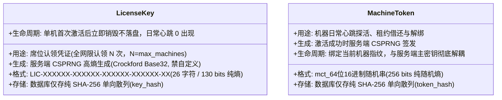
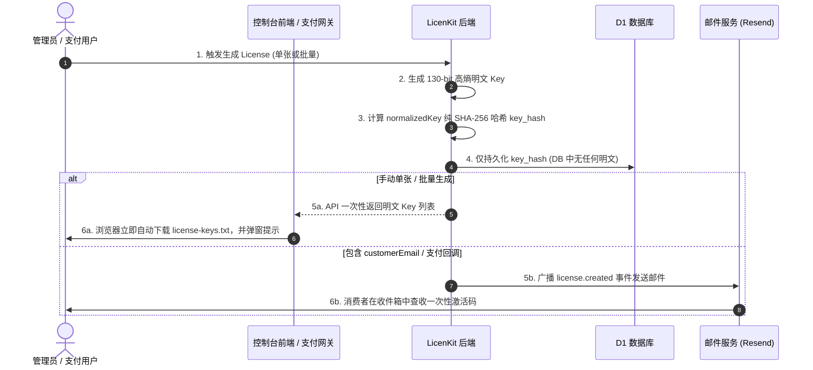
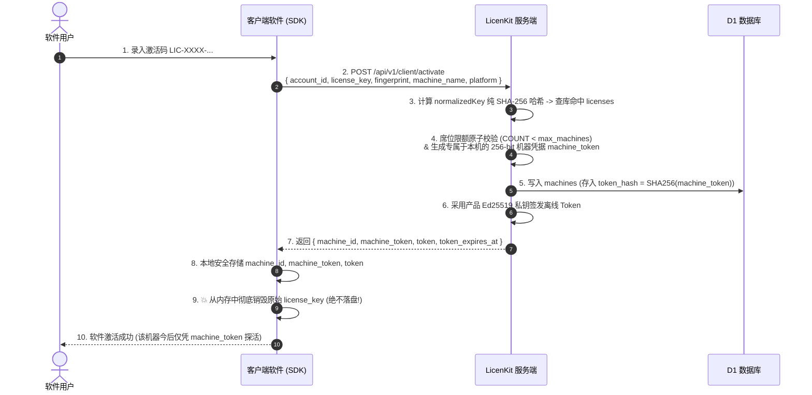
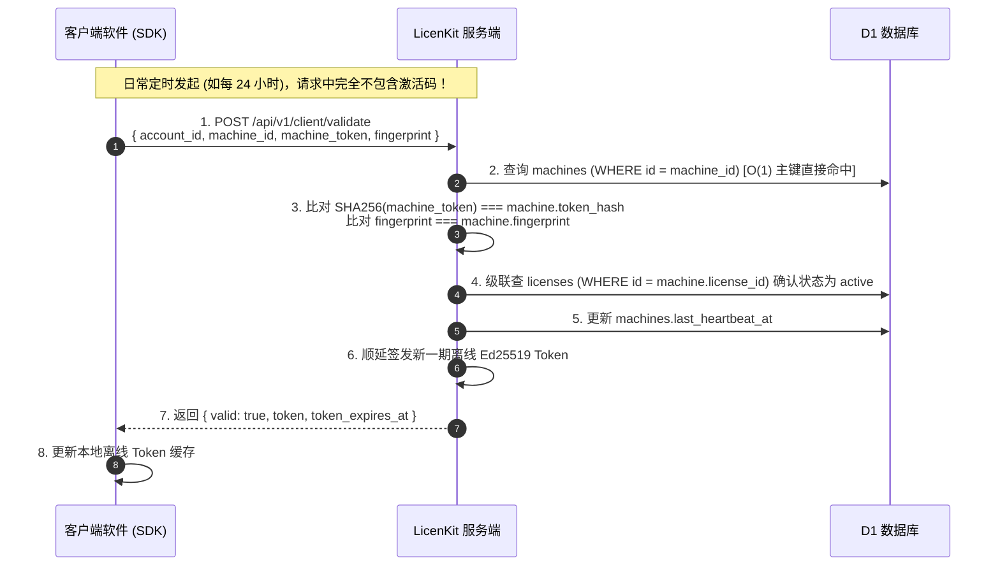
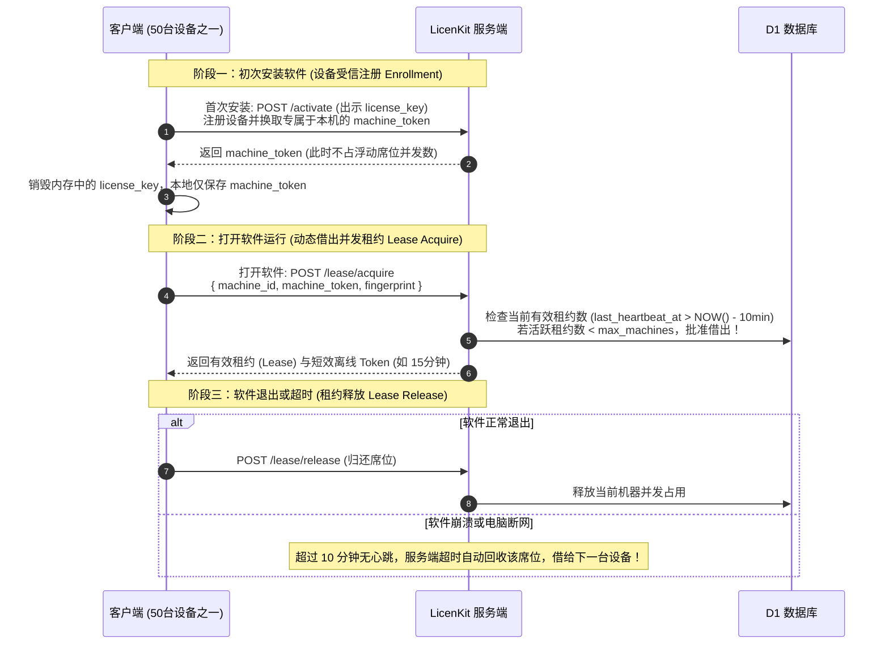

# LicenKit 激活码存储与凭据交换架构改造方案：基于纯 SHA-256 单向散列与 Machine Token (极简高可用版)

> **文档版本**: v2.3.0 (纯 SHA-256 & Machine Token 极简终极版)  
> **更新日期**: 2026-09-18  
> **适用范围**: LicenKit Server、数据库 Schema、客户端 SDK 交互协议、密码学基础设施、安全运维与迁移规范  
> **核心原则**: 奥卡姆剃刀（KISS 原则）——全系统 CSPRNG 高熵发码、纯 SHA-256 单向散列、双层凭据职责分离、日常心跳极致轻量与完全解耦  

---

## 1. 背景与改造动机

### 1.1 现状审查与核心矛盾
在当前代码库中，许可证表 `licenses` 对激活码采用了纯明文存储：
```typescript
// 现有实现 (licenkit/apps/server/src/infra/db/schema.ts)
export const licenses = sqliteTable("licenses", {
  id: text("id").primaryKey(),
  ...
  key: text("key").notNull().unique(), // 纯文本明文存储
  ...
});
```
- **脱库即穿透**：一旦底层数据库（Cloudflare D1 / SQLite）备份或快照意外泄露，所有明文激活码直接失窃。
- **过度设计的陷阱（反思原地重置）**：如果尝试在数据库中做“原地重置激活码（Regenerate Key）”，会导致老设备在后台心跳 `/validate` 时因持有老 Key 而被批量误杀踢下线；而若为了兼容老设备去引入“双 Key 滚动窗口（Dual-Key Rolling Window）”或宽限期，又会引入极其复杂的过渡状态机和并发竞争条件。
- **协议与权限倒错（违背最小权限原则）**：现存客户端在每次日常心跳 `/validate` 时都重复发送原始 `license_key`。这强迫客户端本地长期持久化最高特权的激活码（可用于新设备激活），一旦客户端遭遇内存转储或逆向，原始激活码极易失窃。
- **管理员自定义 Key 的弱口令隐患**：原系统中存在允许管理员自定义激活码（`input.key` 与 `body.key`）的后门，破坏了系统的密码学熵池假设，必须彻底斩断。

### 1.2 极简架构定调（KISS 原则与激活凭据交换）
经复盘，确定采用现代企业级安全授权标准（类似 OAuth2 Token Exchange / Keygen.sh / AWS IAM 的**双层凭据分离模型**）：

1. **全面系统高熵生成，彻底杜绝自定义激活码**：
   - 彻底移除管理端手动发码与轮换时对自定义 Key 的支持；
   - 保证全库 100% 的 License Key 均由服务端 WebCrypto CSPRNG 自动生成（130 bits 纯密码学熵），从根源杜绝可预测弱口令与字典攻击。
2. **彻底移除现有明文 `key` 字段，严禁引入 `key_prefix`**：
   - 彻底删除数据库中原存的明文 `key` 字段；
   - 坚决不引入行业某些系统用于展示的 `key_prefix` 等随机切片字段（杜绝泄露任何随机熵池切片，不给爆破留线索）；
   - 许可证表仅存储不可逆的 **纯 SHA-256 单向散列摘要（`key_hash`）**，且不冗余 `key_tag` 字段。
3. **彻底摒弃 HMAC，License Key 与 Machine Token 统一采用纯 SHA-256 散列**：
   - 由于激活码全部为高熵 CSPRNG 随机串，彩虹表与字典爆破在物理学上完全失效，使用 HMAC 属于冗余过度设计；
   - 采用纯 SHA-256 散列使数据存储与服务端根密钥彻底解耦，消除单点依赖与运维灾备摩擦；
   - 业界顶级巨头（GitHub PAT、Stripe API Key、AWS）对系统高熵 Token 均采用纯 SHA-256 存储。
4. **引入“激活凭据交换（Activation Exchange）”模式**：
   - **激活码角色定调为“席位认领凭证”**：**单机生命周期内一次性交换；全网仅在认领 N 个席位时使用（$N = \text{max\_machines}$），日常心跳 0 出现**。客户端仅在初次激活某台设备时出示 `license_key` + `fingerprint` 进行席位认领交换；
   - 校验通过后，服务端为该设备颁发专属于本机的 256-bit 高熵 **机器凭据（Machine Token）**；
   - **客户端本地不持久化原始激活码**：激活成功后，客户端仅在本地持久化 `machine_id` + `machine_token`（以及离线 Ed25519 Token），原始高权 `license_key` 立即从客户端内存中销毁，实现客户端最小权限；
   - **日常心跳探活（`/validate`）彻底抹去激活码**：日常心跳仅出示 `{ machine_id, machine_token, fingerprint }`。
5. **废除“原地重置”，坚持“废旧立新（Revoke & Issue New）”**：
   - 激活码为强单向凭据，1 个激活码严格对应 1 个 License 实体；
   - 客户遗失激活码走作废并重开流程，彻底杜绝双 Key 滚动等脆弱状态机。
6. **“一次性下发 + 自动导出凭据”机制**：
   - 手动生成时，管理端前端**自动触发下载 `.txt` 激活码文件**供管理员归档；
   - 自动生成 / 绑定邮箱时，自动触发邮件广播发送激活码给消费者。

---

## 2. 核心密码学架构设计

### 2.1 单一主根密钥职责明确定位
整个实例仅需注入唯一的一个平台主根密钥：
```env
STORAGE_ENCRYPTION_KEY=64字符十六进制高熵随机串 (32 Bytes / 256 bits Entropy)
```
**关键原则：主根密钥专职专用，不参与任何哈希查询**：
- `STORAGE_ENCRYPTION_KEY` **仅用于** AES-256-GCM 信封加密保护产品的 Ed25519 签名私钥种子（`crypto_keys.key_material`）以及可选的入向 Webhook 配置；
- **哈希索引完全解耦**：不管是 `licenses.key_hash` 还是 `machines.token_hash`，均不再使用 HMAC 或 HKDF 派生密钥，而是直接采用标准的不可逆 **纯 SHA-256** 单向散列。
- **租户隔离保障**：租户数据隔离完全由 SQL 引擎保证（`WHERE account_id = ? AND key_hash = ?`），避免密码学过度设计与复杂的派生依赖。

---

## 3. 双层凭据生成与散列规范 (Dual-Credential Architecture)

系统严格区分两类生命周期与安全等级完全不同的凭据：



### 3.1 许可证激活码（License Key）与 130-bit 标准 Crockford 生成规范
- **字符集**：标准 Crockford Base32（`0123456789ABCDEFGHJKMNPQRSTVWXYZ`，32 字符，严格排除易混淆字符 `I, L, O` 以及 `U`）；
- **全系统统一高熵生成**：必须由系统通过 WebCrypto CSPRNG 统一签发，彻底杜绝人工指定；
- **长度与熵**：26 个随机字符，每个字符经 `b & 31` 提取 5 bits，提供 $26 \times 5 = 130\text{ bits}$ 纯真随机熵（彻底无模偏差，搜索空间达 $2^{130} \approx 1.36 \times 10^{39}$）；
- **标准外观**：`LIC-XXXXXX-XXXXXX-XXXXXX-XXXXXX-XX`（6-6-6-6-2 分组结构）；
- **服务端生成器标准实现**：
  ```typescript
  export function generateLicenseKey(prefix = "LIC"): string {
    const chars = "0123456789ABCDEFGHJKMNPQRSTVWXYZ"; // 标准 Crockford，排除 I L O U
    const bytes = new Uint8Array(26);
    crypto.getRandomValues(bytes);
    const body = Array.from(bytes, (b) => chars[b & 31]).join(""); // 26 × 5 = 130 bits
    return `${prefix}-${body.slice(0, 6)}-${body.slice(6, 12)}-${body.slice(12, 18)}-${body.slice(18, 24)}-${body.slice(24)}`;
  }
  ```

---

### 3.2 规范化清洗与纯 SHA-256 散列规范（Normalization & SHA-256）
- **散列存储规范**：
  ```typescript
  export function normalizeLicenseKey(rawKey: string): string {
    return rawKey
      .trim()
      .toUpperCase()
      .replace(/[-\s]/g, ""); // 严格抹平空格与连字符
  }

  // 存储与校验采用纯 SHA-256:
  export async function hashLicenseKey(cleanKey: string): Promise<string> {
    return sha256Hex(cleanKey);
  }
  ```
$$\text{key\_hash} = \text{Hex}(\text{SHA256}(\text{normalize}(\text{LicenseKey})))$$

#### 深度解析：为什么 License Key 彻底无需 HMAC？
1. **真实世界威胁模型：没有字典，彩虹表在物理学上无法构建**：
   - 传统需要 HMAC / Salt 的场景（如用户登录密码、短信验证码），本质是因为人脑选择的密码熵极低（通常只有 20~30 bits 且存在海量字典），脱库后黑客可以通过十亿级彩虹表直接查表逆向。
   - 而 LicenKit 的 License Key 已经**彻底废除了管理员自定义**，全由 CSPRNG 生成 26 字符，熵池为 $32^{26} = 2^{130} \approx 1.36 \times 10^{39}$。即使集合全人类所有计算设备算到宇宙毁灭，也无法通过彩虹表或离线碰撞还原原始 Key。
2. **业界巨头事实标准（De Facto Standard）**：
   - GitHub 的个人访问令牌（Personal Access Token, `ghp_...`）；
   - Stripe 的生产 API Key（`sk_live_...`）；
   - AWS、Cloudflare、Slack 的系统鉴权 Token；
   - 以上所有万亿级/百亿级系统的数据库落盘方案，**全线采用纯 SHA-256** 单向哈希存储，无一使用 HMAC。
3. **架构与运维红利：消除致命的“密钥锁死与配置依赖”**：
   - HMAC 强依赖服务端的 `STORAGE_ENCRYPTION_KEY`。一旦使用 HMAC，若备份恢复、跨云迁移或多环境部署时根密钥稍有出入，整个库的激活码哈希全部瞬间瘫痪。
   - 最关键的是：由于数据库中没有明文，**使用 HMAC 意味着一旦根密钥变更，所有存量未激活的 License 永远无法在没有明文的情况下重新生成 HMAC**，造成不可逆的数据死锁！
   - 纯 SHA-256 具有绝对的确定性与自包含性，零配置依赖，零状态耦合。
4. **彻底移除原明文 `key` 字段，严禁引入 `key_prefix`**：绝不向数据库写入任何随机切片字符，杜绝泄露熵池，不为攻击者保留任何掩码爆破线索；
5. **去除冗余 `key_tag` 字段**：遵循 KISS 原则，数据库无需专为固定字符串 `"LIC"` 新增冗余列。

---

### 3.3 机器凭证（Machine Token）与纯 SHA-256 散列规范
- **生成机制**：在设备激活成功后，服务端通过 WebCrypto CSPRNG 生成 32 字节纯真随机数：
  ```typescript
  export function generateMachineToken(): string {
    const bytes = new Uint8Array(32); // 256 bits 纯密码学真随机
    crypto.getRandomValues(bytes);
    return `mct_${bytesToHex(bytes)}`;
  }
  ```
- **哈希存储**：在 `machines` 表中存储 `token_hash = SHA256(machine_token)`。

#### 凭据散列存储设计：双层凭据统一采用纯 SHA-256
1. **统一极简规范**：
   - **License Key**: `key_hash = SHA256(normalize(license_key))`
   - **Machine Token**: `token_hash = SHA256(machine_token)`
2. **核心架构红利：与服务端根主密钥彻底解耦**：
   - 哈希计算无需读取 `STORAGE_ENCRYPTION_KEY`，无需 HKDF 派生租户子密钥；
   - 无论是激活还是高频日常心跳，验证逻辑都是纯数学单向散列，极速高效且绝无密钥配置失步风险。
3. **脱库防伪造与抗原像保障**：
   - 黑客即使完全窃取 D1 数据库，也仅能得到 `key_hash` 与 `token_hash`；
   - 面对 130 bits 的系统 CSPRNG 激活码和 256 bits 的机器凭据，在没有明文字典的情况下，攻击者在物理学上无法逆向原像，更无法伪造凭据向服务端发起验证请求。

---

## 4. 极简数据库 Schema 规范 (SQLite / D1 Drizzle)

在 [`licenkit/apps/server/src/infra/db/schema.ts`](file:///Users/mixbayes/Projects/LicenKit/licenkit/apps/server/src/infra/db/schema.ts) 中，表结构保持极致精炼：

### 4.1 许可证表 (`licenses`)
```typescript
// 7. 许可证表 (Licenses) - 极简高安全版
export const licenses = sqliteTable("licenses", {
  id: text("id").primaryKey(),                       // 内部唯一 ID，如 "lic_01j8x9n..."
  accountId: text("account_id").notNull(),           // 租户主体 ID
  productId: text("product_id").notNull(),           // 产品 ID
  policyId: text("policy_id").notNull(),             // 策略 ID
  
  // ================= 核心安全字段 =================
  keyHash: text("key_hash").notNull(),               // 纯 SHA-256 单向散列摘要 (SHA256(normalize(key)))
  // 【彻底移除】 原 key 明文字段；【严禁引入】 keyPrefix 随机切片与冗余 keyTag
  // ===============================================

  customerEmail: text("customer_email"),
  source: text("source").notNull().default("manual"),
  status: text("status").notNull().default("active"), // 'active' | 'suspended' | 'expired' | 'revoked'
  revokeReason: text("revoke_reason"),
  metadata: text("metadata").notNull().default("{}"),
  expiresAt: text("expires_at"),
  suspendedAt: text("suspended_at"),
  createdAt: text("created_at").notNull(),
  updatedAt: text("updated_at").notNull(),
}, (table) => [
  uniqueIndex("idx_licenses_account_key_hash").on(table.accountId, table.keyHash),
  index("idx_licenses_account_id").on(table.accountId),
  index("idx_licenses_product_policy").on(table.productId, table.policyId),
  index("idx_licenses_customer_email").on(table.customerEmail),
  index("idx_licenses_status").on(table.status),
  index("idx_licenses_created_at").on(table.createdAt),
]);
```

### 4.2 机器席位表 (`machines`)
```typescript
// 8. 机器硬件席位绑定表 (Machines)
export const machines = sqliteTable("machines", {
  id: text("id").primaryKey(),                       // 设备记录全局 ID，如 "mach_01j..."
  licenseId: text("license_id").notNull(),           // 级联关联 licenses.id
  fingerprint: text("fingerprint").notNull(),        // 硬件唯一指纹哈希
  tokenHash: text("token_hash").notNull(),           // 👈 SHA-256(machine_token)，机器专用凭据哈希
  name: text("name"),
  platform: text("platform"),
  ip: text("ip"),
  lastHeartbeatAt: text("last_heartbeat_at").notNull(),
  createdAt: text("created_at").notNull(),
  updatedAt: text("updated_at").notNull(),
}, (table) => [
  index("idx_machines_license_id").on(table.licenseId),
  uniqueIndex("idx_machines_license_fingerprint").on(table.licenseId, table.fingerprint),
  index("idx_machines_token_hash").on(table.tokenHash),
]);
```

---

## 5. 核心业务流程与交互设计

### 5.1 激活码交付流程（One-Time Delivery）


- **手动单张/批量生成**：
  - 前端调用接口成功后，UI 弹窗展示激活码，**并立即在浏览器端自动触发下载文本文件（如 `licenkit-keys-20260918.txt`）**；
  - 文件中包含：产品名、策略名、有效期限、客户邮箱以及完整的激活码明文；
  - 界面明确告知：“数据库不留存激活码明文，请妥善保管下载的文本文件”。
- **在线支付出码**：
  - Stripe/Paddle Webhook 回调成功后，通过 `license.created` 广播事件发送带激活码的确认邮件给买家；
  - 数据库与内部日志表杜绝任何明文持久化。

---

### 5.2 客户端激活与凭据交换流程（`/activate`，单机首次认领席位）

- **多席位（Multi-Seat）机制说明**：
  若策略允许多席位（如 $N = \text{max\_machines} = 3$），同一个激活码允许被用于 3 台不同机器进行**首次认领**。
  服务端每次执行原子计数 `COUNT(machines WHERE license_id = ?) < max_machines`，依次为机器 A、机器 B、机器 C 独立签发 `machine_token_A`、`machine_token_B`、`machine_token_C`。
  **每台机器在换取本机凭证后，立即在内存中彻底销毁原始激活码，绝不落盘**。



---

### 5.3 客户端日常心跳探活流程（`/validate`，高频轻量）


---

### 5.4 机器解绑与反激活流程（`/deactivate`）
- 用户在客户端点击“解绑此设备”：
- 客户端仅发送 `{ account_id, machine_id, machine_token, fingerprint }`；
- 服务端校验机器凭证合法后，直接从 `machines` 表删除该设备记录，席位立即释放；
- 用户无需重新翻找和输入原始激活码。

---

### 5.5 浮动席位（Floating Seats）架构与租约借还模型（二期演进）

系统通过预留的 `policy.floating = true` 字段支持浮动并发席位，**Machine Token 是支撑浮动席位高并发借还与客户端安全的天然基石**。

#### 1. 固定席位 vs 浮动席位
- **固定席位（Node-Locked，`floating: false`）**：静态绑定，机器一旦激活即永久占用 1 个名额，直到主动解除绑定或管理员踢出；
- **浮动席位（Floating / Concurrent Seats，`floating: true`）**：动态占用。例如企业购买了 5 个并发席位，全公司 50 台电脑都可以安装软件，但同一时刻仅允许最多 5 台电脑同时运行软件。

#### 2. 为什么 Machine Token 是浮动席位的最优解？
- **零散落安全保障**：50 台设备首次安装时出示激活码完成受信注册，本地**仅保留 `machine_token`**，不消耗浮动席位。原始激活码彻底不在公用/员工电脑上驻留；
- **微秒级高并发借还**：员工每天频繁打开、退出软件，席位借还协议仅验证 `machine_token`（纯 SHA-256 比对与主键检索），**完全无需激活码参与，主键 O(1) 直达**，吞吐量提升 10 倍以上。

#### 3. “设备受信注册（Enrollment）+ 动态租约借还（Lease Checkout/Checkin）”工作流


---

### 5.6 客户遗失激活码的标准流程（Revoke & Issue New）
摒弃一切不稳定的“原地重置”状态，走清晰标准的工业级流程：
1. 若客户丢失激活码，管理员在后台执行 **“作废旧许可证（Revoke）”**；
2. 为客户**重新签发一张新许可证**；
3. 系统自动下载新激活码文件，并自动给客户邮箱发送新激活码邮件；
4. 客户在电脑上录入新激活码完成首次激活交换；
5. **权责清晰，设备状态机 100% 确定，绝无任何心跳冲突或幽灵设备。**

---

## 6. 严防死守：清除所有旁路明文暗道

为了确保“数据库脱库后零明文失窃”，必须同步封堵以下两处代码暗道：

1. **审计日志脱敏（`audit_logs`）**：
   - 彻底清理 [`admin/licenses.routes.ts` 第 419 行](file:///Users/mixbayes/Projects/LicenKit/licenkit/apps/server/src/routes/admin/licenses.routes.ts#L419) 的明文记录；
   - `details` 对象中严禁记录 `key`，只能记录 `licenseId`、产品信息和脱敏邮箱。
2. **出向 Webhook 流水表脱敏（`webhook_events`）**：
   - 彻底清理 [`infra/events/broadcast.ts` 第 84 行](file:///Users/mixbayes/Projects/LicenKit/licenkit/apps/server/src/infra/events/broadcast.ts#L84) 的明文落盘；
   - 写入 `webhook_events.payload` 前对敏感 `key` 字段进行掩码处理，或者对整行 Payload 使用 `STORAGE_ENCRYPTION_KEY` 进行 AES-GCM 密文存储，仅在队列广播传输中保留明文。
3. **彻底封死管理端自定义 Key 入口（根除弱口令与熵泄露隐患）**：
   - **历史遗留漏洞**：原系统在 `POST /api/v1/admin/licenses` 接收 `input.key`，以及在 `POST /api/v1/admin/licenses/:id/rotate-key` 接收 `body.key`，允许管理员手工传入自定义激活码；
   - **安全隐患**：人工指定的 Key 往往熵极低（如 `VIP-2026-DISCOUNT`），严重破坏系统对“高熵真随机串（130 bits）”的密码学假设，使脱库彩虹表或离线爆破重新具备理论可行性；
   - **彻底斩断与处理策略**：
     1. **Schema 级剔除**：在 `IssueLicenseSchema` 中彻底删除 `key` 字段，服务端自动过滤/拒绝客户端传入的自定义 key；
     2. **强制服务签发**：无论单张发码、批量发码、还是轮换 Key，全线强制调用 `generateLicenseKey()`（26 字符 / 130 bits 标准 Crockford Base32）；
     3. **控制台 UI 清理**：前端 `IssueLicenseModal.tsx` 彻底移除自定义激活码输入表单，产品交互上不留任何人工定义弱口令的窗口；
     4. **密码学闭环**：确保全库 100% 的 `key_hash` 均由不可逆 SHA-256 基于真随机数计算，为纯 SHA-256 存储架构提供绝对的抗碰撞与抗原像理论根基。

---

## 7. 客户端与服务端接口核心实现逻辑

### 7.1 客户端 SDK 本地持久化模型
客户端在激活成功后，**原始 `license_key` 立即从内存中销毁，绝不落盘**。本地 Keychain 或持久化配置仅存储机器凭证：
```json
{
  "account_id": "acc_01j8x...",
  "machine_id": "mach_01j8x9n...",
  "machine_token": "mct_9f8a3c2e1b4d5e...",
  "offline_token": "eyJhbGciOiJFZERTQ...",
  "offline_token_expires_at": 1782000000
}
```

---

### 7.2 服务端首次激活接口 (`/api/v1/client/activate`)
```typescript
// 1. 规范化激活码并计算纯 SHA-256 哈希
const normalizedKey = normalizeLicenseKey(input.license_key);
const targetHash = await sha256Hex(normalizedKey);

// 2. 查验许可证 (配合租户 accountId 严格隔离)
const license = await db
  .select()
  .from(licenses)
  .where(and(eq(licenses.accountId, input.account_id), eq(licenses.keyHash, targetHash)))
  .get();

if (!license || license.status !== "active") {
  return c.json({ success: false, error: { code: "LICENSE_INVALID" } }, 400);
}

// 3. 校验席位限额并处理机器记录
// ... 席位限额与复用判断 ...

// 4. 签发专属于本机的 256-bit Machine Token
const machineToken = generateMachineToken();
const tokenHash = hashMachineToken(machineToken); // 纯 SHA-256
const machineId = newUlid("mach");

await db.insert(machines).values({
  id: machineId,
  licenseId: license.id,
  fingerprint: input.fingerprint,
  tokenHash,
  name: input.machine_name,
  platform: input.platform,
  ip: clientIp,
  lastHeartbeatAt: new Date().toISOString(),
  createdAt: new Date().toISOString(),
  updatedAt: new Date().toISOString(),
});

// 5. 签发离线 Ed25519 Token 并返回
return c.json({
  success: true,
  data: {
    machine_id: machineId,
    machine_token: machineToken, // 仅在激活时返回一次
    token: offlineSignedToken,
    token_expires_at: offlineExpiresTimestamp,
  },
});
```

---

### 7.3 服务端日常心跳接口 (`/api/v1/client/validate`)
心跳接口极其轻量高效，**纯走主键索引查询，零根密钥依赖，零额外派生开销，零激活码传输**：
```typescript
// 1. 根据 machine_id 直接 O(1) 命中主键
const machine = await db
  .select()
  .from(machines)
  .where(eq(machines.id, input.machine_id))
  .get();

if (!machine) {
  return c.json({ success: true, data: { valid: false, reason: "MACHINE_NOT_FOUND" } });
}

// 2. 校验凭据与硬件指纹
const incomingTokenHash = hashMachineToken(input.machine_token); // SHA-256
if (incomingTokenHash !== machine.tokenHash || input.fingerprint !== machine.fingerprint) {
  return c.json({ success: true, data: { valid: false, reason: "UNAUTHORIZED_CREDENTIALS" } });
}

// 3. 主键关联查验许可证状态
const license = await db
  .select()
  .from(licenses)
  .where(eq(licenses.id, machine.licenseId))
  .get();

if (!license || license.status !== "active") {
  return c.json({ success: true, data: { valid: false, reason: "LICENSE_REVOKED" } });
}

// 4. 更新心跳并顺延签发新离线 Token
await db.update(machines).set({ lastHeartbeatAt: new Date().toISOString() }).where(eq(machines.id, machine.id));

return c.json({
  success: true,
  data: {
    valid: true,
    token: refreshedOfflineToken,
    token_expires_at: refreshedExpiresTimestamp,
  },
});
```

---

### 7.4 服务端机器解绑接口 (`/api/v1/client/deactivate`)
```typescript
// 1. 验证机器凭证
const machine = await db
  .select()
  .from(machines)
  .where(eq(machines.id, input.machine_id))
  .get();

if (!machine || hashMachineToken(input.machine_token) !== machine.tokenHash) {
  return c.json({ success: false, error: { code: "UNAUTHORIZED" } }, 401);
}

// 2. 删除席位记录，瞬间释放名额
await db.delete(machines).where(eq(machines.id, machine.id));
return c.json({ success: true });
```

---

## 8. A -> B 跨服务器平滑迁移指南

### 8.1 黄金迁移双要素
1. **D1 SQLite 数据库导出 SQL 文件**（`backup.sql`，包含租户、产品、策略、许可证哈希、机器席位及其 `token_hash` 等全部数据）；
2. **唯一环境变量**：`STORAGE_ENCRYPTION_KEY`。

### 8.2 迁移操作极简流程
```bash
# 1. 从 A 服务器导出数据库
npx wrangler d1 export licenkit-db --output backup.sql

# 2. 在 B 服务器设置完全相同的根密钥
npx wrangler secret put STORAGE_ENCRYPTION_KEY # 输入与 A 相同的密钥字符串

# 3. 将数据导入 B 服务器
npx wrangler d1 execute licenkit-db --file backup.sql

# 4. 切换 DNS 解析或客户端 API 地址至 B 服务器
```
- **客户端体验**：客户端本地保存 `machine_id` 与 `machine_token`，修改 `api_base_url` 后向 B 服务器发起 `/validate`，B 服务器比对 `token_hash` 100% 吻合，`machines` 席位已随数据库完整导入，**验签瞬间通过，零停机，零重新激活**。

---

## 9. 方案对比与总结

| 维度 | 原明文存储方案 | 传统每次心跳带 Key 方案 | 本 Machine Token + 纯 SHA-256 方案 (KISS) |
| :--- | :---: | :---: | :---: |
| **脱库安全性** | ❌ 致命 (明文全泄露) | ✅ 坚固 (哈希) | 🛡️ **双层坚固 (激活码 SHA-256 + 机器凭据纯 SHA-256)** |
| **客户端密钥暴露面** | ❌ 原始 Key 长期落盘，易被反编译/转储 | ❌ 原始 Key 长期落盘并高频走网络 | 🔒 **最小权限！原始 Key 仅在首次认领席位时出示，绝不落盘** |
| **心跳验活性能** | ⚠️ 依赖明文比对 | ⚠️ 每次心跳都有复杂派生或计算开销 | 🚀 **主键 O(1) 直接命中，零密码学派生开销** |
| **多席位管理 (Multi-Seat)** | ⚠️ 粗暴设备列表 | ⚠️ Key 与多设备耦合，难辨认 | 👥 **一码多认领，单机凭 Token 独立自治管理** |
| **设备解绑体验** | 普通 | 需出示原始 Key | 📱 **出示本地 Machine Token 即刻解绑** |
| **浮动席位兼容性 (Floating Seats)** | ❌ 极度复杂 | ❌ 高频借还导致 Key 疯狂暴露 | 🔄 **天然契合！Token 身份绑定 + 租约动态借还** |
| **系统复杂度** | 低 | 复杂 (状态竞争) | 🟢 **极致精炼，状态机 100% 确定** |

