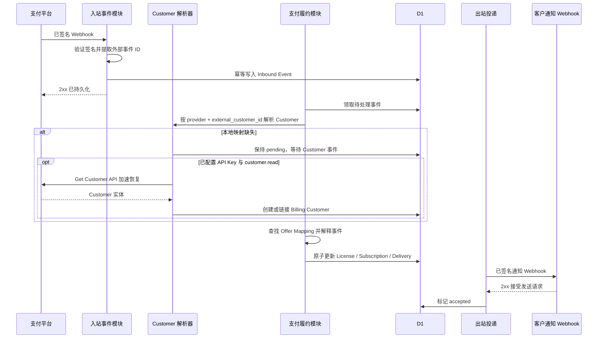
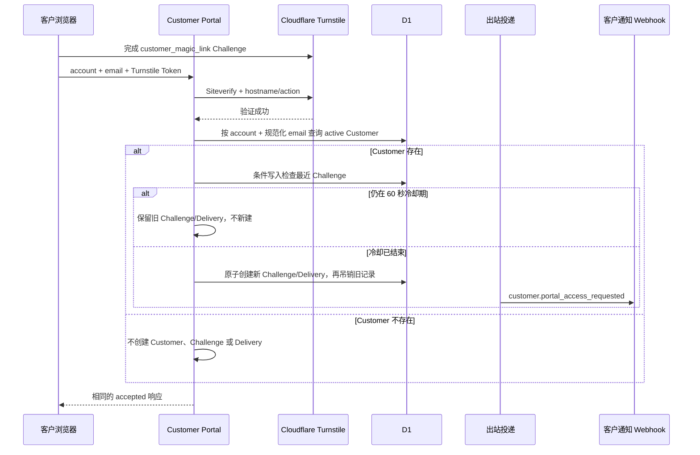
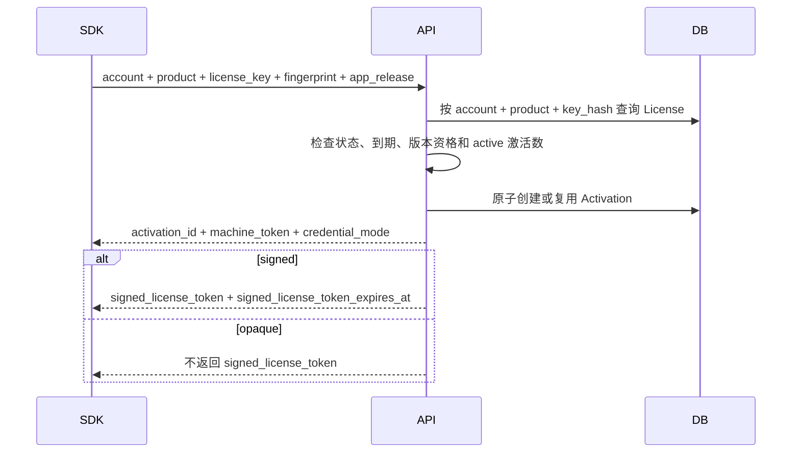

# 核心业务流程

## 1. 购买与履约总览

LicenKit 不创建支付订单。它接收支付平台已经签名的 Webhook，并把其中的购买事实转换为授权状态。

V1 首个真实端到端支付闭环使用 Paddle Sandbox。Paddle Adapter 只负责验签和把渠道事件转换为下述内部语义，不能绕过统一 Fulfillment Service 直接修改 License。



入站接口只有在事件被可靠写入后才返回 2xx；签名无效返回 4xx，持久化失败返回 5xx 让 Paddle 重试。请求上下文可以立即尝试处理已持久化事件以降低延迟；无论即时处理是否成功，数据库中的待处理记录都是恢复来源，Scheduled Worker 会扫描到期任务并继续履约。

### 1.1 从自定义产品页到 Checkout

参考产品页和用户自定义产品页使用同一个公开 Checkout 配置 API 与 Web Checkout SDK：

1. 页面以 `accountSlug + productSlug` 请求公开配置；服务端实时检查 Product、Product 选择的收款环境、Offer、Billing Provider、最小事件合同、Notification Gateway、调度器和签名能力；
2. 不可收款时返回 `available=false` 和可公开原因码，SDK 不初始化 Paddle Checkout；管理端同时展示更完整的联通状态与修复动作；
3. 可收款时只返回 Product 所选环境下的公开 Product/Offer 展示字段、Provider 环境、Paddle Client-side Token 和 active Offer 的 Price ID；不同环境的 Offer 即使存在也不会进入响应；
4. 页面选择一个 Offer，SDK 固定调用一个 Price、`quantity=1`，不能接收调用方传入的任意 Price ID 或数量；
5. Paddle.js 收集客户和支付信息。Checkout 成功回调只更新页面提示或跳转成功页，不创建授权；
6. Paddle 发送已签名 Webhook，LicenKit 持久化后再由统一履约流程发码。

用户可以完全修改页面结构、样式和文案，也可以不使用参考模板；只要使用同一公开契约和 SDK，就不会把支付 Secret 放进前端。恶意调用方即使绕过 SDK 直接构造多商品或多数量 Checkout，服务端仍以已验签 Transaction 的行项目再次校验，失败时进入 `needs_attention` 而不是发码。

### 1.2 Paddle Customer 解析与回调时序

对新 Paddle Customer，业务生成顺序通常是：客户在 Checkout 填写资料后产生 `customer.created`，支付完成阶段产生 `subscription.created`（订阅购买）和 `transaction.completed`。已有 Paddle Customer 再次购买时不会重新产生 `customer.created`；而且 Webhook 是独立、至少一次投递，网络重试会改变到达顺序。因此 LicenKit 既不能把 Customer 事件当作每笔购买的前置条件，也不能假设它一定先到。

V1 的 Paddle Notification Destination 最小事件合同是 `customer.created`、`customer.updated`、`transaction.completed`、`subscription.created`、`subscription.updated`、`adjustment.created` 和 `adjustment.updated`。缺少任一事件时 Offer 不允许激活。由于 API Key 不是基础闭环的必需配置，合同验证以当前 Provider 配置更新时间之后逐个收到并成功验签的对应事件为准，通常由管理员通过 Paddle 官方模拟器触发；轮换 Webhook Secret 会使旧证据失效，切换环境则必须创建另一条 Provider 并重新验证。若配置了可读取 Notification Settings 的 API 能力，可以额外对比远端订阅集合，但不能以此替代端点实际收到了签名事件的证据。`transaction.payment_failed`、`subscription.past_due` 和 `subscription.canceled` 推荐作为诊断补充，但核心状态处理仍必须能由 `subscription.updated` 收敛，不能要求两个重复事件同时到达才推进。所有事件先验签、提取关联 ID、幂等写入 Inbound Event，再返回 2xx。后续处理分为：

1. `customer.created|updated`：把 provider Customer 的 ID、邮箱、名称、状态和版本时间 upsert 到 Billing Customer；版本时间取 `updated_at ?? created_at`，首次出现时按规范化邮箱在当前 Account 查找或创建 LicenKit Customer，并保存稳定映射；
2. 购买事件：先以 `account_id + billing_provider_id + external_customer_id` 查 Billing Customer；已经 `linked` 才可继续签发；
3. 本地映射缺失：Inbound Event 写入 `BILLING_CUSTOMER_PENDING` 并保持 `pending`，等待 `customer.created|updated` 到达后由同一调度器重试；
4. 当前 Provider 配置了具备 `customer.read` 权限的 Paddle API Key 时，可以根据已验签事件中的 Customer ID 调用 `GET /customers/{customer_id}` 加速恢复，响应仍进入同一个 upsert/link 服务；API 暂时失败只保存 Paddle request ID、HTTP 状态和原始错误码后退避；
5. 等待超过显式上限、购买事件没有外部 Customer ID，或 Provider Customer 已确认不存在、归档、邮箱无效、链接冲突时，事件进入 `needs_attention`，等待管理员修复后 replay。

Customer Webhook 是正常路径；API 读穿和定期对账是配置 API Key 后的可选加速/恢复能力，不是另一套 Customer 创建流程，也不是开启收款的必要条件。`custom_data.email`、产品页参数或 Transaction 上任意客户端自定义邮箱一律不参与身份解析；已验签只能证明 Paddle 发送了 payload，不能把客户端自定义值提升为可信 Customer 实体。

若 Customer 事件超过 Paddle 重试窗口仍未到达，管理员有两条受控恢复路径：在 Paddle Notification 日志中重放对应 `customer.created|updated`，或配置只读 API Key 后对该外部 Customer 执行 reconcile。两条路径都进入相同同步服务，再 replay 原购买事件；管理员不能在购买事件上手填邮箱直接放行。

### 1.3 Provider API 认证问题与恢复

购买事件为了补齐 Billing Customer 调用 Paddle Get Customer 时，如果返回 `401/403`，这不是“该交易失败”，而是同一 Provider 的 `customer_read` 共享能力不可用。一次失败在同一 D1 原子批次中写入三层事实：

1. Inbound Event 保持 `pending`，在 `last_error_code` 写入 `BILLING_PROVIDER_API_AUTH_INVALID`，在 `last_error_detail` 保留 `httpStatus`、Provider 原始错误码、request ID 和 message，并设置当前阻塞 System Issue；
2. `system_issues` 按账户、Provider、`customer_read` 能力和问题代码 upsert；相同问题只更新一行并累加次数；
3. `system_issue_inbound_events` 幂等关联 Issue 与 Event，供管理端展示全部受影响事件和恢复预览。

`blocking_system_issue_id` 非空的事件不参加 Scheduled Worker 扫描，避免无效凭证持续请求 Paddle；即使 Issue 已被管理员标记 resolved，未选择重试的事件也不会被隐式唤醒。与此同时 Customer Webhook 仍可正常进入：若它已经为某个外部 Customer 建立安全映射，只解除对应事件的当前阻塞并重新排入原状态机，不关闭 Provider 级 Issue，也不删除历史关联。

管理员更新 API Key 或权限后点击“已修复”，服务端先执行只读 `customer_read` 能力验证。能力验证成功只证明当前 Key 在该环境具有 Customer 读权限，不证明它必然属于原事件所在的正确 Paddle 商户；后者必须由重新处理每条事件时对其外部 Customer ID 的结果确认。成功后界面显示“仅标记已修复”和“标记已修复并重新处理 N 条事件”两个结果明确的选择。后者不是直接发码，也不是只重试一次 Get Customer；它只把仍满足条件的原始事件重新排入统一状态机。逐条结果固定如下：

| 当前事实 | 重新处理动作 | 结果边界 |
| --- | --- | --- |
| Billing Customer 已由 Webhook 建立且为 `linked` | 跳过 Provider API，重新执行完整事件处理 | 重新校验 Offer、Price、数量、环境与业务唯一键后才允许履约 |
| 映射仍缺失且 payload 有效 | 先对事件自带的外部 Customer ID 执行 Get Customer；`200 active` 进入统一同步服务，再继续完整事件处理 | Get Customer 成功本身不等于已发码 |
| Get Customer 返回 `404` 或 Customer 为 archived | 不发码，事件进入 `needs_attention` 并保存新的业务错误 | 认证 Issue 可以保持 resolved，因为失败原因已变成具体 Customer 不可用 |
| 返回 `429/5xx` 或网络超时 | 事件保持 `pending` 并按退避时间重试 | 不重新打开认证 Issue，保留 Provider 原始错误 |
| 再次返回 `401/403` | 重新打开同一 System Issue，事件再次阻塞 | 不创建第二条相同 Issue |
| 邮箱不一致、链接冲突或 Customer 被禁用 | 事件进入 `needs_attention` | 必须人工处理身份问题，不能使用事件里的邮箱旁路 |
| payload 已清理或过期 | 不自动重放 | 管理端提示从 Paddle 重放原始 Webhook；不能只靠已提取 ID 猜测交易行项目 |
| License/Subscription/Delivery 已由其他乱序事件完成 | 状态机命中现有业务唯一键并关联既有结果 | 不重复发 License 或 Delivery |
| 事件已 processed，或当前错误已不是该 Issue | 从恢复候选中跳过 | System Issue 详情仍保留历史关联 |

管理员手动执行 Billing Customer reconcile 时发生的 `401/403` 也 upsert 同一个 `customer_read` System Issue，但不能伪造一条 Inbound Event；修复后的重试对象只是该 reconcile 操作。创建客户门户会话的认证错误使用独立 capability，其修复后由用户重新发起短期门户会话，不自动重放旧的同步 HTTP 请求。这样每个“重试”都对应可验证的原始工作单元。

Paddle Customer 邮箱只作为初次联系和发码地址来源，不宣称已经验证邮箱所有权。Customer Portal 的 Magic Link 消费才证明收件人当前控制该邮箱。

映射建立后以外部 Customer ID 为稳定键。后续 `customer.updated` 若邮箱与 LicenKit Customer 不一致，只更新 Billing Customer 镜像并标记 `email_mismatch`，不自动改绑或修改 Customer 邮箱。该外部 Customer 的新 License 签发进入 `needs_attention`；已有 Billing Subscription 仍续期原 License，不受联系邮箱变化影响。

## 2. Offer Mapping

支付价格与授权方案使用独立映射表关联：

```text
billing_provider_id + external_price_id
  -> Product
  -> License Plan
  -> purchase_type(one_time | subscription)
```

禁止以下回退：

- 找不到价格映射时选择“唯一启用的授权方案”；
- 缺少 Billing Customer 映射或 provider Customer 邮箱时构造占位邮箱；
- 从 `custom_data.email`、Checkout 页面参数或 Transaction 自定义字段创建 Customer；
- 无法识别事件时仍标记为成功履约。

找不到本地 Billing Customer 属于可恢复依赖，Inbound Event 保持 `pending` 并等待 Customer 事件；配置 API Key 时可以并行使用 API 读穿加速。等待超时、API 已确认 Customer 无效、邮箱冲突或其他不可自动决定的问题才进入 `needs_attention`。价格映射缺失同样进入可修复状态，保留原始错误并允许配置修复后重放。

每次普通购买履约还必须检查已验签 Transaction 的行项目：恰好一个行项目、Price 对应当前 active Offer、Offer Provider 环境与 Product 的 `billing_environment` 一致、数量恰好为 1，并且 Offer 的 `purchase_type` 与授权方案一致。零行、多行、多个 Price、数量不为 1、Price 未映射、环境不一致或 Offer 非 active 都进入 `needs_attention`；处理器不得选第一项、合并数量或按金额猜测目标授权。

### 2.1 管理员 Sandbox 闭环验证

Offer 默认是 draft，但真实端到端测试又必须发生在激活前。为避免因此建立第二套履约逻辑，owner/admin 对 draft Sandbox Offer 发起验证时，服务端创建一条短期、一次性的 Checkout Verification，只保存验证令牌哈希，并把明文令牌随 `Cache-Control: no-store` 的验证配置返回一次。管理控制台使用同一个 Web Checkout SDK 打开一个 Price、数量 1 的 Checkout；SDK 只在该受控入口把令牌放入 Paddle `custom_data.licenkit_checkout_verification`，普通公开 SDK 不允许调用方自定义该字段。

已验签 Transaction 到达后，服务端必须以等值索引查询令牌哈希，同时确认验证尝试仍为 `pending`、未过期、Offer/Provider/Price 完全一致且 Provider 为 Sandbox，再以条件更新消费令牌。随后仍调用统一 Customer 解析、Fulfillment 和 Delivery 模块，但创建的 License 固定为 `is_checkout_verification=1`、`status=suspended`、`status_reason=checkout_verification`。它会产生真实注册码和通知 Delivery，以验证发码接管链路，但激活、恢复和方案迁移都必须拒绝该 License。

若验证的是订阅 Offer，可以创建正常的 Billing Subscription 以覆盖真实状态同步，但该 Subscription 绑定的验证 License 必须始终保持 suspended。Paddle 会把初始 Transaction 的 `custom_data` 复制到 Subscription 及后续续费 Transaction；因此令牌只在“尚无已绑定 Billing Subscription 的首次验证交易”中解释。后续事件先按外部 Subscription ID 命中既有验证 Subscription，只更新可审计的支付镜像，忽略已经消费的验证令牌作为授权依据，不能把验证 License 改为 active、再次发码或错误进入新的验证流程。

验证尝试只有在对应 Delivery 被 Notification Gateway 接收后才标记 `completed`。重复、过期、错误 Offer、非 Sandbox 或已经消费的令牌进入带原始 Transaction/Event 引用的 `needs_attention`，不得回退到普通付款处理。`custom_data` 中普通邮箱或产品字段仍不受信；这里唯一受信的是服务器生成、短期、一次性且只授权“生成不可用测试 License”的随机令牌。

## 3. 买断与固定期限

### 3.1 首次付款成功

在同一个数据库事务中：

1. 锁定并再次检查 Inbound Event 未履约；
2. 根据 Offer Mapping 读取授权方案，并确认普通付款的 Provider 环境等于 Product 收款环境；
3. 使用购买事件的 `external_customer_id` 解析已链接 Billing Customer，取得稳定的 LicenKit `customer_id`；
4. 生成 License ID 和高熵注册码，并通过 `customer_id` 归属 Customer；
5. 保存注册码哈希和授权条款快照；
6. 对固定期限授权计算 `expires_at`，永久授权保持为空；
7. 对限制更新期限的永久授权计算 `updates_until`，永久全版本授权保持为空；
8. 创建 `customer.license_issued` Delivery，敏感负载中包含一次性注册码；
9. 将 Inbound Event 标记为已处理并保存结果引用。

事务提交后，注册码不再以 License 字段明文保存。

`updates_until` 的计算基准必须稳定：支付签发优先使用支付事件中可信的购买生效时间，手动签发使用 License 创建时间。Webhook 延迟、重放或后台重试不能把更新窗口向后顺延。

### 3.2 同一交易重复通知

唯一约束命中后返回已有事件的处理状态，不再次创建 License 或 Delivery。

## 4. 订阅制

订阅表示“有明确周期、可以续期”，不等于“必须由支付平台创建”。V1 用 `renewal_mode` 区分两种周期权威：

- `manual`：管理员或受信 API 给出本期明确的未来 `expires_at`，之后通过独立续期操作延长；
- `billing`：周期只来自已验签支付事件，并绑定 Billing Subscription。

永久授权不需要伪装成“永不到期的订阅”。管理员给朋友签发永久使用权时选择 `license_model=perpetual`、`renewal_mode=none`、`expires_at=NULL`；只有选择可反复续期的 `subscription` 时才要求未来到期时间。

### 4.1 手动签发与续期

管理员和受信 API 可以签发三类非支付授权：

- 永久：`perpetual + none`，`expires_at` 为空；
- 固定期限：`fixed_term + none`，按授权方案的固定时长计算一次到期时间；
- 手动续期订阅：`subscription + manual`，请求必须提供未来 `expiresAt`。

手动续期订阅不创建 Billing Subscription，`payment_grace_seconds` 固化为 0。续期必须调用独立操作，提交新的绝对 `expiresAt` 和原因；新值必须晚于当前到期时间，等于当前值的重放则返回当前结果，早于当前值拒绝。操作只延长同一个 License，不轮换注册码、不创建新 License，并记录操作者、请求 ID 和前后值。使用绝对时间而不是“增加 N 天”，使相同请求重放不会重复累加。普通 License PATCH 不得修改到期时间或续期权威。

### 4.2 首次订阅付款

首次付款成功时创建：

- 一个 `subscription + billing` License；
- 一个绑定该 License 的 Billing Subscription；
- 一条发码 Delivery。

License 到期时间优先使用支付平台提供的当前周期结束时间，而不是本地执行“现在加一个月”。

### 4.3 Paddle 免费订阅试用

V1 支持要求预先绑定支付方式的 Paddle 免费订阅试用。它使用配置了免费试用期的 Paddle recurring price，客户通过 Paddle Checkout 提交支付方式；LicenKit 不在 Product 或 License Plan 中重复配置这段试用时长。

Paddle 的 `subscription.created` 包含创建该订阅的 Transaction ID 和完整 Subscription；`transaction.completed` 包含 Transaction ID 和 Subscription ID。接收层验签后把这两个可选关联 ID 提取到 Inbound Event 的独立可查询字段。收到任一事件时，只有已经具备 price、Customer、Subscription、Transaction 和试用周期这些完整事实，履约事务才创建：

- 一个 `subscription + billing` License；
- 一个状态为 `trialing` 的 Billing Subscription；
- 一条首次发码 Delivery。

Billing Subscription 保存 Paddle 给出的 `trial_started_at`、`trial_ends_at` 和 `next_billed_at`，License 的 `expires_at` 使用受信试用周期结束时间。试用期内使用普通 License Key、Activation 和校验流程，不创建 Trial Claim 或 Trial Token。

若相关事件先后顺序导致事实暂不完整，当前 Inbound Event 保持 `pending`、记录 `BILLING_DEPENDENCY_PENDING` 并安排重试；关联事件到达后再履约，不能把正常乱序当成永久失败。唯一交易键与外部订阅键保证两个事件无论谁先处理都只创建一组对象。

试用结束扣款成功时，更新同一个 Billing Subscription 和 License 为付费周期，不重新发码。扣款失败时进入 `past_due`，并使用同一 License 已固化的支付宽限期；取消、退款和拒付继续遵循正常支付订阅规则。未取得已验签周期事实时不得根据 Checkout 页面参数自行创建试用 License。

### 4.4 续费成功

续费必须通过外部订阅 ID 查找到原 Billing Subscription 和 License：

1. 更新订阅状态、价格和当前周期；
2. 将同一个 License 的 `expires_at` 更新为新的周期结束时间；
3. 如 License 仅因支付逾期而暂停，则恢复为 active；
4. 产生 `subscription.renewed` 业务事件；
5. 不生成新注册码，不发送首次发码邮件。

### 4.5 扣款失败

收到扣款失败或 `past_due` 事件时：

- Billing Subscription 立即记录为 `past_due`；
- License 在当前受信周期和固化的 `payment_grace_seconds` 内保持可用；
- 宽限期结束仍未恢复付款时，License 转为 `suspended`；
- 后续付款成功可恢复同一个 License。

账户中的订阅宽限期默认值为 `432000` 秒（5 天）。创建订阅授权方案时，调用方未填写该字段则读取 Account 当前默认值并保存为方案实际值；签发时再固化到 License Terms。之后修改 Account 默认值或授权方案，都不能追溯改变已售 License。

宽限截止时间按 `License.expires_at + License.payment_grace_seconds` 派生，其中 `expires_at` 是支付平台给出的当前付费周期结束时间；若首次扣款在免费订阅试用结束时失败，则是试用周期结束时间。V1 不再保存一份可漂移的 `grace_until`；Scheduled Worker 通过 `past_due` Subscription 的周期索引找到到期项，并在同一账户内条件更新 License。`payment_grace_seconds=0` 表示当前周期结束后不额外宽限。

### 4.6 取消自动续费

“安排在周期结束时取消”只设置 `cancel_at_period_end`，License 在当前已付周期内继续有效。

当取消真正生效后，License 根据外部 `current_period_end` 到期。不得仅凭事件名称在收到取消事件时立即吊销，否则会剥夺用户已经付款的剩余时间。

### 4.7 升级与降级

升级或降级是显式操作：

1. 支付平台把订阅切换到新的外部价格；
2. Webhook 命中新 Offer Mapping；
3. LicenKit 在支付平台指定的生效时间应用新的 License Terms；
4. 记录旧条款、新条款和来源事件。

普通授权方案编辑不会触发存量订阅升级。

### 4.8 退款与拒付

Paddle 把退款、credit 和拒付表示为 Adjustment。LicenKit 必须订阅 `adjustment.created` 与 `adjustment.updated`，并把 `external_adjustment_id`、交易/订阅/Customer ID、`action`、`type`、`status`、币种、总额、原因、最后外部时间和事件 ID 写入 Billing Adjustment。不能只保留会在到期后清理的原始 payload。

状态映射固定为：

| Paddle 事实 | 自动 License 动作 | 人工处理 |
| --- | --- | --- |
| `refund + full + approved` | 暂停 License；保留注册码与 Activation | 必须，由管理员决定保持暂停、恢复、吊销或安全重置 |
| `action=chargeback` | 暂停 License；保留注册码与 Activation | 必须；Paddle 在持卡人成功争议该笔扣款后自动创建此 Adjustment，不等同于 warning |
| `refund + pending_approval` | 不改变 License | 必须，等待 Paddle 审批后的 `adjustment.updated` |
| `refund + partial + approved` | 不改变 License | 必须，LicenKit 不能从部分金额猜测应减少哪些授权 |
| `chargeback_warning` | 不改变 License | 必须，这只是可能发生拒付的预警 |
| `refund + rejected` | 不改变 License | 不需要自动动作，保留记录 |
| `chargeback_reverse`、`chargeback_warning_reverse` 或 `status=reversed` | 不自动恢复 | 必须，管理员根据当前风险决定是否恢复 |
| `credit`、`credit_reverse` | 不改变 License | 默认不需要授权动作，保留财务记录 |

表中“必须人工处理”的行都把 Billing Adjustment 设为 `review_status=open`，并让对应 Inbound Event 进入 `needs_attention`；被拒绝退款和默认无需授权动作的 credit 类事件可以标记为 `processed`。自动暂停、Billing Adjustment 和 Inbound Event 结果必须在同一领域事务中提交。暂停不是吊销：现有注册码和 Activation 历史保留，但在线校验拒绝使用；已签发且尚未过期的离线 Signed License Token 只能在自身 TTL 到期后感知暂停，因此高风险产品应使用较短 TTL。

无法明确关联交易与 License、事件语义未知或关键字段缺失时，Billing Adjustment 与 Inbound Event 都进入人工处理，不能猜测目标。管理员处置必须使用显式动作：`no_action`、`keep_suspended`、`reinstate`、`revoke` 或 `security_reset`，提交原因并记录前后状态、操作者和来源事件。退款、拒付、取消和扣款失败不能归一化成同一个状态。

## 5. License 签发与通知不是同一状态

正常产品页收款前必须已经存在 active 且 Endpoint Test 被接收的 Notification Gateway，因此 Offer 激活和公开 Checkout API 都要把通知联通作为门禁。管理控制台在 Billing Provider 与 Offer 页面展示：Webhook 事件合同、最近验签事件、Notification Gateway 最近测试、调度器健康、Sandbox 端到端验收、签名密钥和最终 `checkout_available` 状态。

该门禁只能阻止 LicenKit 官方 SDK/模板发起新 Checkout，不能撤销支付平台已经发生的外部付款。如果管理员在 Paddle 后台手工创建交易、旧页面继续收款或关键配置在 Checkout 打开后失效，只要已验签交易仍满足一个 active Offer、数量 1、环境一致和 Customer 可解析这些履约合同，LicenKit 就必须履约，不能因通知配置缺失拒绝已付款用户。不满足授权合同的付款必须完整保存并进入 `needs_attention`，由管理员决定，不能自动猜测发码，也不能静默丢弃。License 创建成功后，即使通知 Webhook 尚未配置或投递失败，授权事实也已经存在。管理控制台必须分别展示：

- License 履约状态；
- 注册码通知状态；
- 最近一次投递错误；
- 可执行的恢复动作。

如果异常路径中没有启用的 `notification_gateway`，创建 License 的事务应成功，但同时创建状态为 `blocked_configuration` 的 Delivery，并产生高优先级管理员告警。系统不得静默丢弃，也不得假装邮件已发送。管理员配置并通过 Endpoint Test 后，可对仍保留敏感负载、尚未产生 HTTP Attempt 的该 Delivery 执行显式“绑定当前 Gateway 并发送”；动作固化当前 URL 与 Secret、把状态改为 `pending` 并写审计。负载已过期时只能执行注册码找回，不能恢复旧明文。

## 6. 通知 Webhook 发码

### 6.1 配置

账户配置一个通知 Webhook：

- 接收 URL；
- 用于 HMAC 签名的共享 Secret；
- 是否启用；
- 请求超时；
- 最大尝试次数；
- 允许的通知事件类型。

LicenKit 不保存 Resend API Key、SMTP 密码、发件人域名或邮件模板正文。外部接收方负责把语义化事件转换为实际邮件。

### 6.2 发码负载

```json
{
  "id": "dly_01...",
  "type": "customer.license_issued",
  "created_at": "2026-09-19T10:00:00Z",
  "recipient": {
    "email": "buyer@example.com"
  },
  "data": {
    "product_id": "prd_01...",
    "product_name": "Example App",
    "license_id": "lic_01...",
    "license_key": "LK-XXXXXX-XXXXXX-XXXXXX-XXXXXX-XX",
    "license_model": "subscription",
    "expires_at": "2026-10-19T10:00:00Z",
    "updates_until": null
  }
}
```

外部接收方必须按 `id` 幂等处理。LicenKit 的 HTTP 重试会保持 Delivery ID、目标 URL、签名 Secret 快照和负载不变；端点配置或 Secret 的后续修改只影响新 Delivery，不能让同一逻辑消息在重试中改变目标或签名身份。

### 6.3 Webhook 签名

```http
X-LicenKit-Delivery: dly_01...
X-LicenKit-Timestamp: 1789783200
X-LicenKit-Signature: v1=<hex hmac sha256>
```

签名原文为：

```text
<timestamp>.<raw_request_body>
```

接收方应验证签名、时间窗口和 Delivery ID 幂等性。

### 6.4 成功语义

- HTTP 2xx：接收方已接受请求，Delivery 标记为 `accepted`；
- HTTP 非 2xx：记录原始状态码和截断后的响应体，按策略重试；
- 网络或 TLS 错误：记录原始传输错误，按策略重试；
- 达到最大尝试次数：标记 `failed`，等待人工处理。

`accepted` 不等于邮件已经进入收件箱。V1 不虚构最终邮件投递状态。

### 6.5 Magic Link 通知

Customer Portal 登录使用独立事件 `customer.portal_access_requested`。负载包含 Customer 邮箱和一次性访问 URL，不包含注册码。Magic Link Token 与注册码同样属于敏感凭证：

- 服务端只在登录 Challenge 中保存 Token 哈希；
- 明文 Token 只进入加密 Delivery 负载和最终访问 URL；
- 自动 retry 复用同一个 Challenge、Delivery 和 Token；
- Challenge 一旦消费、吊销或过期，即使旧邮件再次送达也不能建立会话；
- Challenge 到期后，尚未发送或等待重试的 Delivery 进入 `payload_expired` 并清除访问 URL，不再发送无效链接；
- 日志、审计和普通管理响应不得返回完整 Token 或访问 URL。

## 7. Retry、再次发送与注册码找回

三个动作不能混用：

| 动作 | 使用场景 | 注册码是否变化 | 已有激活是否变化 |
| --- | --- | --- | --- |
| Retry Delivery | 同一条 Webhook 投递暂时失败 | 不变 | 不变 |
| Recover License Key | 用户忘记注册码，需要再次发送 | 轮换新码 | 保留 |
| Security Reset | 注册码疑似泄露 | 轮换新码 | 全部吊销 |

### 7.1 自动重试

自动重试使用同一个 Delivery、目标与签名配置快照，以及同一个加密敏感负载。License 表仍然只保存注册码哈希。

默认行为是首次请求失败后再自动重试 3 次，即自动预算最多产生 4 个 HTTP Attempt。退避与抖动使用显式配置；无论剩余次数多少，敏感负载、Magic Link Challenge 或其他凭证一旦到期就停止重试并进入 `payload_expired`。

管理端只能对 `failed` 且仍保留负载的 Delivery 执行人工 retry。每次操作只追加一个 `manual_retry` Attempt，不重置已经消耗的自动预算，也不启动新一轮 3 次自动重试；失败后仍保持 `failed`。首次、自动和人工 Attempt 必须分别记录来源，人工操作还要写审计。

### 7.2 普通找回

1. 通过已验证的邮箱找回流程或管理员操作确定目标 License；
2. 生成新注册码并替换 `key_hash`；
3. 增加 `key_version`，记录轮换原因；
4. 保留全部 active 激活；
5. 创建新的 `customer.license_recovered` Delivery；
6. 旧注册码立即失效。

人工界面应写“生成新注册码并发送”，不能写“重发原注册码”。

### 7.3 安全重置

在普通找回基础上，把全部 active 激活改为 revoked，使所有设备必须使用新注册码重新激活。

## 8. 敏感投递负载生命周期

可靠投递与注册码单向哈希之间存在一个必要条件：在投递完成前，系统必须能重建同一条发码请求。

V1 采用以下规则：

1. 注册码明文只写入经过 `STORAGE_ENCRYPTION_KEY` 加密的 Delivery 敏感负载；
2. License 表只保存哈希；
3. Retry 期间解密同一负载；
4. Notification Gateway 返回 2xx、可靠接管任务并将 Delivery 标记为 `accepted` 后立即清除敏感负载；
5. 敏感负载已清除后，任何再次发送都必须执行注册码找回轮换。

未成功 Delivery 的敏感负载最长保留 24 小时。`payload_expires_at` 在创建 Delivery 时固化为实际截止时间；Magic Link 使用自身 15 分钟 Challenge 到期时间作为更早上限，Challenge 消费、吊销或到期时也立即清除对应负载。开发环境和正式环境使用同一清理机制，只允许显式配置值不同。

## 9. Customer Portal

### 9.1 请求 Magic Link



Turnstile 必须在服务端调用 Siteverify；只渲染客户端 Widget 不构成验证。服务端校验 Token 单次使用、`action=customer_magic_link` 和当前实例 hostname，短暂网络重试复用同一个 Siteverify idempotency key；验证失败或无法确认时在查询 Customer 之前 fail-closed。Turnstile Token 不写入数据库或日志。

已存在 Customer 的重复请求使用 `customer_login_challenges(account_id, customer_id, created_at)` 索引执行默认 60 秒冷却，不增加 KV、Durable Object 或新的限流表。无论 Customer 是否存在或是否命中冷却，公开响应的状态码、内容、缓存头和最短响应时间策略保持一致，并在各分支使用相同的小幅随机抖动，降低通过稳定时差枚举购买者邮箱的风险。

Magic Link Token 使用高熵随机值。服务端只保存哈希、过期时间、消费时间和吊销时间。冷却期内重复请求必须保留旧链接；冷却结束后，必须在同一 D1 原子批次中先确认新 Challenge 与 Delivery 已创建，再吊销此前所有未消费 Challenge，并停止其关联 Delivery 的后续投递，避免失败请求使客户失去最后一条有效入口。

链接使用同源页面的 URL Fragment 携带 Token，例如 `/customer/auth#token=...`；Fragment 不进入首个 HTTP 请求。落地页不得加载第三方脚本、图片或字体，响应设置 `Referrer-Policy: no-referrer`。页面脚本读取 Token 后立即通过 `history.replaceState` 清除地址栏，但 GET 和页面加载本身绝不消费 Challenge；只有用户显式点击“继续登录”后才以 POST 消费，避免邮件安全扫描器或链接预览提前使链接失效。消费时必须在一个事务中完成“确认未过期、未消费且未吊销，只创建一个与 Challenge 唯一绑定的 Customer Session，标记已消费”，并保证并发请求最多只有一个成功。

Customer Session 使用 HttpOnly、Secure、SameSite=Lax 的 host-only Cookie。浏览器只持有随机会话 Token，D1 只保存哈希；默认绝对有效期为 7 天，退出登录、过期或 Customer 被禁用后不能继续访问。所有写操作还必须验证同源请求，不能只依赖 Cookie。

Magic Link 默认有效 15 分钟。释放设备、轮换注册码、安全重置和创建支付平台门户会话属于敏感动作，必须要求当前 Session 的 Magic Link 验证时间在最近 15 分钟内；超出窗口返回 `CUSTOMER_RECENT_AUTH_REQUIRED`，客户通过新 Magic Link 重新认证后再执行。三个时长都允许显式配置，但测试与正式环境使用相同机制。

### 9.2 查看授权与设备

Customer Portal 只查询当前 Session 对应 Customer 的数据，可以展示：

- License 状态、授权模型、到期时间和版本更新截止时间；
- 当前 Subscription 状态、周期结束时间和是否已安排取消；
- Activation 名称、平台、激活时间、最近验证时间和状态。

所有查询必须在数据库条件中包含 `account_id + customer_id`。禁止先按 License ID 读取后再只在应用内判断归属。

### 9.3 释放设备席位

客户选择某个 active Activation 后，服务端必须同时校验该 Activation 所属 License 的 `customer_id` 与当前 Session 一致。成功后将状态改为 `deactivated`、写入时间和 Customer 审计，不删除记录。

客户释放设备不等于吊销 License，也不影响其他 Activation。管理员因安全或违规执行的 `revoked` 仍使用独立管理接口和审计语义。

### 9.4 找回与安全重置

完成最近认证的 Customer 可以对自己的 License 执行：

- 普通找回：轮换注册码、保留 active Activation、在当前页面一次性展示新码并创建找回通知；
- 安全重置：轮换注册码、吊销全部 active Activation、在当前页面一次性展示新码并创建安全重置通知。

两者使用独立接口和确认文案。Customer 不能暂停、恢复、吊销 License，不能修改 License Terms、`expires_at` 或 `updates_until`。

成功页面一次性展示新注册码并同时创建通知 Delivery；响应使用 `Cache-Control: no-store`，前端不得写入本地存储、日志或分析事件，离开页面后不再保留。Notification Gateway 失败不回滚已经完成的注册码轮换，页面必须独立展示通知状态。

### 9.5 管理支付订阅

Customer Portal 不直接修改 `cancel_at_period_end`、Billing Subscription 状态或 License 到期时间。只有 `renewal_mode=billing` 的 License 显示“管理支付订阅”；客户点击时：

1. 服务端校验 Customer 对 License 和 Billing Subscription 的归属；
2. Billing Adapter 使用对应外部 Customer/Subscription 标识创建短期支付平台客户门户会话；
3. Portal 跳转到支付平台返回的 URL；
4. 客户在支付平台修改支付方式、自动续费或取消；
5. LicenKit 等待已签名 Webhook 更新 Subscription 和 License。

支付平台不支持客户门户、缺少服务端 API 凭证或外部 Customer 标识时，应返回保留 provider 信息的明确配置错误，不能生成一个本地“取消成功”结果。

`renewal_mode=manual` 没有支付门户。Portal 只显示由发行方管理的到期时间和联系提示；客户不能通过 Customer API 自行延长。`perpetual` 和 `fixed_term` 也不显示支付订阅入口。

## 10. 客户端激活



机器令牌每次激活生成，只把哈希写入服务端。在线验证必须同时匹配账户、产品、Activation、机器令牌和设备指纹。

SDK 只提交 App 的 `release_version + release_platform`，设备平台另行用于 Activation 诊断。服务端必须在当前 `account_id + product_id` 下查找对应 Product Release，并使用受信记录中的 `released_at`。未知 Release 返回 `PRODUCT_RELEASE_UNKNOWN`；当永久 License 存在 `updates_until` 且受信 `released_at > updates_until` 时，返回独立的 `UPDATE_ENTITLEMENT_REQUIRED`，不能把它归一化成 License 过期或吊销。

`signed` 模式把 Release ID、版本、平台、受信 `released_at` 和 `updates_until` 一并写入 Signed License Token，SDK 使用这些签名字段执行本地检查。Release 文件 Hash 只用于发布审计和下载完整性，不作为客户端远程证明。

## 11. 无需支付方式的 Product/设备试用

本节只描述不绑定支付方式的 Trial Claim；Paddle 免费订阅试用见 4.3，二者不共享凭证或状态。Product 未启用试用时，领取请求返回 `TRIAL_NOT_ENABLED`。启用后，客户端必须提交账户、产品、设备指纹以及当前 Release 版本与平台：

1. 服务端在当前 Account 与 Product 下查找受信 Product Release；未知 Release 拒绝领取；
2. 在事务中以 `account_id + product_id + fingerprint_hash` 检查并创建唯一 Trial Claim；
3. `expires_at = claimed_at + Product.trial_duration_seconds`，同时固化 Product 当前的试用功能；
4. 生成高熵 Trial Token，只返回一次，服务端只保存哈希；
5. 客户端后续使用 Trial ID、Trial Token、同一设备指纹和当前 Release 执行在线校验。

重复或并发领取由唯一约束拒绝，返回 `TRIAL_ALREADY_CLAIMED`，不能延长原试用、创建第二条 Claim 或重新显示旧 Token。Trial Token 丢失时不能仅凭设备指纹补发；用户可以购买并使用正常 License。试用到期或吊销后返回独立状态，不转换成 License 过期，也不创建 Customer、License、Activation、Subscription 或 Delivery。

V1 试用不签发 Signed License Token，因此不能离线证明有效。设备指纹不是防篡改硬件身份；服务端还必须按 Account、Product、来源 IP 和设备指纹限流，并保留原始拒绝原因。

## 12. 授权方案修改

- 修改授权方案：revision 加一，只影响新 License；
- 归档授权方案：禁止新签发，已有 License 不受影响；
- 应用到已有 License：显式批量迁移，展示预计影响数量和字段；
- 修改凭证模式：不得原地迁移存量 License，除非确认客户端已经具备对应能力；
- 修改 `update_window_seconds`：只影响以后签发的 License；
- 延长已售 License 的版本更新权益：显式更新 `updates_until` 并记录前值、后值和业务来源，不更换注册码；
- Product 停用与 License 吊销是不同操作，不得由授权方案状态代替。
