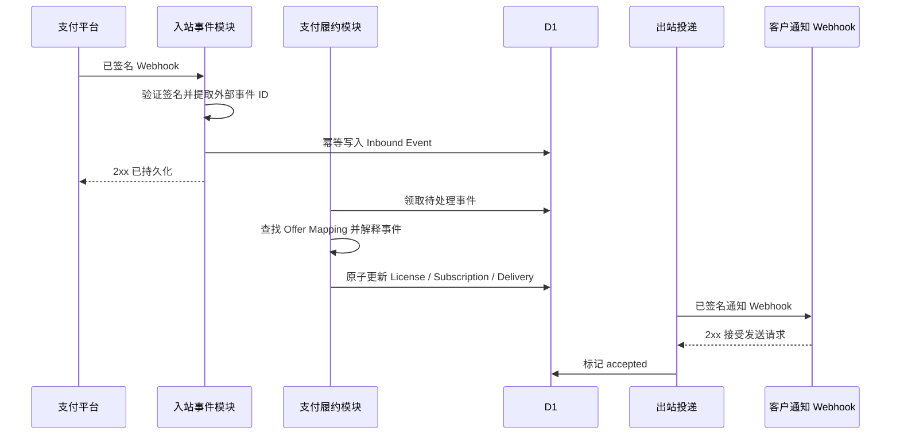
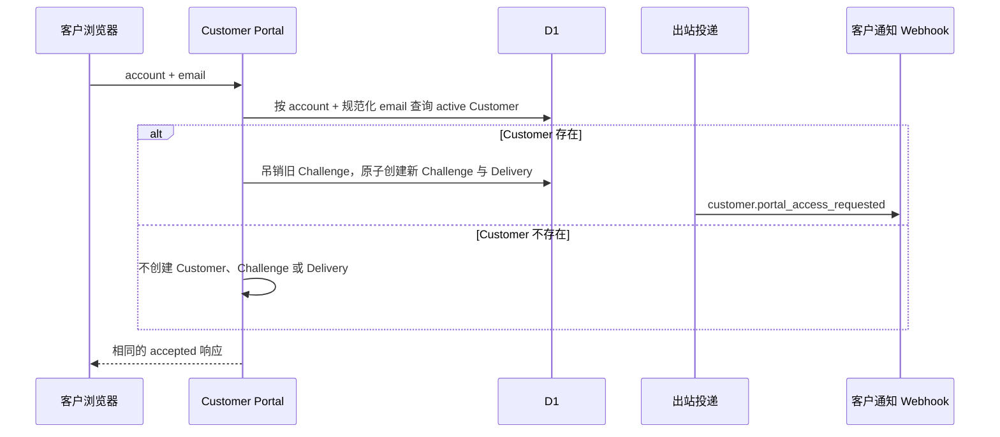
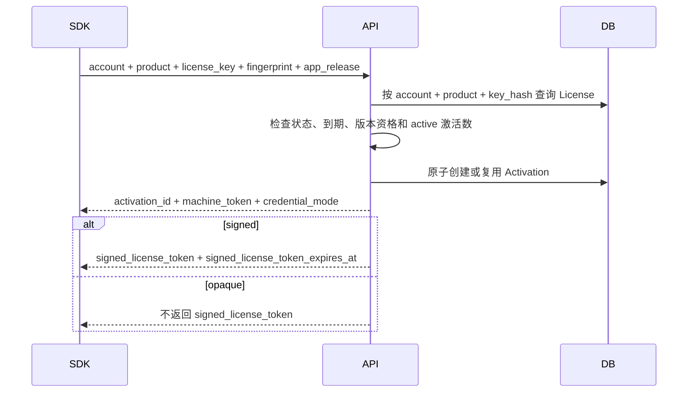

# 核心业务流程

## 1. 购买与履约总览

LicenKit 不创建支付订单。它接收支付平台已经签名的 Webhook，并把其中的购买事实转换为授权状态。



入站接口在事件被可靠写入后即可返回。请求上下文可以立即尝试处理该事件以降低延迟；无论即时处理是否成功，数据库中的待处理记录都是恢复来源，Scheduled Worker 会扫描到期任务并继续履约。

## 2. Offer Mapping

支付价格与授权方案使用独立映射表关联：

```text
billing_provider_id + external_price_id
  -> Product
  -> License Plan
  -> purchase_type(one_time | subscription)
```

禁止以下回退：

- 找不到价格映射时选择“唯一启用的授权方案”；
- 缺少客户邮箱时构造占位邮箱；
- 无法识别事件时仍标记为成功履约。

发生这些情况时，Inbound Event 进入 `failed` 或 `needs_attention`，保留原始错误并允许配置修复后重放。

## 3. 买断与固定期限

### 3.1 首次付款成功

在同一个数据库事务中：

1. 锁定并再次检查 Inbound Event 未履约；
2. 根据 Offer Mapping 读取授权方案；
3. 使用规范化购买邮箱查找或创建 Customer；
4. 生成 License ID 和高熵注册码，并通过 `customer_id` 归属 Customer；
5. 保存注册码哈希和授权条款快照；
6. 对固定期限授权计算 `expires_at`，永久授权保持为空；
7. 对限制更新期限的永久授权计算 `updates_until`，永久全版本授权保持为空；
8. 创建 `customer.license_issued` Delivery，敏感负载中包含一次性注册码；
9. 将 Inbound Event 标记为已处理并保存结果引用。

事务提交后，注册码不再以 License 字段明文保存。

`updates_until` 的计算基准必须稳定：支付签发优先使用支付事件中可信的购买生效时间，手动签发使用 License 创建时间。Webhook 延迟、重放或后台重试不能把更新窗口向后顺延。

### 3.2 同一交易重复通知

唯一约束命中后返回已有事件的处理状态，不再次创建 License 或 Delivery。

## 4. 订阅制

### 4.1 首次订阅付款

首次付款成功时创建：

- 一个 License；
- 一个绑定该 License 的 Billing Subscription；
- 一条发码 Delivery。

License 到期时间优先使用支付平台提供的当前周期结束时间，而不是本地执行“现在加一个月”。

### 4.2 续费成功

续费必须通过外部订阅 ID 查找到原 Billing Subscription 和 License：

1. 更新订阅状态、价格和当前周期；
2. 将同一个 License 的 `expires_at` 更新为新的周期结束时间；
3. 如 License 仅因支付逾期而暂停，则恢复为 active；
4. 产生 `subscription.renewed` 业务事件；
5. 不生成新注册码，不发送首次发码邮件。

### 4.3 扣款失败

收到扣款失败或 `past_due` 事件时：

- Billing Subscription 立即记录为 `past_due`；
- License 在已付周期和固化的 `payment_grace_seconds` 内保持可用；
- 宽限期结束仍未恢复付款时，License 转为 `suspended`；
- 后续付款成功可恢复同一个 License。

具体默认宽限期仍待确认，但宽限期数值属于已售授权条款，不能由后续授权方案编辑追溯改变。

### 4.4 取消自动续费

“安排在周期结束时取消”只设置 `cancel_at_period_end`，License 在当前已付周期内继续有效。

当取消真正生效后，License 根据外部 `current_period_end` 到期。不得仅凭事件名称在收到取消事件时立即吊销，否则会剥夺用户已经付款的剩余时间。

### 4.5 升级与降级

升级或降级是显式操作：

1. 支付平台把订阅切换到新的外部价格；
2. Webhook 命中新 Offer Mapping；
3. LicenKit 在支付平台指定的生效时间应用新的 License Terms；
4. 记录旧条款、新条款和来源事件。

普通授权方案编辑不会触发存量订阅升级。

### 4.6 退款与拒付

退款和拒付必须保留原始支付状态与事件。V1 默认动作仍待业务确认，但只能在以下显式语义中选择：

- `suspend`：停止使用但允许人工恢复；
- `revoke`：终止 License，并吊销全部激活。

禁止把退款、拒付、取消和扣款失败统一映射成同一个状态。

## 5. License 签发与通知不是同一状态

License 创建成功后，即使通知 Webhook 尚未配置或投递失败，授权事实也已经存在。管理控制台必须分别展示：

- License 履约状态；
- 注册码通知状态；
- 最近一次投递错误；
- 可执行的恢复动作。

如果没有启用的 `notification_gateway`，创建 License 的事务应成功，但同时创建状态为 `blocked_configuration` 的 Delivery。系统不得静默丢弃，也不得假装邮件已发送。

## 6. 通知 Webhook 发码

### 6.1 配置

账户配置一个通知 Webhook：

- 接收 URL；
- 用于 HMAC 签名的共享 Secret；
- 是否启用；
- 请求超时；
- 最大尝试次数；
- 允许的通知事件类型。

LicenKit 不保存 Resend API Key、SMTP 密码、发件人域名或邮件模板正文。外部接收方负责把语义化事件转换为实际邮件。

### 6.2 发码负载

```json
{
  "id": "dly_01...",
  "type": "customer.license_issued",
  "created_at": "2026-09-19T10:00:00Z",
  "recipient": {
    "email": "buyer@example.com"
  },
  "data": {
    "product_id": "prd_01...",
    "product_name": "Example App",
    "license_id": "lic_01...",
    "license_key": "LK-XXXXXX-XXXXXX-XXXXXX-XXXXXX-XX",
    "license_model": "subscription",
    "expires_at": "2026-10-19T10:00:00Z",
    "updates_until": null
  }
}
```

外部接收方必须按 `id` 幂等处理。LicenKit 的 HTTP 重试会保持 Delivery ID、目标 URL、签名 Secret 快照和负载不变；端点配置或 Secret 的后续修改只影响新 Delivery，不能让同一逻辑消息在重试中改变目标或签名身份。

### 6.3 Webhook 签名

```http
X-LicenKit-Delivery: dly_01...
X-LicenKit-Timestamp: 1789783200
X-LicenKit-Signature: v1=<hex hmac sha256>
```

签名原文为：

```text
<timestamp>.<raw_request_body>
```

接收方应验证签名、时间窗口和 Delivery ID 幂等性。

### 6.4 成功语义

- HTTP 2xx：接收方已接受请求，Delivery 标记为 `accepted`；
- HTTP 非 2xx：记录原始状态码和截断后的响应体，按策略重试；
- 网络或 TLS 错误：记录原始传输错误，按策略重试；
- 达到最大尝试次数：标记 `failed`，等待人工处理。

`accepted` 不等于邮件已经进入收件箱。V1 不虚构最终邮件投递状态。

### 6.5 Magic Link 通知

Customer Portal 登录使用独立事件 `customer.portal_access_requested`。负载包含 Customer 邮箱和一次性访问 URL，不包含注册码。Magic Link Token 与注册码同样属于敏感凭证：

- 服务端只在登录 Challenge 中保存 Token 哈希；
- 明文 Token 只进入加密 Delivery 负载和最终访问 URL；
- 自动 retry 复用同一个 Challenge、Delivery 和 Token；
- Challenge 一旦消费、吊销或过期，即使旧邮件再次送达也不能建立会话；
- Challenge 到期后，尚未发送或等待重试的 Delivery 进入 `payload_expired` 并清除访问 URL，不再发送无效链接；
- 日志、审计和普通管理响应不得返回完整 Token 或访问 URL。

## 7. Retry、再次发送与注册码找回

三个动作不能混用：

| 动作 | 使用场景 | 注册码是否变化 | 已有激活是否变化 |
| --- | --- | --- | --- |
| Retry Delivery | 同一条 Webhook 投递暂时失败 | 不变 | 不变 |
| Recover License Key | 用户忘记注册码，需要再次发送 | 轮换新码 | 保留 |
| Security Reset | 注册码疑似泄露 | 轮换新码 | 全部吊销 |

### 7.1 自动重试

自动重试使用同一个 Delivery、目标与签名配置快照，以及同一个加密敏感负载。License 表仍然只保存注册码哈希。

### 7.2 普通找回

1. 通过已验证的邮箱找回流程或管理员操作确定目标 License；
2. 生成新注册码并替换 `key_hash`；
3. 增加 `key_version`，记录轮换原因；
4. 保留全部 active 激活；
5. 创建新的 `customer.license_recovered` Delivery；
6. 旧注册码立即失效。

人工界面应写“生成新注册码并发送”，不能写“重发原注册码”。

### 7.3 安全重置

在普通找回基础上，把全部 active 激活改为 revoked，使所有设备必须使用新注册码重新激活。

## 8. 敏感投递负载生命周期

可靠投递与注册码单向哈希之间存在一个必要条件：在投递完成前，系统必须能重建同一条发码请求。

V1 采用以下规则：

1. 注册码明文只写入经过 `STORAGE_ENCRYPTION_KEY` 加密的 Delivery 敏感负载；
2. License 表只保存哈希；
3. Retry 期间解密同一负载；
4. Delivery 成功并超过配置的保留期后清除敏感负载；
5. 敏感负载已清除后，任何再次发送都必须执行注册码找回轮换。

具体保留时长待确认，开发环境和正式环境使用同一机制，只允许配置值不同。

## 9. Customer Portal

### 9.1 请求 Magic Link



请求按账户、邮箱和来源 IP 限流。无论 Customer 是否存在，公开响应的状态码、内容、缓存头和最短响应时间策略保持一致，并在两个分支使用相同的小幅随机抖动，降低通过稳定时差枚举购买者邮箱的风险。

Magic Link Token 使用高熵随机值。服务端只保存哈希、过期时间、消费时间和吊销时间。同一 Customer 请求新链接时，必须在同一事务中吊销此前所有未消费 Challenge，并停止其关联 Delivery 的后续投递，避免多个有效入口并存。

链接使用同源页面的 URL Fragment 携带 Token，例如 `/customer/auth#token=...`；Fragment 不进入首个 HTTP 请求。落地页不得加载第三方脚本、图片或字体，响应设置 `Referrer-Policy: no-referrer`。页面脚本读取 Token 后立即通过 `history.replaceState` 清除地址栏，但 GET 和页面加载本身绝不消费 Challenge；只有用户显式点击“继续登录”后才以 POST 消费，避免邮件安全扫描器或链接预览提前使链接失效。消费时必须在一个事务中完成“确认未过期、未消费且未吊销，只创建一个与 Challenge 唯一绑定的 Customer Session，标记已消费”，并保证并发请求最多只有一个成功。

Customer Session 使用 HttpOnly、Secure、SameSite=Lax 的 host-only Cookie。浏览器只持有随机会话 Token，D1 只保存哈希；默认绝对有效期为 7 天，退出登录、过期或 Customer 被禁用后不能继续访问。所有写操作还必须验证同源请求，不能只依赖 Cookie。

Magic Link 默认有效 15 分钟。释放设备、轮换注册码、安全重置和创建支付平台门户会话属于敏感动作，必须要求当前 Session 的 Magic Link 验证时间在最近 15 分钟内；超出窗口返回 `CUSTOMER_RECENT_AUTH_REQUIRED`，客户通过新 Magic Link 重新认证后再执行。三个时长都允许显式配置，但测试与正式环境使用相同机制。

### 9.2 查看授权与设备

Customer Portal 只查询当前 Session 对应 Customer 的数据，可以展示：

- License 状态、授权模型、到期时间和版本更新截止时间；
- 当前 Subscription 状态、周期结束时间和是否已安排取消；
- Activation 名称、平台、激活时间、最近验证时间和状态。

所有查询必须在数据库条件中包含 `account_id + customer_id`。禁止先按 License ID 读取后再只在应用内判断归属。

### 9.3 释放设备席位

客户选择某个 active Activation 后，服务端必须同时校验该 Activation 所属 License 的 `customer_id` 与当前 Session 一致。成功后将状态改为 `deactivated`、写入时间和 Customer 审计，不删除记录。

客户释放设备不等于吊销 License，也不影响其他 Activation。管理员因安全或违规执行的 `revoked` 仍使用独立管理接口和审计语义。

### 9.4 找回与安全重置

完成最近认证的 Customer 可以对自己的 License 执行：

- 普通找回：轮换注册码、保留 active Activation、在当前页面一次性展示新码并创建找回通知；
- 安全重置：轮换注册码、吊销全部 active Activation、在当前页面一次性展示新码并创建安全重置通知。

两者使用独立接口和确认文案。Customer 不能暂停、恢复、吊销 License，不能修改 License Terms、`expires_at` 或 `updates_until`。

成功页面一次性展示新注册码并同时创建通知 Delivery；响应使用 `Cache-Control: no-store`，前端不得写入本地存储、日志或分析事件，离开页面后不再保留。Notification Gateway 失败不回滚已经完成的注册码轮换，页面必须独立展示通知状态。

### 9.5 管理订阅

Customer Portal 不直接修改 `cancel_at_period_end`、Subscription 状态或 License 到期时间。客户点击“管理订阅”时：

1. 服务端校验 Customer 对 License 和 Billing Subscription 的归属；
2. Billing Adapter 使用对应外部 Customer/Subscription 标识创建短期支付平台客户门户会话；
3. Portal 跳转到支付平台返回的 URL；
4. 客户在支付平台修改支付方式、自动续费或取消；
5. LicenKit 等待已签名 Webhook 更新 Subscription 和 License。

支付平台不支持客户门户、缺少 API Secret 或外部 Customer 标识时，应返回保留 provider 信息的明确配置错误，不能生成一个本地“取消成功”结果。

## 10. 客户端激活



机器令牌每次激活生成，只把哈希写入服务端。在线验证必须同时匹配账户、产品、Activation、机器令牌和设备指纹。

SDK 只提交 App 的 `release_version + release_platform`，设备平台另行用于 Activation 诊断。服务端必须在当前 `account_id + product_id` 下查找对应 Product Release，并使用受信记录中的 `released_at`。未知 Release 返回 `PRODUCT_RELEASE_UNKNOWN`；当永久 License 存在 `updates_until` 且受信 `released_at > updates_until` 时，返回独立的 `UPDATE_ENTITLEMENT_REQUIRED`，不能把它归一化成 License 过期或吊销。

`signed` 模式把 Release ID、版本、平台、受信 `released_at` 和 `updates_until` 一并写入 Signed License Token，SDK 使用这些签名字段执行本地检查。Release 文件 Hash 只用于发布审计和下载完整性，不作为客户端远程证明。

## 11. 授权方案修改

- 修改授权方案：revision 加一，只影响新 License；
- 归档授权方案：禁止新签发，已有 License 不受影响；
- 应用到已有 License：显式批量迁移，展示预计影响数量和字段；
- 修改凭证模式：不得原地迁移存量 License，除非确认客户端已经具备对应能力；
- 修改 `update_window_seconds`：只影响以后签发的 License；
- 延长已售 License 的版本更新权益：显式更新 `updates_until` 并记录前值、后值和业务来源，不更换注册码；
- Product 停用与 License 吊销是不同操作，不得由授权方案状态代替。
