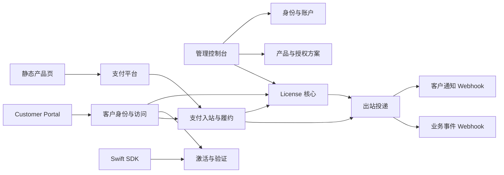

# 系统架构

## 1. 架构结论

V1 使用 Cloudflare Workers、D1、Scheduled Triggers、Turnstile、Hono、Drizzle、React 和 Swift。自部署版本不使用 Cloudflare KV、Durable Objects 或 Queues，也不实现 LicenKit Cloud 控制面；需要重构的是领域边界、数据模型和可靠投递流程，不是更换主要技术栈。

系统按职责分为九个后端/授权模块，并把产品购买页视为独立静态前端。模块之间通过明确接口和持久化事实协作，支付、授权、客户访问和通知不共享隐式状态。



## 2. 模块职责

### M01 身份与账户

负责首次安装、管理员登录、角色、账户边界和审计上下文。

不负责 Customer 身份或 Customer Session。管理员 User 与购买者 Customer 是不同概念，不共享会话和权限模型。

管理员登录使用账户标识、邮箱和密码建立服务端可吊销 Session：浏览器 Cookie 保存账户选择器和高熵随机 Token，D1 只保存 Token 哈希。账户选择器仅用于构造 `account_id + token_hash` 查询，必须与 Session 数据库记录共同匹配，不能单独作为身份。每次请求都重新校验 Session、Account 状态、User 状态和当前角色，因此禁用用户或修改角色立即生效，不能把长期有效的角色声明只信任在客户端 Cookie 中。

独立部署在数据库完全未初始化时开放一次性 Setup 页面。Setup 至少收集实例/初始 Account 名称、管理员姓名、邮箱和密码，并要求输入部署时配置的 `INITIAL_SETUP_TOKEN`。服务端在一个 D1 原子批次中创建 `system_settings`、首个 Account、首位 owner User 和管理员 Session；任一步失败全部回滚。成功后以 `system_settings(id='current')` 为数据库闩锁永久关闭 Setup，后续请求返回 `SETUP_ALREADY_COMPLETED`。

Setup 是否可用必须同时满足 `system_settings`、Account 和 User 均为空，不能只依赖前端隐藏页面。`INITIAL_SETUP_TOKEN` 只用于首次初始化，按 Secret 管理、常量时间比较、不得进入 URL 或日志，完成后可从部署环境移除。

身份模块保留内部 `AccountProvisioningService.createAccountWithOwner(...)` 领域接口，负责同账户创建和默认拒绝角色约束；Setup Service 在同一原子批次中组合该接口与实例初始化。V1 只有 Setup Adapter 可以调用，不暴露 Cloud API、公开 Account 注册或 Cloud Adapter。未来 Cloud 如进入范围，只增加调用该领域接口的受信 Adapter，不复制账户创建逻辑或绕过多账户约束。

### M02 产品与授权方案

负责 Product、Product Release、签名密钥和 License Plan。

授权方案只用于以后签发，不参与存量 License 的实时判定。它保存可选的相对更新窗口，签发时解析为 License 的绝对 `updates_until`。Product Release 是版本发布时间的服务端事实来源；客户端只提交版本和平台。签名密钥属于 Product；`opaque` 凭证模式不要求签名密钥，`signed` 凭证模式必须有可用密钥。

### M03 License 核心

负责：

- 注册码生成、规范化和哈希；
- License Terms 快照；
- 永久、固定期限、手动续期订阅与支付续期订阅的生命周期；
- 状态、到期、暂停和吊销；
- 永久 License 的版本更新权益；
- 手动订阅的显式续期；
- 普通找回与安全重置；
- 显式权益迁移。

License 核心不直接发送 HTTP Webhook，只在事务中创建 Outbound Delivery。

### M04 激活、试用与验证

负责 Activation、机器令牌、最大激活数、Product Release 版本资格、在线验证、解绑、Signed License Token 签发，以及独立的 Trial Claim 领取与在线校验。

所有席位判断使用 License Terms，不读取当前 License Plan。

Trial Claim 不复用 License 或 Activation 状态机。它只表示无需支付方式的 Product/设备级试用，保存设备领取事实、Trial Token 哈希、功能快照和绝对到期时间；V1 不为这类试用签发离线凭证。要求支付方式的 Paddle 免费订阅试用属于 M05，使用正常 License 与 Billing Subscription。

### M05 支付入站与履约

负责：

- 支付平台配置和签名验证；
- Billing Customer 镜像、外部 Customer ID 到 LicenKit Customer 的稳定映射；
- Customer Webhook 同步，以及配置 API Key 后可选的 Paddle API 读穿与定期对账；
- 外部价格到授权方案的映射；
- Offer 激活前的收款就绪判断；
- Product 收款环境隔离、管理员一次性 Checkout Verification；
- Inbound Event 幂等持久化；
- 买断、固定期限和订阅状态转换；
- Adjustment 状态映射、自动暂停和管理员处置；
- Paddle 要求支付方式的免费订阅试用，以及 `trialing` 到 `active`/`past_due` 的转换；
- 为已授权 Customer 创建支付平台托管的客户门户会话；
- 把 Provider 共享能力故障去重为 System Issue，并保持与单个 Inbound Event 错误的关联；
- 失败重放和乱序事件保护。

每个支付平台使用 Adapter 将原始事件转换为内部语义。Adapter 不直接写 License，统一 Fulfillment Service 执行领域动作。

Customer Webhook 和 Paddle Get Customer API 必须进入同一个 `BillingCustomerSyncService.upsertAndLink(...)` 领域入口。该服务只接受已验签事件数据或服务器端认证 API 响应，拒绝 `custom_data.email` 等客户端自定义字段。首次链接时可以按规范化邮箱查找或创建 Customer；一旦外部 Customer ID 已链接，后续同步只能更新 provider 镜像和一致性状态，不能静默改绑内部 Customer。

`BillingCustomerSyncService` 是跨 Adapter 的领域服务，不是 Paddle 专用表访问层。Adapter 必须传入当前 Account、已解析的 Billing Provider 连接、外部 Customer ID 和受信 Customer 快照；服务只用 `account_id + billing_provider_id + external_customer_id` 查询映射。Provider ID 同时隔离平台、环境和账户，因此 Paddle、未来 Stripe 及 sandbox/live 的外部 ID 不会互相碰撞。领域服务不得从所有 Billing Customer 载入内存后按 ID 或邮箱扫描。

Provider API 的 `401/403` 同时产生事件级错误和 Provider 能力级 System Issue。事件保存本次 HTTP 状态、Provider 原始错误码、request ID 与 message；System Issue 以账户、Provider、能力和问题代码去重。Scheduler 跳过 `blocking_system_issue_id` 非空的事件；管理员验证配置修复后，可以选择是否解除这些事件的阻塞并把仍可重放的记录重新排入完整状态机。仅解决 Issue 不能隐式唤醒事件、清空事件错误或调用发码服务。

Paddle Provider 必须保存与环境匹配的 Client-side Token 和加密 Webhook Secret。Client-side Token 是 Paddle.js 的公开受限凭证，静态产品页可以直接配置同一个值；Webhook Secret 只能在服务端验签。Paddle API Key 是可选的服务端凭证，加密保存在 `billing_providers.api_secret_ciphertext`：启用 Get Customer/对账需要 `customer.read`，启用托管客户门户需要 `customer_portal_session.write`。它不能发送到浏览器或通知接收方。未配置 API Key 时，购买事件等待 Customer Webhook 后重试；配置后的 API 读穿发生在 Webhook 已持久化并返回 2xx 之后，超时或限流只让 Inbound Event 保持 `pending`。

Billing 模块对每个普通购买事件使用已验签 Transaction 行项目执行授权检查：只接受一个 active Offer Price、数量为 1，且 Offer Provider 环境等于 Product 的 `billing_environment`。静态页面参数从来不是安全边界。唯一例外是命中未过期、未消费且绑定当前 draft Sandbox Offer 的 Checkout Verification；该例外仍复用统一 Fulfillment，但强制生成不可激活的验证 License。退款和拒付同样由 Adapter 规范化为 Billing Adjustment；自动动作只包括对已批准全额退款与 `action=chargeback` 暂停 License，其他情况进入人工处理。

Billing 模块只能推进 `renewal_mode=billing` 的 License，并要求存在同账户 Billing Subscription；它不得修改 `renewal_mode=manual` 的到期时间。反过来，License 核心的手动续期操作也不得修改 Billing Subscription 或支付续期 License。

V1 只要求 Paddle Adapter 完成真实 Sandbox 闭环。Adapter 注册表对未实现的 provider 默认拒绝；后续支付平台只能增加 Adapter，不能增加第二套履约状态机。

### M06 出站投递

负责通知 Webhook 和业务事件 Webhook：

- Endpoint 配置与 HMAC Secret；
- Delivery 持久化；
- Attempt 记录；
- 自动重试和人工 retry；
- 敏感负载加密和到期清理。

LicenKit 不包含 Resend、SMTP 或特定邮件服务商客户端。Magic Link 邮件同样通过 Notification Gateway 投递。

### M07 客户身份与访问

负责 Customer、Magic Link、Customer Session 和 Customer Portal API：

- 支付履约或人工签发时创建或匹配 Customer；
- 在 Magic Link 请求查询 Customer 前完成 Turnstile 服务端验证；
- 使用现有 Login Challenge 的创建时间在 D1 中执行重复请求冷却；
- 创建一次性登录 Challenge 和通知 Delivery；
- 原子消费 Magic Link 并创建可吊销会话；
- 按当前 Customer 限定 License、Subscription 和 Activation 查询；
- 执行客户设备释放、注册码找回、安全重置和支付平台门户跳转。

该模块不提供自主注册、密码登录或管理员能力。它调用 License、Activation 和 Billing 模块完成领域动作，不直接跨表拼装新的状态机。

Customer Portal 属于使用方 Site。LicenKit 只在 `examples/customer-site` 保存参考实现，不把它加入生产构建或 Worker 静态资产；管理控制台位于 `apps/admin`，并由 LicenKit Worker 的 `/admin` 路径发布。Setup 显式保存 `siteUrl`，用于生成邮件中的 Magic Link；当前 `siteUrl` 与 `appUrl` 必须同源。Customer 页面通过同源 `/api/v1` 使用 Customer Session 和 API，不增加第二套服务端状态机。

### M08 管理控制台

负责配置、检索、诊断和显式业务操作。控制台不得自行推导领域状态，应展示服务端返回的状态、错误和可执行动作。

### M09 客户端 SDK

负责设备指纹、Machine Token 和 Signed License Token 的本地保存与验证。SDK 不能把网络异常伪装成服务端确认有效，也不能把未签名缓存称为签名授权凭证。

### 静态产品页与 Admin Checkout

参考产品页和用户自定义产品页静态维护产品、方案、展示价格、Paddle Client-side Token 和 Price ID，直接调用 Paddle.js。页面不调用 LicenKit Checkout API，也不创建 Customer、License 或 Delivery；`checkout.completed`、重定向和成功页都不是支付事实。

管理控制台另有一个内部 Sandbox 验证函数。它只接受 `POST verification-config` 返回的一次性验证配置，把令牌附加到固定的 Paddle custom data 字段并打开一个 Price、数量 1。该函数不是公开 SDK，静态产品页不能取得或构造验证令牌。

## 3. 写入边界与事务

### 3.1 支付事件接收

接收请求时只执行：

1. 读取对应 Billing Provider 配置；
2. 验证原始请求签名；
3. 提取外部事件 ID、类型和发生时间；
4. 提取事件中存在的外部 Customer、Transaction、Subscription 与 Adjustment ID，以唯一约束写入 Inbound Event；
5. 注册一次请求后的即时处理任务；
6. 返回接收结果。

验签失败、配置缺失或无法提取稳定事件 ID 时直接失败，不写入待履约事件。

即时处理只用于降低正常路径延迟，不承担可靠性。事件一旦写入 D1，即使即时处理没有运行、被中断或失败，Scheduled Worker 仍会根据持久状态继续处理。

### 3.2 履约事务

一次履约事务至少同时提交：

- License 或 Billing Subscription 的变更；
- Inbound Event 的最终处理状态；
- 需要发送的 Outbound Delivery；
- 必要的审计记录。

禁止先创建 License，再在事务外创建发码任务。否则进程中断会产生无法补发的注册码。

永久 License 签发时，`update_window_seconds` 必须在事务内解析为 `updates_until`。支付事件重放不得使用新的处理时间重新计算该值。

手动签发必须在同一原子批次中固定 `renewal_mode`：永久和固定期限为 `none`，手动订阅为 `manual`。手动订阅的未来 `expires_at`、零支付宽限期、License 和 Delivery 必须共同提交；显式续期只允许把同一个手动订阅 License 延长到更晚的绝对时间，并同时写审计。相同绝对时间的请求重放返回当前结果，不能再次累加期限。

Paddle 免费订阅试用进入同一支付履约事务：根据已验签的试用周期创建 `subscription + billing` License 与 `trialing` Billing Subscription，并保存试用开始、结束和下一扣款时间。后续成功扣款只更新同一对象，不能把试用转正实现为再次签发。

Paddle 的订阅创建相关事件可能乱序到达。Fulfillment 使用 Inbound Event 中可索引的外部 Transaction/Subscription ID 关联 `subscription.created` 与 `transaction.completed`；事实不足时保留 `pending`、写入 `BILLING_DEPENDENCY_PENDING` 并退避重试，关联事件到达后再提交完整履约。不能创建缺少周期的半成品 Billing Subscription，也不能把暂缺关联事件标成不可恢复的成功。

购买履约还必须先把事件中的外部 Customer ID 解析为 `billing_customers.customer_id`。本地没有映射时保持 `BILLING_CUSTOMER_PENDING` 并等待 Customer Webhook；Provider 配置了对应 API Key 时可以调用 Paddle Get Customer 并走统一同步服务以加速恢复。API 失败与 Customer Webhook 尚未到达都属于可重试依赖。`email_mismatch`、明确无效或等待超过显式上限时进入 `needs_attention`。这个依赖只限制新 License 签发；已有 Subscription 的续费直接命中原 License，不重新按邮箱解析 Customer。

普通支付 License 的创建事务必须读取 Product、Offer 与 Billing Provider，确认 Product 已选择收款环境、Offer active 且 Provider 环境一致。Checkout Verification 则必须通过令牌哈希等值查询和条件更新原子消费一个仍有效的 attempt，并在同一事务中把 License 固化为 `is_checkout_verification=1`、`suspended + checkout_verification`。验证 Delivery 被接收后再把 attempt 标记为 completed；令牌不能再次使用。

激活与在线校验在读取 License 后首先拒绝 `is_checkout_verification=1`，返回独立的 `LICENSE_CHECKOUT_VERIFICATION_ONLY`。这一检查不能被管理员恢复 License、方案迁移或普通状态编辑绕过。

### 3.3 注册码找回事务

普通找回必须同时提交：

- 新 `key_hash` 和 `key_version`；
- key rotation 审计；
- 包含新注册码密文的 Delivery。

安全重置还要在同一事务中吊销全部 active Activation。

### 3.4 Magic Link 与 Customer Session

请求 Magic Link 时先验证 Turnstile Token、固定 action 和 `site_url` hostname。验证失败时在 Customer 查询之前拒绝；验证成功后，只有在 active Customer 存在且最近一条 Challenge 已超过默认 60 秒冷却期时，才在一个 D1 原子批次中创建：

- 只保存 Token 哈希的 Login Challenge；
- 包含一次性访问 URL 密文的 Notification Delivery；
- 必要的审计事实。

公开接口无论 Customer 是否存在都返回相同的接受语义。不存在的邮箱不能隐式注册 Customer。

冷却判断不能采用批次外先查再写。批次先通过 `INSERT ... SELECT ... WHERE NOT EXISTS` 对最近 Challenge 作条件写入；只有新 Challenge 与 Delivery 确实创建，后续语句才吊销同一 Customer 仍未消费的旧 Challenge，并停止旧 Delivery 重试。冷却命中时不创建记录，也不破坏旧链接。消费 Magic Link 时使用条件写入保证 Challenge 未过期、未消费、未吊销且 Customer 仍为 active；Customer Session 通过唯一 `login_challenge_id` 与 Challenge 绑定，并与 `consumed_at` 在同一个原子批次中提交，因此并发消费只能有一个请求成功。每次使用 Customer Session 仍要验证 Session 未过期、未吊销且 Customer 为 active，不能只在登录时检查一次。

客户释放 Activation、找回注册码、安全重置和创建支付门户 Session 都必须在持久层查询中带上当前 `account_id + customer_id`，验证最近认证窗口，并记录 `actor_type=customer` 的审计。不能只依赖前端隐藏按钮或应用层事后比对归属。

### 3.5 D1 原子写入规则

D1 不提供让应用任意停留在事务中间的交互式事务。所有需要共同成功或共同失败的多语句写入必须预先生成 ID 和随机凭证，再通过一次 `D1Database.batch()` 提交；`batch()` 中任一语句失败，整个批次回滚。禁止在批次外先 `SELECT`，再根据旧结果执行多个独立写入。

需要条件成立才能写入的流程还要有数据库断言：

- Magic Link 使用条件 `INSERT ... SELECT`、Challenge 唯一 Session 约束和同批条件更新；
- 支付履约同时依赖事件唯一键与外部交易业务唯一键；
- 激活数上限由数据库 Trigger 在插入或重新激活前检查，不能仅依赖应用层计数；
- 后台任务通过带状态和租约条件的单条 `UPDATE` 领取，并检查实际受影响行数。

## 4. D1 Outbox 与 Scheduled Worker

D1 中的 `inbound_events` 和 `outbound_deliveries` 是后台任务的事实来源。V1 不使用 Cloudflare Queues，也不依赖进程内任务列表。

```text
请求持久化 pending 记录
        │
        ├── 请求后立即尝试处理 -> 降低正常延迟
        │
        └── Scheduled Worker 每分钟扫描到期任务
                  │
                  ├── 原子领取租约
                  ├── 执行履约或 HTTP 投递
                  └── 成功 / 安排重试 / 等待人工处理
```

### 4.1 即时处理

HTTP Handler 可以通过 Worker 请求上下文启动一次即时处理，但必须先提交 D1 记录。即时处理失败只更新同一条事件或 Delivery 的状态和下次执行时间，不能创建一条无关联的新任务。

即时处理不能成为唯一执行路径，因为请求后的后台工作可能超时或中断。其作用只是让正常支付履约和发码通常在秒级完成。

### 4.2 定时恢复

Scheduled Worker 默认每分钟执行。它先分页读取 active Account ID，再对每个 Account 使用带 `account_id` 的有界索引查询：

- 到达 `next_attempt_at` 的待履约 Inbound Event；
- 到达 `next_attempt_at` 的待发送 Delivery；
- `locked_until` 已过期但仍处于 processing 的任务。

查询必须使用状态、调度时间和租约索引下推到 D1，不允许加载全表后在内存筛选。

### 4.3 租约与重复执行

处理器使用条件更新原子领取任务，写入 `locked_by` 和 `locked_until`。只有成功取得租约的实例可以执行；实例崩溃后，其他实例在租约过期时重新领取。

租约不能提供 exactly-once。外部接收方可能已经成功接受请求，而 LicenKit 在写回 `accepted` 前中断，因此：

- 履约动作必须受事件唯一约束和领域幂等键保护；
- 出站接收方必须按 Delivery ID 幂等；
- 每次 HTTP 尝试都写入独立 Attempt；
- 重试复用同一个 Delivery ID 和加密负载。
- Delivery 创建时固化目标 URL 和加密签名 Secret；Endpoint 或 Secret 后续轮换只影响新 Delivery。
- Delivery 默认最多 4 次自动 HTTP Attempt，即首次请求加 3 次自动重试；凭证或负载到期可以提前结束。
- Attempt 明确记录 `initial`、`automatic_retry` 或 `manual_retry`；人工 retry 只追加一次请求，不重置 Delivery 的自动预算。
- Notification Gateway 返回 2xx 后立即清除敏感负载；未成功负载按 Delivery 固化的截止时间清理，默认最长 24 小时，Magic Link 以 Challenge 的更早到期时间为上限。

## 5. 事件顺序与并发

支付 Webhook 可能重复、延迟或乱序。Billing Subscription 保存 `last_external_occurred_at` 和最后事件 ID。

处理订阅事件时：

- 较旧事件不得覆盖较新的订阅周期或状态；
- 被忽略的旧事件仍标记为 processed，并记录 `ignored_as_stale` 结果；
- 同一外部订阅的更新在数据库事务中串行检查；
- 续费事件不得依赖“读取后在内存中加一个周期”的结果。

设备激活同样使用数据库约束和事务判断 active 数量，不能只做先查数量再插入的无保护流程。

## 6. 错误模型

错误必须保留以下层次：

```json
{
  "code": "BILLING_OFFER_MAPPING_MISSING",
  "message": "No active offer mapping matches the external price.",
  "details": {
    "provider": "paddle",
    "external_event_id": "evt_...",
    "external_price_id": "pri_...",
    "provider_event_type": "transaction.completed"
  }
}
```

规则：

- 对外响应可以脱敏，但内部事件保留可回溯的原始错误；
- 支付平台错误、HTTP 状态、数据库错误和业务拒绝不能被统一压缩成一个错误码；
- 敏感字段按字段过滤，不隐藏整个原始包体；
- Inbound Event 错误描述单个事件，System Issue 描述多个任务共享的配置或外部能力故障；两者都必须保留，不能互相覆盖；
- 同一 System Issue 按账户、资源、能力和错误代码去重，request ID 与 message 只作为最近诊断，不参与去重；
- 关闭 System Issue 不自动修改关联任务；管理端必须明确展示是否重新处理、可处理数量和跳过原因；
- 所有异步失败都必须能从控制台查询，并只对仍满足前置条件的原始工作单元执行受控重试。

## 7. 配置模型

### 7.1 环境 Secrets

- `STORAGE_ENCRYPTION_KEY`：保护支付 Secret、出站 HMAC Secret、签名私钥和敏感 Delivery 负载；
- `INITIAL_SETUP_TOKEN`：独立部署首次初始化的高熵一次性 Secret；完成 Setup 后不再读取；
- `TURNSTILE_SITE_KEY`：Customer Portal Magic Link 请求页使用的公开 Widget Sitekey；
- `TURNSTILE_SECRET_KEY`：Worker 调用 Siteverify 的服务端 Secret，不进入浏览器、日志或数据库；
- Cloudflare 资源绑定：自部署 V1 只要求 D1，不要求 KV、Durable Object 或 Queue；
- Scheduled Trigger：负责入站事件履约、出站投递重试和过期租约恢复；全部作业成功后把最近成功时间与耗时写入 D1 `system_settings`，Readiness 不读取 KV 或进程内心跳。

### 7.2 数据库配置

- Billing Provider：支付平台类型、环境、公开 Client-side Token、加密 Webhook Secret、可选服务端 API 凭证和启用状态；
- Paddle API Key 仅用于显式启用的 Customer 读穿、定期对账和托管 Customer Portal 会话；它不是 Webhook Secret，也不能暴露给前端；
- Offer Mapping：外部价格与授权方案映射；默认 `draft`，通过收款就绪检查后才能显式激活；
- Outbound Endpoint：通知或事件 Webhook URL、Secret 和事件范围；
- Account Settings：包括默认 5 天的订阅支付宽限期；创建订阅授权方案时把该默认值解析并保存为方案实际值，不存放支付渠道混合 JSON。

独立表的原因是这些配置需要唯一约束、索引、状态和审计，继续放在 `accounts.payment_configs` JSON 中会使查询和局部更新不可验证。

## 8. 测试与正式环境一致性

测试和正式环境使用相同：

- Webhook 路由；
- 支付 Adapter；
- Fulfillment Service；
- License 和 Subscription 状态机；
- Outbound Delivery 和重试流程；
- SDK 接口和验证路径。

只允许以下配置不同：

- 支付平台 sandbox/live 环境；
- Webhook Secret、域名和资源 ID；
- 测试接收端点；
- 重试时间等显式环境配置。

不得为正式环境增加一条测试环境未经过的“真实发码”旁路，也不得用 Mock 接口替代正式模块接口。

## 9. 安全边界

- `account_id` 是服务端安全上下文：所有 Repository/Service 方法必须显式接收它，所有读取、更新和删除条件都包含它；跨账户外键由数据库复合约束拒绝；
- 管理员 Session 服务端存储且可吊销；所有管理路由必须声明权限，未声明或未命中角色矩阵时默认拒绝；
- 支付 Webhook 必须对原始请求体验签；包括 custom provider 在内都不能跳过签名；
- Paddle Client-side Token 和 Price ID 可以公开，但 API Key、Webhook Secret、通知端点或内部诊断细节不能进入静态产品页；
- 服务端对已验签 Transaction 强制校验一个 Price、数量 1、active Offer 和 Provider/Product 环境一致；draft Sandbox Offer 只接受一次性管理员验证例外；
- 产品私钥、支付 Secret 和出站 HMAC Secret 必须加密持久化；
- 加密字段使用带版本的 AES-256-GCM 信封，保存 key ID、96-bit 随机 nonce、ciphertext 和 tag，并把 `account_id + table + row_id + field` 作为 AAD；轮换期间保留解密旧 key 的能力；
- 注册码和机器令牌只保存哈希；
- Trial Token 只保存哈希，并同时绑定 Account、Product 与设备指纹；重复领取不能返回旧 Token 或延长试用；
- Magic Link Token 和 Customer Session Token 只保存哈希，完整值不得进入日志或普通审计；
- Magic Link 请求页必须使用 Turnstile，并由 Worker 调用 Siteverify 校验成功、单次 Token、固定 action 和 `system_settings.site_url` hostname；Widget 成功回调本身不是安全边界；
- 已存在 Customer 的重复 Magic Link 请求使用 D1 Login Challenge 执行冷却；冷却命中时返回统一 accepted，不创建新通知、不吊销旧链接；
- Magic Link 默认 15 分钟有效且只能消费一次；公开请求不得泄露 Customer 是否存在；
- Magic Link 落地页不得加载第三方资源，使用 URL Fragment 传 Token、`Referrer-Policy: no-referrer`，立即清理浏览器地址；GET 不消费 Token，必须由用户显式动作触发 POST，避免邮件扫描器提前消费；
- Admin 与 Customer Session 必须使用 HttpOnly、Secure、SameSite=Lax 的 host-only Session Cookie；另发与 Session 绑定的 Secure、SameSite=Lax、host-only CSRF Cookie。所有 Cookie 鉴权写操作同时验证精确 Origin、`X-CSRF-Token` Header 与 CSRF Cookie 常量时间相等，并校验 Token Hash 属于当前 Session；SameSite 不能单独替代 CSRF 校验；
- Customer Session 默认有效 7 天；释放设备、注册码轮换、安全重置和支付门户跳转要求最近 15 分钟内完成 Magic Link 验证；
- Customer API 的持久层查询必须同时限定账户和 Customer 归属；
- Customer Portal 不直接修改支付状态，只能跳转支付平台并等待已验签 Webhook；
- 客户端公钥应随应用内置或通过可信发布链固定，不能把同一不可信运行时服务返回的公钥直接作为离线信任根；
- App 只提交版本号和平台；服务端使用 Product Release 的受信 `released_at`，并把 Release 身份与发布时间写入 Signed License Token；
- Signed License Token 固定使用 JWS `alg=EdDSA` 和专用 `typ`，SDK 必须拒绝算法降级、未知 `kid`、错误类型和不符合预期的 Claim；
- 自部署应用不在 Worker 内保存通用限流计数，也不为此引入 KV、Durable Object 或 D1 限流表。部署时必须在 Cloudflare Zone 级 WAF Rate Limiting Rules 配置边缘保护；建议按方法与路径分别覆盖 Setup 写入、管理员登录、管理端写操作、客户端激活/校验/解绑、Trial Claim/校验、Customer 敏感写操作和 Webhook 测试。具体阈值与可用匹配条件由实际流量和 Cloudflare WAF 套餐决定，不写入应用业务合同；
- License Key、Delivery 敏感负载和完整支付包体不能进入普通审计详情或应用日志。

V1 出站 URL 只允许公网 HTTPS：禁止 URL credentials、非标准端口、IP literal、localhost 和已知私网/链路本地/云元数据目标；`fetch` 使用 `redirect: manual`，每个重定向目标重新执行同一策略。Cloudflare Workers 的出站请求还经过平台代理的公网边界，但应用不能把平台限制当成唯一校验。

单独 DNS 预解析无法把后续 `fetch` 固定到同一个 IP，不能独自解决 DNS rebinding。V1 不支持任意私网 URL，也不引入 VPC Service/Tunnel；未来如 Cloud 产品确有私网需求，必须作为新的基础设施能力单独设计和批准。

## 10. 可观测性与就绪检查

Readiness 至少覆盖：

- D1 可读写；
- D1 `system_settings` 记录的 Scheduled Worker 最近一次完整成功执行时间未超过告警阈值；
- 最老的待履约事件和待发送 Delivery 未超过积压阈值；
- `STORAGE_ENCRYPTION_KEY` 可解密一条健康检查样本；
- 启用中的 Billing Provider 配置可解密；
- 使用 `signed` 凭证模式的 Product 存在可用签名密钥；
- 通知功能启用时存在有效 Notification Gateway；
- 部署 Customer Portal 时存在有效 Notification Gateway；
- active Paddle Provider 的 Client-side Token、Webhook Secret 和环境匹配，最小事件合同完整；
- 启用了 Customer API 读穿、定期对账或托管客户门户时，对应 Paddle API Key 可解密、环境和最小权限匹配；
- Turnstile Sitekey/Secret 已配置，Siteverify 可用且 Widget hostname 与 `site_url` 一致；
- 部署检查确认上述 Zone 级 WAF Rate Limiting Rules 已配置；Worker 运行时无法在不引入额外 Cloudflare 管理凭证的情况下自行读取该控制面事实，因此 `/system/readiness` 不伪造这一检查；
- open System Issue 数量、最早发生时间、受影响且仍阻塞的 Inbound Event 数量；
- 每个 active Offer 的 Provider/Product 环境一致性、Notification Gateway 最近测试、真实 Sandbox 端到端验收和当前 Checkout Readiness 状态；
- 待处理或失败事件没有超过告警阈值。

健康检查只报告能力状态，不读取或返回明文 Secret。
