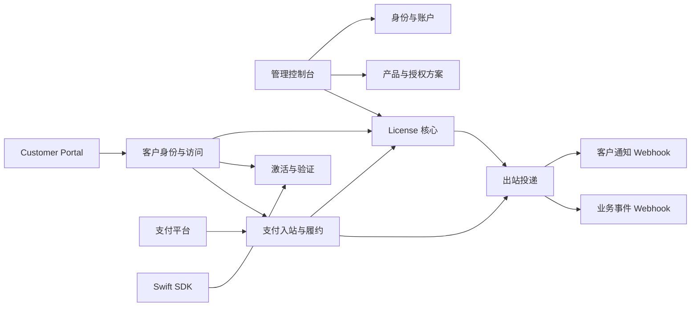

# 系统架构

## 1. 架构结论

V1 使用 Cloudflare Workers、D1、Scheduled Triggers、Hono、Drizzle、React 和 Swift。V1 不使用 Cloudflare Queues，也不实现 LicenKit Cloud 控制面；需要重构的是领域边界、数据模型和可靠投递流程，不是更换主要技术栈。

系统按职责分为九个模块。模块之间通过明确接口和持久化事实协作，支付、授权、客户访问和通知不共享隐式状态。



## 2. 模块职责

### M01 身份与账户

负责首次安装、管理员登录、角色、账户边界和审计上下文。

不负责 Customer 身份或 Customer Session。管理员 User 与购买者 Customer 是不同概念，不共享会话和权限模型。

管理员登录使用账户标识、邮箱和密码建立服务端可吊销 Session：浏览器 Cookie 保存账户选择器和高熵随机 Token，D1 只保存 Token 哈希。账户选择器仅用于构造 `account_id + token_hash` 查询，必须与 Session 数据库记录共同匹配，不能单独作为身份。每次请求都重新校验 Session、Account 状态、User 状态和当前角色，因此禁用用户或修改角色立即生效，不能把长期有效的角色声明只信任在客户端 Cookie 中。

独立部署在数据库完全未初始化时开放一次性 Setup 页面。Setup 至少收集实例/初始 Account 名称、管理员姓名、邮箱和密码，并要求输入部署时配置的 `INITIAL_SETUP_TOKEN`。服务端在一个 D1 原子批次中创建 `system_settings`、首个 Account、首位 owner User 和管理员 Session；任一步失败全部回滚。成功后以 `system_settings(id='current')` 为数据库闩锁永久关闭 Setup，后续请求返回 `SETUP_ALREADY_COMPLETED`。

Setup 是否可用必须同时满足 `system_settings`、Account 和 User 均为空，不能只依赖前端隐藏页面。`INITIAL_SETUP_TOKEN` 只用于首次初始化，按 Secret 管理、常量时间比较、不得进入 URL 或日志，完成后可从部署环境移除。

身份模块保留内部 `AccountProvisioningService.createAccountWithOwner(...)` 领域接口，负责同账户创建和默认拒绝角色约束；Setup Service 在同一原子批次中组合该接口与实例初始化。V1 只有 Setup Adapter 可以调用，不暴露 Cloud API、公开 Account 注册或 Cloud Adapter。未来 Cloud 如进入范围，只增加调用该领域接口的受信 Adapter，不复制账户创建逻辑或绕过多账户约束。

### M02 产品与授权方案

负责 Product、Product Release、签名密钥和 License Plan。

授权方案只用于以后签发，不参与存量 License 的实时判定。它保存可选的相对更新窗口，签发时解析为 License 的绝对 `updates_until`。Product Release 是版本发布时间的服务端事实来源；客户端只提交版本和平台。签名密钥属于 Product；`opaque` 凭证模式不要求签名密钥，`signed` 凭证模式必须有可用密钥。

### M03 License 核心

负责：

- 注册码生成、规范化和哈希；
- License Terms 快照；
- 状态、到期、暂停和吊销；
- 永久 License 的版本更新权益；
- 普通找回与安全重置；
- 显式权益迁移。

License 核心不直接发送 HTTP Webhook，只在事务中创建 Outbound Delivery。

### M04 激活与验证

负责 Activation、机器令牌、最大激活数、Product Release 版本资格、在线验证、解绑和 Signed License Token 签发。

所有席位判断使用 License Terms，不读取当前 License Plan。

### M05 支付入站与履约

负责：

- 支付平台配置和签名验证；
- 外部价格到授权方案的映射；
- Inbound Event 幂等持久化；
- 买断、固定期限和订阅状态转换；
- 为已授权 Customer 创建支付平台托管的客户门户会话；
- 失败重放和乱序事件保护。

每个支付平台使用 Adapter 将原始事件转换为内部语义。Adapter 不直接写 License，统一 Fulfillment Service 执行领域动作。

### M06 出站投递

负责通知 Webhook 和业务事件 Webhook：

- Endpoint 配置与 HMAC Secret；
- Delivery 持久化；
- Attempt 记录；
- 自动重试和人工 retry；
- 敏感负载加密和到期清理。

LicenKit 不包含 Resend、SMTP 或特定邮件服务商客户端。Magic Link 邮件同样通过 Notification Gateway 投递。

### M07 客户身份与访问

负责 Customer、Magic Link、Customer Session 和 Customer Portal API：

- 支付履约或人工签发时创建或匹配 Customer；
- 创建一次性登录 Challenge 和通知 Delivery；
- 原子消费 Magic Link 并创建可吊销会话；
- 按当前 Customer 限定 License、Subscription 和 Activation 查询；
- 执行客户设备释放、注册码找回、安全重置和支付平台门户跳转。

该模块不提供自主注册、密码登录或管理员能力。它调用 License、Activation 和 Billing 模块完成领域动作，不直接跨表拼装新的状态机。

Customer Portal 与管理控制台可以由同一个 `apps/web` 构建和部署，但使用独立路由、Session Cookie 和 API 权限边界；不需要为 V1 新增 Web 服务或部署单元。

### M08 管理控制台

负责配置、检索、诊断和显式业务操作。控制台不得自行推导领域状态，应展示服务端返回的状态、错误和可执行动作。

### M09 客户端 SDK

负责设备指纹、Machine Token 和 Signed License Token 的本地保存与验证。SDK 不能把网络异常伪装成服务端确认有效，也不能把未签名缓存称为签名授权凭证。

## 3. 写入边界与事务

### 3.1 支付事件接收

接收请求时只执行：

1. 读取对应 Billing Provider 配置；
2. 验证原始请求签名；
3. 提取外部事件 ID、类型和发生时间；
4. 以唯一约束写入 Inbound Event；
5. 注册一次请求后的即时处理任务；
6. 返回接收结果。

验签失败、配置缺失或无法提取稳定事件 ID 时直接失败，不写入待履约事件。

即时处理只用于降低正常路径延迟，不承担可靠性。事件一旦写入 D1，即使即时处理没有运行、被中断或失败，Scheduled Worker 仍会根据持久状态继续处理。

### 3.2 履约事务

一次履约事务至少同时提交：

- License 或 Billing Subscription 的变更；
- Inbound Event 的最终处理状态；
- 需要发送的 Outbound Delivery；
- 必要的审计记录。

禁止先创建 License，再在事务外创建发码任务。否则进程中断会产生无法补发的注册码。

永久 License 签发时，`update_window_seconds` 必须在事务内解析为 `updates_until`。支付事件重放不得使用新的处理时间重新计算该值。

### 3.3 注册码找回事务

普通找回必须同时提交：

- 新 `key_hash` 和 `key_version`；
- key rotation 审计；
- 包含新注册码密文的 Delivery。

安全重置还要在同一事务中吊销全部 active Activation。

### 3.4 Magic Link 与 Customer Session

请求 Magic Link 时，只有在 active Customer 存在的情况下才在一个事务中创建：

- 只保存 Token 哈希的 Login Challenge；
- 包含一次性访问 URL 密文的 Notification Delivery；
- 必要的审计和限流事实。

公开接口无论 Customer 是否存在都返回相同的接受语义。不存在的邮箱不能隐式注册 Customer。

创建新 Magic Link 时先吊销同一 Customer 仍未消费的旧 Challenge，并停止旧 Delivery 重试。消费 Magic Link 时使用条件写入保证 Challenge 未过期、未消费、未吊销且 Customer 仍为 active；Customer Session 通过唯一 `login_challenge_id` 与 Challenge 绑定，并与 `consumed_at` 在同一个原子批次中提交，因此并发消费只能有一个请求成功。每次使用 Customer Session 仍要验证 Session 未过期、未吊销且 Customer 为 active，不能只在登录时检查一次。

客户释放 Activation、找回注册码、安全重置和创建支付门户 Session 都必须在持久层查询中带上当前 `account_id + customer_id`，验证最近认证窗口，并记录 `actor_type=customer` 的审计。不能只依赖前端隐藏按钮或应用层事后比对归属。

### 3.5 D1 原子写入规则

D1 不提供让应用任意停留在事务中间的交互式事务。所有需要共同成功或共同失败的多语句写入必须预先生成 ID 和随机凭证，再通过一次 `D1Database.batch()` 提交；`batch()` 中任一语句失败，整个批次回滚。禁止在批次外先 `SELECT`，再根据旧结果执行多个独立写入。

需要条件成立才能写入的流程还要有数据库断言：

- Magic Link 使用条件 `INSERT ... SELECT`、Challenge 唯一 Session 约束和同批条件更新；
- 支付履约同时依赖事件唯一键与外部交易业务唯一键；
- 激活数上限由数据库 Trigger 在插入或重新激活前检查，不能仅依赖应用层计数；
- 后台任务通过带状态和租约条件的单条 `UPDATE` 领取，并检查实际受影响行数。

## 4. D1 Outbox 与 Scheduled Worker

D1 中的 `inbound_events` 和 `outbound_deliveries` 是后台任务的事实来源。V1 不使用 Cloudflare Queues，也不依赖进程内任务列表。

```text
请求持久化 pending 记录
        │
        ├── 请求后立即尝试处理 -> 降低正常延迟
        │
        └── Scheduled Worker 每分钟扫描到期任务
                  │
                  ├── 原子领取租约
                  ├── 执行履约或 HTTP 投递
                  └── 成功 / 安排重试 / 等待人工处理
```

### 4.1 即时处理

HTTP Handler 可以通过 Worker 请求上下文启动一次即时处理，但必须先提交 D1 记录。即时处理失败只更新同一条事件或 Delivery 的状态和下次执行时间，不能创建一条无关联的新任务。

即时处理不能成为唯一执行路径，因为请求后的后台工作可能超时或中断。其作用只是让正常支付履约和发码通常在秒级完成。

### 4.2 定时恢复

Scheduled Worker 默认每分钟执行。它先分页读取 active Account ID，再对每个 Account 使用带 `account_id` 的有界索引查询：

- 到达 `next_attempt_at` 的待履约 Inbound Event；
- 到达 `next_attempt_at` 的待发送 Delivery；
- `locked_until` 已过期但仍处于 processing 的任务。

查询必须使用状态、调度时间和租约索引下推到 D1，不允许加载全表后在内存筛选。

### 4.3 租约与重复执行

处理器使用条件更新原子领取任务，写入 `locked_by` 和 `locked_until`。只有成功取得租约的实例可以执行；实例崩溃后，其他实例在租约过期时重新领取。

租约不能提供 exactly-once。外部接收方可能已经成功接受请求，而 LicenKit 在写回 `accepted` 前中断，因此：

- 履约动作必须受事件唯一约束和领域幂等键保护；
- 出站接收方必须按 Delivery ID 幂等；
- 每次 HTTP 尝试都写入独立 Attempt；
- 重试复用同一个 Delivery ID 和加密负载。
- Delivery 创建时固化目标 URL 和加密签名 Secret；Endpoint 或 Secret 后续轮换只影响新 Delivery。

## 5. 事件顺序与并发

支付 Webhook 可能重复、延迟或乱序。Billing Subscription 保存 `last_external_occurred_at` 和最后事件 ID。

处理订阅事件时：

- 较旧事件不得覆盖较新的订阅周期或状态；
- 被忽略的旧事件仍标记为 processed，并记录 `ignored_as_stale` 结果；
- 同一外部订阅的更新在数据库事务中串行检查；
- 续费事件不得依赖“读取后在内存中加一个周期”的结果。

设备激活同样使用数据库约束和事务判断 active 数量，不能只做先查数量再插入的无保护流程。

## 6. 错误模型

错误必须保留以下层次：

```json
{
  "code": "BILLING_OFFER_MAPPING_MISSING",
  "message": "No active offer mapping matches the external price.",
  "details": {
    "provider": "paddle",
    "external_event_id": "evt_...",
    "external_price_id": "pri_...",
    "provider_event_type": "transaction.completed"
  }
}
```

规则：

- 对外响应可以脱敏，但内部事件保留可回溯的原始错误；
- 支付平台错误、HTTP 状态、数据库错误和业务拒绝不能被统一压缩成一个错误码；
- 敏感字段按字段过滤，不隐藏整个原始包体；
- 所有异步失败都必须能从控制台查询并执行受控重试。

## 7. 配置模型

### 7.1 环境 Secrets

- `STORAGE_ENCRYPTION_KEY`：保护支付 Secret、出站 HMAC Secret、签名私钥和敏感 Delivery 负载；
- `INITIAL_SETUP_TOKEN`：独立部署首次初始化的高熵一次性 Secret；完成 Setup 后不再读取；
- Cloudflare 资源绑定：D1，以及确有用途的缓存或限流资源；
- Scheduled Trigger：负责入站事件履约、出站投递重试和过期租约恢复。

### 7.2 数据库配置

- Billing Provider：支付平台类型、环境、Webhook Secret、启用状态；
- 可选的支付平台 API Secret：只用于创建托管 Customer Portal 会话，不用于在 LicenKit 内处理支付；
- Offer Mapping：外部价格与授权方案映射；
- Outbound Endpoint：通知或事件 Webhook URL、Secret 和事件范围；
- Account Settings：实例业务配置，不存放支付渠道混合 JSON。

独立表的原因是这些配置需要唯一约束、索引、状态和审计，继续放在 `accounts.payment_configs` JSON 中会使查询和局部更新不可验证。

## 8. 测试与正式环境一致性

测试和正式环境使用相同：

- Webhook 路由；
- 支付 Adapter；
- Fulfillment Service；
- License 和 Subscription 状态机；
- Outbound Delivery 和重试流程；
- SDK 接口和验证路径。

只允许以下配置不同：

- 支付平台 sandbox/live 环境；
- Webhook Secret、域名和资源 ID；
- 测试接收端点；
- 重试时间等显式环境配置。

不得为正式环境增加一条测试环境未经过的“真实发码”旁路，也不得用 Mock 接口替代正式模块接口。

## 9. 安全边界

- `account_id` 是服务端安全上下文：所有 Repository/Service 方法必须显式接收它，所有读取、更新和删除条件都包含它；跨账户外键由数据库复合约束拒绝；
- 管理员 Session 服务端存储且可吊销；所有管理路由必须声明权限，未声明或未命中角色矩阵时默认拒绝；
- 支付 Webhook 必须对原始请求体验签；包括 custom provider 在内都不能跳过签名；
- 产品私钥、支付 Secret 和出站 HMAC Secret 必须加密持久化；
- 加密字段使用带版本的 AES-256-GCM 信封，保存 key ID、96-bit 随机 nonce、ciphertext 和 tag，并把 `account_id + table + row_id + field` 作为 AAD；轮换期间保留解密旧 key 的能力；
- 注册码和机器令牌只保存哈希；
- Magic Link Token 和 Customer Session Token 只保存哈希，完整值不得进入日志或普通审计；
- Magic Link 默认 15 分钟有效且只能消费一次；公开请求不得泄露 Customer 是否存在；
- Magic Link 落地页不得加载第三方资源，使用 URL Fragment 传 Token、`Referrer-Policy: no-referrer`，立即清理浏览器地址；GET 不消费 Token，必须由用户显式动作触发 POST，避免邮件扫描器提前消费；
- Customer Session 必须使用 HttpOnly、Secure、SameSite=Lax 的 host-only Cookie，写操作验证同源请求；
- Customer Session 默认有效 7 天；释放设备、注册码轮换、安全重置和支付门户跳转要求最近 15 分钟内完成 Magic Link 验证；
- Customer API 的持久层查询必须同时限定账户和 Customer 归属；
- Customer Portal 不直接修改支付状态，只能跳转支付平台并等待已验签 Webhook；
- 客户端公钥应随应用内置或通过可信发布链固定，不能把同一不可信运行时服务返回的公钥直接作为离线信任根；
- App 只提交版本号和平台；服务端使用 Product Release 的受信 `released_at`，并把 Release 身份与发布时间写入 Signed License Token；
- Signed License Token 固定使用 JWS `alg=EdDSA` 和专用 `typ`，SDK 必须拒绝算法降级、未知 `kid`、错误类型和不符合预期的 Claim；
- 管理端、激活、找回和 Webhook 测试接口需要独立限流；
- License Key、Delivery 敏感负载和完整支付包体不能进入普通审计详情或应用日志。

V1 出站 URL 只允许公网 HTTPS：禁止 URL credentials、非标准端口、IP literal、localhost 和已知私网/链路本地/云元数据目标；`fetch` 使用 `redirect: manual`，每个重定向目标重新执行同一策略。Cloudflare Workers 的出站请求还经过平台代理的公网边界，但应用不能把平台限制当成唯一校验。

单独 DNS 预解析无法把后续 `fetch` 固定到同一个 IP，不能独自解决 DNS rebinding。V1 不支持任意私网 URL，也不引入 VPC Service/Tunnel；未来如 Cloud 产品确有私网需求，必须作为新的基础设施能力单独设计和批准。

## 10. 可观测性与就绪检查

Readiness 至少覆盖：

- D1 可读写；
- Scheduled Worker 最近一次成功执行时间未超过告警阈值；
- 最老的待履约事件和待发送 Delivery 未超过积压阈值；
- `STORAGE_ENCRYPTION_KEY` 可解密一条健康检查样本；
- 启用中的 Billing Provider 配置可解密；
- 使用 `signed` 凭证模式的 Product 存在可用签名密钥；
- 通知功能启用时存在有效 Notification Gateway；
- 部署 Customer Portal 时存在有效 Notification Gateway；
- 需要支付平台客户门户的 Billing Provider 已配置可解密的 API Secret；
- 待处理或失败事件没有超过告警阈值。

健康检查只报告能力状态，不读取或返回明文 Secret。
