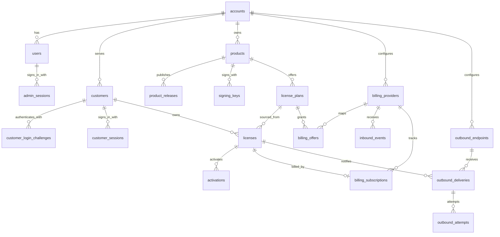

# V1 数据模型

## 1. 设计目标

V1 不迁移旧原型数据，允许重新生成初始迁移。数据模型优先保证：

- 已售授权条款不被模板修改追溯影响；
- 订阅续费始终命中原 License；
- 支付事件严格幂等并能处理乱序；
- 发码和找回不会因异步投递失败丢失；
- Customer 使用 Magic Link 安全访问且只能操作自己的 License；
- 多账户关联不能越过 Account 边界，权限不能依赖前端约定；
- 版本资格只使用服务端受信的 Product Release；
- 错误与尝试记录可诊断；
- 所有检索可以通过数据库条件和索引完成。

目标 DDL 见 [`docs/schemas/schema.sql`](../schemas/schema.sql)。DDL 是领域结构草案，实际 Drizzle Schema 应表达相同约束。

## 2. 关系总览

## 3. 身份与产品

### 3.1 `system_settings`

实例级配置，仅保存实例名称、外部 URL 和初始化状态。Secret 不进入此表。

不存在 `id='current'` 行且 Account、User 同时为空，表示独立部署尚未初始化。Setup 在同一个 D1 原子批次中插入该固定行、首个 Account、首位 Owner、管理员 Session 和 Setup 审计。固定行是一次性初始化闩锁，数据库 Trigger 禁止删除；需要重新初始化测试实例时应重建空数据库，不能删除该行重新开放 Setup。

### 3.2 `accounts`

业务资产和租户安全边界。独立部署 V1 通过 Setup 创建第一个 Account，不提供创建第二个 Account 的 UI 或公开 API；数据模型保留多账户能力，为未来 Cloud 的内部 Account Provisioning 接口复用。支付配置不再以 JSON 放在账户行内。

### 3.3 `users`

管理员身份。Setup 创建首位 `owner`，邮箱在同一账户内唯一；如果未来需要同一用户加入多个账户，再引入 membership，而不是提前增加复杂度。

### 3.4 `admin_sessions`

保存管理员服务端会话，只持久化随机 Session Token 的哈希、`account_id + user_id`、过期和吊销时间。Cookie 中的账户选择器只用于执行 `account_id + session_token_hash` 查询，身份必须由完整 Session 记录确认。每个请求都通过该记录重新读取 User 当前状态和角色；禁用用户、修改角色或吊销 Session 后立即失效。

### 3.5 `customers`

购买者身份。Customer 由支付履约或管理员手动签发自动创建，不开放自主注册：

- `email`：规范化后的当前联系与 Magic Link 验证邮箱，在同一账户内唯一；
- `name`：可选显示名称；
- `status`：`active` 或 `disabled`，只控制 Customer Portal 访问，不替代 License 状态。

Customer ID 是 License 的稳定归属。修改邮箱是显式管理操作，需要唯一约束和审计，同时吊销未消费 Login Challenge 和现有 Customer Session，但不改变已有 License ID、条款或支付状态。V1 不自动合并两个 Customer；目标邮箱已被占用时返回冲突。

### 3.6 `customer_login_challenges`

保存 Magic Link 的一次性验证事实：

- `token_hash`：高熵 Token 的哈希且全局唯一；
- `expires_at`、`consumed_at`、`revoked_at`：限制有效期、保证只能消费一次，并支持邮箱变更或禁用 Customer 时主动吊销；
- `delivery_id`：关联发送该 Magic Link 的 Notification Delivery；
- `requested_ip`：用于安全审计和限流诊断。

明文 Token 只存在于加密 Delivery 负载和客户收到的 URL 中。过期、已消费、已吊销或 Customer 被禁用时不能创建 Session。

为同一 Customer 创建新 Challenge 时，旧的未消费 Challenge 必须吊销，并停止关联 Delivery；这既减少多个活跃链接，也保证用户可以明确知道“最后一次请求的链接有效”。

### 3.7 `customer_sessions`

保存 Customer Portal 会话：

- `session_token_hash`：浏览器随机会话 Token 的哈希；
- `login_challenge_id`：建立该 Session 的 Challenge，唯一且不可复用；
- `expires_at`：服务端绝对过期时间；
- `last_seen_at`：最近使用时间；
- `revoked_at`：退出或管理员吊销时间。

Session 必须同时携带 `account_id` 和 `customer_id`。Cookie 中的账户选择器只用于执行 `account_id + session_token_hash` 查询，不能单独证明账户身份。它不能复用管理员 Session，也不能获得管理控制台权限。

### 3.8 `products`

保存产品身份、显示信息和状态。`archived` 表示不再创建新方案或 License，不直接吊销现有 License。

### 3.9 `product_releases`

一行代表一个具体 Product、版本和平台的受信发布事实：

| 字段 | 约束与原因 |
| --- | --- |
| `version` | 必填；与平台共同标识构建 |
| `platform` | 必填；同一版本在不同平台可能有不同文件和发布时间 |
| `description` | 可空；发布说明不参与授权判定 |
| `download_url` | 可空；LicenKit 可只做授权而不托管下载入口 |
| `artifact_sha256` | 必填；固定为 64 位小写十六进制，标识这次发布的具体分发工件 |
| `released_at` | 必填；由受信发布流程写入的 UTC 时间 |

`(account_id, product_id, version, platform)` 唯一。发布后 ID、归属、`version`、`platform`、`artifact_sha256` 和 `released_at` 由数据库 Trigger 禁止修改，Release 也不允许物理删除；二进制变化要创建新记录。Hash 是完整性和审计元数据，不证明请求方实际运行该文件。

### 3.10 `signing_keys`

只服务 `credential_mode=signed`。允许 active、retired、revoked 状态：

- active：用于新 Token 签发；
- retired：不再签发，但客户端仍需保留公钥验证未过期 Token；
- revoked：发生安全事件，不再信任。

一个产品同一时刻只允许一个 active 签名密钥。

## 4. 授权领域

### 4.1 `license_plans`

授权方案是可编辑模板：

| 字段 | 说明 |
| --- | --- |
| `license_model` | License 有效期演进方式：`perpetual`、`fixed_term`、`subscription` |
| `credential_mode` | 激活后签发的凭证集合：`opaque` 或 `signed` |
| `default_term_seconds` | 固定期限默认时长；买断为空；订阅实际周期以支付平台为准 |
| `update_window_seconds` | 永久 License 的版本更新窗口；`NULL` 表示不限制未来版本 |
| `signed_token_ttl_seconds` | `signed` 模式下 Signed License Token 的最长有效时间；`opaque` 模式必须为 0 |
| `payment_grace_seconds` | 扣款失败后的使用宽限期 |
| `max_activations` | 同时有效的激活数量 |
| `features_json` | 功能标识数组 |
| `revision` | 每次影响授权条款的编辑递增 |
| `status` | `active` 或 `archived` |

授权方案不保存 Stripe Price、Paddle Price 或其他支付渠道字段。

`license_model` 的三个值定义如下：

- `perpetual`：永久有效，`expires_at` 为空；
- `fixed_term`：签发时按 `default_term_seconds` 得到固定到期时间，不由订阅事件自动续期；
- `subscription`：`expires_at` 跟随 Billing Subscription 的 `current_period_end`，续费更新同一个 License。

`update_window_seconds` 只适用于 `perpetual`：

- `NULL`：签发的 License 不限制未来版本；
- 正整数：从可信的授权生效时间开始计算 `updates_until`；
- `fixed_term` 和 `subscription`：必须为 `NULL`，避免同时存在两套到期语义。

`credential_mode` 的两个值都支持在线激活和在线校验：

- `opaque`：只签发 Machine Token；客户端不解析该随机凭证，服务端通过哈希查询和判定；
- `signed`：在 Machine Token 之外额外签发 Ed25519 Signed License Token，允许 SDK 使用受信公钥进行本地校验。

### 4.2 `licenses`

License 同时保存来源和已固化条款：

- 来源：`plan_id`、`plan_revision`；
- 条款：`license_model`、`credential_mode`、`max_activations`、`updates_until`、`signed_token_ttl_seconds`、`payment_grace_seconds`、`features_json`；
- 凭证：`key_hash`、`key_version`、`key_rotated_at`；
- 状态：`active`、`suspended`、`revoked`；
- 时限：`expires_at`、`updates_until`；
- 归属：稳定的 `customer_id`；联系邮箱从 Customer 获取，Delivery 仍保存实际收件地址快照。

V1 不单独建立通用 `license_terms` 表，因为一份 License 在某一时刻只有一组生效条款。显式迁移通过审计日志记录前后快照。未来如需预约生效或复杂历史查询，再增加 terms history。

`updates_until` 只适用于 `perpetual`：

- `NULL`：永久使用所有未来版本；
- UTC 时间：永久使用 `released_at <= updates_until` 的版本；
- 到达截止时间不会改变 License 状态，也不会让此前符合条件的版本失效。

授权方案编辑不能重新计算已售 License 的 `updates_until`。更新权益续费直接显式延长该绝对时间，并通过审计记录前值、后值和来源。

### 4.3 `license_key_rotations`

记录每次注册码轮换的原因、发起人、是否清退激活和关联 Delivery。它不保存旧码或新码明文。

### 4.4 `activations`

Activation 保留历史，不使用删除表示解绑：

- `active`：占用席位；
- `revoked`：不再占用席位；
- `deactivated`：客户端主动解绑。

唯一约束只限制同一个 License 和指纹同时存在一个 active Activation。历史记录可以重复出现，支持同一设备重新激活。

### 4.5 `trial_claims`

如果 V1 保留免费试用，用独立表记录产品和设备指纹的试用领取事实，不污染商业 License。是否进入首发仍待确认。

## 5. 支付领域

### 5.1 `billing_providers`

每个账户和 provider/environment 组合一条配置：

- `provider`；
- `environment`：sandbox/live；
- `webhook_secret_ciphertext`；
- 可选 `api_secret_ciphertext`：仅在 Adapter 需要调用支付平台创建托管客户门户会话时配置；
- `status`；
- 配置版本和更新时间。

支付平台 Secret 使用 `STORAGE_ENCRYPTION_KEY` 加密，不返回明文。

创建客户门户会话不改变本地 Subscription。客户在支付平台完成操作后，仍由已验签 Webhook 更新本地状态。

### 5.2 `billing_offers`

保存可查询的外部商品映射：

- `billing_provider_id`；
- `external_price_id`；
- `product_id`；
- `license_plan_id`；
- `purchase_type`；
- `status`。

同一个 provider 下的外部价格 ID 必须唯一。找不到映射时失败，不使用默认方案。创建或更新映射时必须校验：`purchase_type=one_time` 只能关联 `perpetual` 或 `fixed_term` 授权方案，`purchase_type=subscription` 只能关联 `license_model=subscription` 的授权方案。

### 5.3 `billing_subscriptions`

保存外部订阅与 License 的一对一关系：

- `external_subscription_id`；
- `external_customer_id`；
- `external_price_id`；
- `license_id`；
- 外部状态；
- `current_period_start`、`current_period_end`；
- `cancel_at_period_end`；
- `last_external_occurred_at`、`last_external_event_id`。

### 5.4 `inbound_events`

保存验签后的原始支付事件和处理状态：

- 原始负载加密保存，超过保留期后清空 `payload_ciphertext`，同时保留 Hash、事件身份、结果和错误链路；
- `(billing_provider_id, external_event_id)` 唯一；路由已绑定一个明确的 sandbox/live Provider 配置；
- 状态：`pending`、`processing`、`processed`、`failed`、`needs_attention`；
- 保存 attempt 数、下次处理时间、原始错误和结果引用；
- 使用 `locked_by`、`locked_until` 保存短期处理租约；
- 支持在修复配置后重放，但业务动作仍受唯一约束保护。

支付创建 License 时，License 还保存 `source_billing_provider_id + source_external_transaction_id` 并建立唯一约束。事件去重只能防止同一事件重复，业务唯一键用于防止多个不同事件对同一交易重复发 License。

## 6. 出站投递

### 6.1 `outbound_endpoints`

| 字段 | 说明 |
| --- | --- |
| `endpoint_type` | `notification_gateway` 或 `event_subscriber` |
| `url` | 公网 HTTPS 接收地址；V1 拒绝 URL credentials、非标准端口、IP literal、localhost、私网、链路本地和云元数据目标 |
| `signing_secret_ciphertext` | HMAC Secret 密文 |
| `subscribed_events_json` | 接收的语义事件 |
| `timeout_ms` | 单次请求超时 |
| `max_attempts` | 最大尝试次数 |
| `status` | active/disabled |

每个账户只能有一个 active `notification_gateway`。`event_subscriber` 可以有多个。

### 6.2 `outbound_deliveries`

Delivery 是逻辑消息和 transactional outbox：

- `event_type`；
- `endpoint_id`；
- 可选 `customer_id`；
- 可选 `license_id`；
- `recipient_email`；
- `payload_ciphertext`；
- `idempotency_key`；
- 创建时固化的 `target_url` 与 `signing_secret_ciphertext`；
- 状态、尝试数、下次重试时间和最后错误；
- `locked_by`、`locked_until` 处理租约；
- `accepted_at` 与敏感负载清除时间。

对同一业务动作和端点使用唯一 idempotency key，防止事务或 Worker 重试创建重复消息。重试必须使用 Delivery 固化的 URL 与签名 Secret；编辑 Endpoint 或轮换 Secret 只影响之后的新 Delivery。

Scheduled Worker 只通过状态、`next_attempt_at` 和 `locked_until` 索引领取到期任务。租约过期表示任务可以被重新领取，不表示上一次外部请求一定没有成功，因此 Delivery ID 幂等仍然是必要条件。

### 6.3 `outbound_attempts`

每次 HTTP 请求单独记录：

- attempt number；
- 开始、结束和耗时；
- 结果类型；
- HTTP 状态；
- 截断并脱敏后的响应体；
- 原始传输错误代码与信息。

不能只在 Delivery 上覆盖 `last_error`，否则无法还原重试链路。

## 7. 审计

### `audit_logs`

保存管理员、Customer 和系统执行的高价值动作。`actor_type` 区分 `user`、`customer` 和 `system`，对应 Actor ID 不能混用。高价值动作包括：

- 授权方案编辑与 revision；
- License 签发、暂停、恢复、吊销；
- 版本更新权益延长；
- 注册码普通找回和安全重置；
- Customer 登录、释放 Activation、找回和安全重置；
- 存量 License Terms 迁移；
- 支付配置与 Offer Mapping 修改；
- 出站 Endpoint 修改和人工 retry。

审计详情只记录引用和脱敏快照，不记录注册码、机器令牌、私钥、支付 Secret 或 Delivery 明文负载。

## 8. 关键唯一约束

| 约束 | 防止的问题 |
| --- | --- |
| `customers(account_id, email)` 唯一 | 同一账户内一个邮箱形成多个 Customer 身份 |
| `customer_login_challenges(token_hash)` 唯一 | 一个 Magic Link Token 对应多个 Challenge |
| `customer_sessions(session_token_hash)` 唯一 | 一个会话 Token 对应多个 Customer Session |
| `customer_sessions(login_challenge_id)` 唯一 | 同一个 Magic Link 建立多个 Session |
| `product_releases(account_id, product_id, version, platform)` 唯一 | 同一版本和平台出现冲突的受信发布时间或 Hash |
| `licenses(account_id, key_hash)` 唯一 | 注册码冲突 |
| `licenses(account_id, source_billing_provider_id, source_external_transaction_id)` 部分唯一 | 不同支付事件对同一交易重复发 License |
| `activations(license_id, fingerprint_hash) WHERE status='active'` 唯一 | 同设备重复占座 |
| `billing_providers(account_id, provider, environment)` 唯一 | 配置歧义 |
| `billing_offers(billing_provider_id, external_price_id)` 唯一 | 一个价格映射多个方案 |
| `billing_subscriptions(billing_provider_id, external_subscription_id)` 唯一 | 一个外部订阅发多份 License |
| `billing_subscriptions(license_id)` 唯一 | 一个 License 绑定多个订阅 |
| `inbound_events(billing_provider_id, external_event_id)` 唯一 | 支付事件重复履约或 sandbox/live 配置歧义 |
| active notification gateway 部分唯一 | 一次动作发送多封客户邮件 |
| `outbound_deliveries(account_id, idempotency_key)` 唯一 | 出站消息重复创建；端点尚未配置时仍可防重 |

## 9. 时间和删除规则

- 时间统一保存 UTC RFC 3339 文本，并由一套解析函数处理；
- 核心业务记录使用状态归档，不物理删除；
- 可清理的数据只包括过期敏感 Delivery 负载和按保留策略归档的原始事件密文；
- Product、License Plan、License、Subscription、Activation 和审计记录不能因普通 UI 删除动作消失。
- Customer、Login Challenge 和 Customer Session 按状态、消费时间和过期时间管理；清理过期认证记录不得删除 Customer 或 License。

## 10. 多账户数据库约束

所有属于 Account 的父表都声明 `UNIQUE(account_id, id)`；所有同租户关联使用 `(account_id, child_id) -> parent(account_id, id)` 复合外键。这样即使 ID 全局唯一约定、应用授权或 Repository 过滤出现缺陷，数据库仍拒绝把账户 A 的 License 关联到账户 B 的 Customer、Product、Plan、Provider、Endpoint 或 Actor。

应用层仍必须遵守：

1. Repository 和 Service 方法把 `account_id` 作为必填参数，不提供仅按资源 ID、Session Token、License Key 或 Provider ID 查询的租户资源方法；
2. `SELECT`、`UPDATE` 和 `DELETE` 条件同时包含 `account_id`；
3. 列表、详情、批量操作、后台任务和审计查询使用相同规则；Scheduled Worker 按 active Account 分页后逐账户领取任务；
4. 数据库迁移和集成测试必须尝试构造跨账户关联，并断言由外键拒绝；
5. API 负向测试使用账户 A 的会话访问账户 B 的每类资源，统一表现为不存在或无权限且不泄露资源详情。

## 11. 迁移策略

V1 采用新的初始迁移：

1. 删除旧原型迁移的兼容目标；
2. 以 Drizzle Schema 为执行来源，以本文档和目标 DDL 为设计来源；
3. 在提交首个 V1 migration 前，执行 Schema、Drizzle 定义和 API DTO 三方字段对照；
4. 后续一旦产生真实用户数据，恢复正常的向前迁移规则，不再修改已发布迁移。
