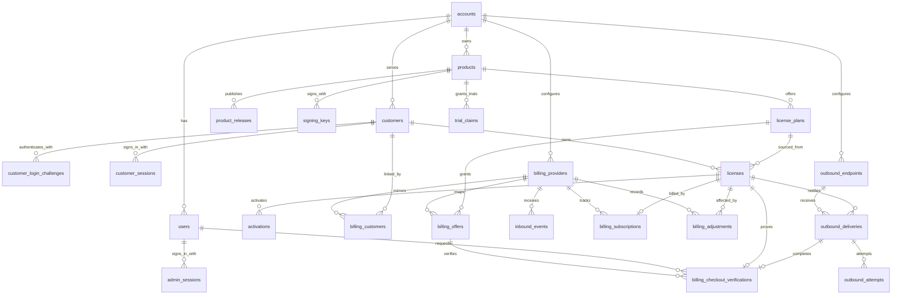

# V1 数据模型

## 1. 设计目标

V1 不迁移旧原型数据，允许重新生成初始迁移。数据模型优先保证：

- 已售授权条款不被模板修改追溯影响；
- 订阅续费始终命中原 License；
- 支付事件严格幂等并能处理乱序；
- 发码和找回不会因异步投递失败丢失；
- Customer 使用 Magic Link 安全访问且只能操作自己的 License；
- 多账户关联不能越过 Account 边界，权限不能依赖前端约定；
- 版本资格只使用服务端受信的 Product Release；
- 错误与尝试记录可诊断；
- 所有检索可以通过数据库条件和索引完成。

目标 DDL 见 [`docs/schemas/schema.sql`](../schemas/schema.sql)。DDL 是领域结构草案，实际 Drizzle Schema 应表达相同约束。

## 2. 关系总览



## 3. 身份与产品

### 3.1 `system_settings`

实例级配置，仅保存实例名称、外部 URL 和初始化状态。Secret 不进入此表。

不存在 `id='current'` 行且 Account、User 同时为空，表示独立部署尚未初始化。Setup 在同一个 D1 原子批次中插入该固定行、首个 Account、首位 Owner、管理员 Session 和 Setup 审计。固定行是一次性初始化闩锁，数据库 Trigger 禁止删除；需要重新初始化测试实例时应重建空数据库，不能删除该行重新开放 Setup。

### 3.2 `accounts`

业务资产和租户安全边界。独立部署 V1 通过 Setup 创建第一个 Account，不提供创建第二个 Account 的 UI 或公开 API；数据模型保留多账户能力，为未来 Cloud 的内部 Account Provisioning 接口复用。支付配置不再以 JSON 放在账户行内。

`default_subscription_payment_grace_seconds` 是创建订阅授权方案时使用的账户默认值，初始值为 `432000` 秒（5 天）。它不是每次校验时动态读取的开关：方案创建时保存解析后的实际值，License 签发时再次固化，因此修改 Account 默认值只影响之后新建且未显式填写宽限期的订阅方案。

### 3.3 `users`

管理员身份。Setup 创建首位 `owner`，邮箱在同一账户内唯一；如果未来需要同一用户加入多个账户，再引入 membership，而不是提前增加复杂度。

### 3.4 `admin_sessions`

保存管理员服务端会话，只持久化随机 Session Token 与 CSRF Token 的哈希、`account_id + user_id`、过期和吊销时间。Session Token 使用 HttpOnly Cookie；独立 CSRF Token 使用 Secure、SameSite=Lax、host-only 的可读 Cookie，并由前端作为 `X-CSRF-Token` 发送。服务端同时校验精确 Origin、Header 与 Cookie 常量时间相等、Token Hash 命中当前 Session。Cookie 中的账户选择器只用于执行 `account_id + session_token_hash` 查询，身份必须由完整 Session 记录确认。每个请求都通过该记录重新读取 User 当前状态和角色；禁用用户、修改角色或吊销 Session 后立即失效。

### 3.5 `customers`

购买者身份。Customer 由支付履约或管理员手动签发自动创建，不开放自主注册：

- `email`：规范化后的当前联系与 Magic Link 验证邮箱，在同一账户内唯一；
- `name`：可选显示名称；
- `status`：`active` 或 `disabled`，只控制 Customer Portal 访问，不替代 License 状态。

Customer ID 是 License 的稳定归属。修改邮箱是显式管理操作，需要唯一约束和审计，同时吊销未消费 Login Challenge 和现有 Customer Session，但不改变已有 License ID、条款或支付状态。V1 不自动合并两个 Customer；目标邮箱已被占用时返回冲突。

### 3.6 `customer_login_challenges`

保存 Magic Link 的一次性验证事实：

- `token_hash`：高熵 Token 的哈希且全局唯一；
- `expires_at`、`consumed_at`、`revoked_at`：限制有效期、保证只能消费一次，并支持邮箱变更或禁用 Customer 时主动吊销；
- `delivery_id`：关联发送该 Magic Link 的 Notification Delivery；
- `requested_ip`：用于安全审计和限流诊断。

明文 Token 只存在于加密 Delivery 负载和客户收到的 URL 中。过期、已消费、已吊销或 Customer 被禁用时不能创建 Session。

为同一 Customer 创建新 Challenge 时，旧的未消费 Challenge 必须吊销，并停止关联 Delivery；这既减少多个活跃链接，也保证用户可以明确知道“最后一次请求的链接有效”。

### 3.7 `customer_sessions`

保存 Customer Portal 会话：

- `session_token_hash`：浏览器随机会话 Token 的哈希；
- `csrf_token_hash`：与该 Session 唯一绑定的双提交 CSRF Token 哈希；
- `login_challenge_id`：建立该 Session 的 Challenge，唯一且不可复用；
- `expires_at`：服务端绝对过期时间；
- `last_seen_at`：最近使用时间；
- `revoked_at`：退出或管理员吊销时间。

Session 必须同时携带 `account_id` 和 `customer_id`。Cookie 中的账户选择器只用于执行 `account_id + session_token_hash` 查询，不能单独证明账户身份。Customer 状态写入与管理员 API 使用相同的精确 Origin + 双提交 CSRF 校验，但 Token 和 Cookie 名称互相隔离。它不能复用管理员 Session，也不能获得管理控制台权限。

### 3.8 `products`

保存产品身份、显示信息和状态。`slug` 在 Account 内唯一，作为公开 Checkout URL 的稳定选择器；应用层只接受规范化的小写 URL-safe 值。`archived` 表示不再创建新方案、License、Checkout 或 Trial Claim，不直接吊销现有 License 或已有 Trial Claim。

`billing_environment` 可空，值为 `sandbox|live`。空值表示没有公开支付销售；非空值同时限定公开 Checkout 返回的 Offer 环境，以及普通支付 License 的来源环境。设置或切换前必须确认当前 Product 没有 active Offer，也没有 `is_checkout_verification=0` 的支付 License；一旦已有真实支付权益就拒绝切换，避免已有授权的环境语义被改写。管理员 Sandbox Verification 不受该字段限制，因为其 License 被单独标记且永远不可激活。

无需支付方式的 Product/设备试用使用三个 Product 配置字段：

- `trial_enabled`：是否允许新领取；默认关闭；
- `trial_duration_seconds`：启用时必须是正数，不使用隐式全局天数；
- `trial_features_json`：之后领取的 Trial Claim 的功能模板。

修改时长或功能只影响之后领取的 Trial Claim，不能追溯改变已有试用快照。

### 3.9 `product_releases`

一行代表一个具体 Product、版本和平台的受信发布事实：

| 字段 | 约束与原因 |
| --- | --- |
| `version` | 必填；与平台共同标识构建 |
| `platform` | 必填；同一版本在不同平台可能有不同文件和发布时间 |
| `description` | 可空；发布说明不参与授权判定 |
| `download_url` | 可空；LicenKit 可只做授权而不托管下载入口 |
| `artifact_sha256` | 必填；固定为 64 位小写十六进制，标识这次发布的具体分发工件 |
| `released_at` | 必填；由受信发布流程写入的 UTC 时间 |

`(account_id, product_id, version, platform)` 唯一。发布后 ID、归属、`version`、`platform`、`artifact_sha256` 和 `released_at` 由数据库 Trigger 禁止修改，Release 也不允许物理删除；二进制变化要创建新记录。Hash 是完整性和审计元数据，不证明请求方实际运行该文件。

### 3.10 `signing_keys`

只服务 `credential_mode=signed`。允许 active、retired、revoked 状态：

- active：用于新 Token 签发；
- retired：不再签发，但客户端仍需保留公钥验证未过期 Token；
- revoked：发生安全事件，不再信任。

一个产品同一时刻只允许一个 active 签名密钥。

## 4. 授权领域

### 4.1 `license_plans`

授权方案是可编辑模板：

| 字段 | 说明 |
| --- | --- |
| `license_model` | License 有效期演进方式：`perpetual`、`fixed_term`、`subscription` |
| `credential_mode` | 激活后签发的凭证集合：`opaque` 或 `signed` |
| `default_term_seconds` | 固定期限默认时长；永久和订阅为空；手动订阅在签发请求中给出绝对到期时间，支付订阅使用外部周期 |
| `update_window_seconds` | 永久 License 的版本更新窗口；`NULL` 表示不限制未来版本 |
| `signed_token_ttl_seconds` | `signed` 模式下 Signed License Token 的最长有效时间；`opaque` 模式必须为 0 |
| `payment_grace_seconds` | 支付订阅扣款失败后的使用宽限期；订阅方案省略时从 Account 默认值解析，非订阅方案必须为 0，手动订阅签发时固化为 0 |
| `max_activations` | 同时有效的激活数量 |
| `features_json` | 功能标识数组 |
| `revision` | 每次影响授权条款的编辑递增 |
| `status` | `active` 或 `archived` |

授权方案不保存 Stripe Price、Paddle Price 或其他支付渠道字段。

`license_model` 的三个值定义如下：

- `perpetual`：永久有效，`expires_at` 为空；
- `fixed_term`：签发时按 `default_term_seconds` 得到固定到期时间，不由订阅事件自动续期；
- `subscription`：有明确周期并可续期；`renewal_mode=manual` 使用管理员给出的未来绝对时间，`renewal_mode=billing` 跟随 Billing Subscription 的 `current_period_end`，两者都延长同一个 License。

`update_window_seconds` 只适用于 `perpetual`：

- `NULL`：签发的 License 不限制未来版本；
- 正整数：从可信的授权生效时间开始计算 `updates_until`；
- `fixed_term` 和 `subscription`：必须为 `NULL`，避免同时存在两套到期语义。

`credential_mode` 的两个值都支持在线激活和在线校验：

- `opaque`：只签发 Machine Token；客户端不解析该随机凭证，服务端通过哈希查询和判定；
- `signed`：在 Machine Token 之外额外签发 Ed25519 Signed License Token，允许 SDK 使用受信公钥进行本地校验。

`payment_grace_seconds` 在 `license_plans` 中没有数据库隐式默认。应用创建订阅方案时必须显式写入请求值，或读取当前 Account 的 `default_subscription_payment_grace_seconds` 后写入；这样通过服务层或迁移写入时都能看见支付方案的实际条款。V1 初始账户默认值是 5 天，但某个订阅方案可以显式配置为其他非负值。签发 `renewal_mode=manual` 时不复制这项支付条款，而是把 License 快照写为 0。

### 4.2 `licenses`

License 同时保存来源和已固化条款：

- 来源：`plan_id`、`plan_revision`；
- 条款：`license_model`、`renewal_mode`、`credential_mode`、`max_activations`、`updates_until`、`signed_token_ttl_seconds`、`payment_grace_seconds`、`features_json`；
- 凭证：`key_hash`、`key_version`、`key_rotated_at`；
- 状态：`active`、`suspended`、`revoked`；
- 验证用途：`is_checkout_verification`；
- 时限：`expires_at`、`updates_until`；
- 归属：稳定的 `customer_id`；联系邮箱从 Customer 获取，Delivery 仍保存实际收件地址快照。

V1 不单独建立通用 `license_terms` 表，因为一份 License 在某一时刻只有一组生效条款。显式迁移通过审计日志记录前后快照。未来如需预约生效或复杂历史查询，再增加 terms history。

`source=manual|api` 可以签发三种 License：

- `perpetual + none`：`expires_at=NULL`，用于永久授权，包括赠送给朋友的永久 License；
- `fixed_term + none`：按方案固定时长计算一次到期时间；
- `subscription + manual`：调用方必须提供明确的未来 `expires_at`，不建立 Billing Subscription，`payment_grace_seconds=0`。

`source=payment` 的订阅必须是 `subscription + billing`，同时保存支付来源字段并在同一履约中建立 Billing Subscription。数据库约束拒绝把手动和支付续期权威混在一条 License 上；“永久订阅”不作为第四种状态，因为它在到期、续期、支付门户和报表中都等价于永久 License。

普通 `source=payment` License 只有在 Offer active 且 Billing Provider 环境等于 Product `billing_environment` 时创建。管理员端到端验证生成的记录必须为 `is_checkout_verification=1`，数据库同时约束其 `source=payment`、`status=suspended`、`status_reason=checkout_verification`。领域层还必须拒绝激活、恢复或迁移该记录；不能通过修改状态把测试卡交易转成客户权益。

目标 DDL 还约束手动订阅的 `expires_at > created_at`。之后续期时“新到期时间不得早于当前值”无法用静态 CHECK 表达，由带旧值条件的更新、绝对时间重放语义和审计测试共同保证。

`updates_until` 只适用于 `perpetual`：

- `NULL`：永久使用所有未来版本；
- UTC 时间：永久使用 `released_at <= updates_until` 的版本；
- 到达截止时间不会改变 License 状态，也不会让此前符合条件的版本失效。

授权方案编辑不能重新计算已售 License 的 `updates_until`。更新权益续费直接显式延长该绝对时间，并通过审计记录前值、后值和来源。

支付订阅的宽限截止时间不重复存储，按 `expires_at + payment_grace_seconds` 派生。后台从 `billing_subscriptions(account_id, status, current_period_end)` 索引扫描 `past_due` 项，再以 `account_id + license_id` 更新目标 License，避免另一个 `grace_until` 字段与支付周期漂移。手动订阅没有“扣款失败”事件，因此不能获得这段宽限。

### 4.3 `license_key_rotations`

记录每次注册码轮换的原因、发起人、是否清退激活和关联 Delivery。它不保存旧码或新码明文。

### 4.4 `activations`

Activation 保留历史，不使用删除表示解绑：

- `active`：占用席位；
- `revoked`：不再占用席位；
- `deactivated`：客户端主动解绑。

唯一约束只限制同一个 License 和指纹同时存在一个 active Activation。历史记录可以重复出现，支持同一设备重新激活。

### 4.5 `trial_claims`（无需支付方式）

无需支付方式的 Product/设备级免费试用属于 V1 首发范围。独立表记录 Product 与设备指纹的领取事实，不污染商业 License：

- `fingerprint_hash`：设备指纹的服务端哈希；
- `trial_token_hash`：高熵 Trial Token 的哈希，明文只在首次领取响应中出现；
- `features_json`：领取时从 Product 固化的功能快照；
- `claimed_at`、`expires_at`：不可通过重复领取刷新的绝对时间；
- `last_validated_at`：最近一次成功在线校验；
- `revoked_at`、`revoke_reason`：显式终止并保留原因。

`(account_id, product_id, fingerprint_hash)` 唯一，保证并发领取也最多产生一条 Claim；`(account_id, trial_token_hash)` 唯一，查询始终同时携带 Account。Token 丢失后不能仅凭指纹补发或返回旧明文。Trial Claim 只支持在线校验，不关联 Customer、License、Activation、Subscription 或 Delivery。要求支付方式的 Paddle 免费订阅试用不写此表。

## 5. 支付领域

### 5.1 `billing_providers`

每个账户和 provider/environment 组合一条配置：

- `provider`；
- `environment`：sandbox/live；
- `client_side_token`：可公开给 Paddle.js 的受限凭证；sandbox 必须以 `test_` 开头，live 必须以 `live_` 开头；
- `webhook_secret_ciphertext`；
- 可空 `api_secret_ciphertext`：通用的支付平台服务端 API 凭证密文字段；V1 Paddle 只有在启用 Get Customer/对账或托管客户门户时才保存 API Key，并分别要求 `customer.read` 或 `customer_portal_session.write`；
- `status`；
- 配置版本和更新时间。

V1 实现和真实 Sandbox 验收只开放 `provider=paddle`。Schema 保持字符串字段是为了以后增加 Adapter 时不迁移领域表，但服务端 Adapter 注册表必须对未实现 provider 默认拒绝。

`UNIQUE(account_id, provider, environment)` 表示 V1 每个账户在同一平台和环境下只有一个商户连接；不同平台和 sandbox/live 可以并存。未来若要同时连接多个同平台、同环境商户，需要为 Provider 引入显式连接标识并迁移该唯一约束，不能复用或拼接外部 Customer ID 区分商户。

`account_id + provider + environment` 是不可变连接身份。PATCH 只允许轮换凭证、启停能力或更新同一连接配置；环境切换必须创建新 Provider，避免把既有 sandbox 外部 ID 重新解释成 live 身份。DDL Trigger 对身份字段更新 fail-closed。

Webhook Secret 和 API Key 使用 `STORAGE_ENCRYPTION_KEY` 加密，不返回明文。Client-side Token 按 Paddle 的前端凭证语义以明文保存并由公开 Checkout API 返回；它不能与 API Key 共用字段，也不能被管理端误标为 Secret。

创建客户门户会话不改变本地 Subscription。客户在支付平台完成操作后，仍由已验签 Webhook 更新本地状态。

### 5.2 `billing_customers`

保存 provider Customer 的本地镜像和稳定归属：

- `billing_provider_id + external_customer_id`：支付平台 Customer 的唯一身份；
- 可空 `customer_id`：成功链接后的 LicenKit Customer；
- `provider_email`、`provider_name`、`provider_status`：来自 `customer.created|updated` 或经过服务器端认证的 Get Customer API；
- `link_status`：`pending`、`linked`、`email_mismatch` 或 `needs_attention`；
- `last_sync_source`：`webhook`、`api` 或 `reconciliation`；
- `external_updated_at` 与 `last_external_event_id`：防止旧 Customer 事件覆盖新镜像并保留来源；Paddle `customer.created` 的 `updated_at` 允许为空，因此该字段固化 `provider.updated_at ?? provider.created_at`，不能写入接收时间伪装 provider 版本。

首次同步时，服务端规范化 `provider_email`，在同一 Account 内查找现有 Customer；没有时创建 Customer，然后把外部 Customer ID 链接到稳定的内部 Customer ID。并发 Customer Webhook 与可选 API 读穿依赖 Customer 邮箱唯一键和 Billing Customer 外部 ID 唯一键收敛到同一结果。

表的基数是 `customers 1 -> N billing_customers`。例如，同一个 LicenKit Customer 可以同时拥有 `paddle/live + ctm_*` 和未来 `stripe/live + cus_*` 两条映射；每条 Billing Subscription 仍引用自己的 Billing Provider 和外部 Customer。查找必须下推为完整等值条件：

```sql
WHERE account_id = ?
  AND billing_provider_id = ?
  AND external_customer_id = ?
  AND link_status = 'linked'
```

同一 Account 下，来自不同 Provider 的规范化邮箱相同才自动链接到同一个 Customer；邮箱不同则分别创建或匹配 Customer，不根据名称、卡信息或其他弱特征自动合并。两个外部 Customer 即使链接同一个内部 Customer，其 provider 镜像、Subscription 和后续同步仍保持独立。

链接建立后不能因 Paddle 邮箱改变而自动改绑。若当前 `provider_email` 与 Customer 邮箱不一致，保存新镜像并把 `link_status` 设为 `email_mismatch`；新 License 签发停止并进入人工处理，已有 Subscription 仍按原 License 续费。管理员确认并通过既有 Customer 管理接口修改邮箱后，reconcile 可以恢复为 `linked`。

Billing Customer 只接受两类来源：已验签 `customer.created|updated` payload，或在已配置 API Key 时使用对应 Provider 的服务端 API 获取的 Customer 响应。前者是基础购买闭环的正常来源，后者只是可选加速/恢复来源。Transaction `custom_data.email`、前端 Checkout 参数和占位邮箱都不能写入本表。

### 5.3 `billing_offers`

保存可查询的外部商品映射：

- `billing_provider_id`；
- `external_price_id`；
- `product_id`；
- `license_plan_id`；
- `purchase_type`；
- `status`：`draft`、`active` 或 `archived`；默认 `draft`。

同一个 provider 下的外部价格 ID 必须唯一。找不到映射时失败，不使用默认方案。创建或更新映射时必须校验：`purchase_type=one_time` 只能关联 `perpetual` 或 `fixed_term` 授权方案，`purchase_type=subscription` 只能关联 `license_model=subscription` 的授权方案。

Offer 尚未产生任何 Checkout Verification 时可以在 draft 状态修正映射；一旦存在验证尝试，Provider、Price、Product、Plan 和购买类型由 Trigger 锁定，修改销售合同必须归档并新建 Offer。否则历史验证证据可能被错误复用到另一份权益。

从 `draft` 激活前，服务端执行 Checkout Readiness 检查：Product/Plan/Provider 可用、Offer Provider 环境等于 Product `billing_environment`、Client-side Token 环境匹配且当前 Price 可被 PricePreview 读取、当前 Provider 配置更新时间之后已逐项收到最小事件合同中的对应事件并验签成功（通常由官方模拟器触发）、Notification Gateway 已启用并通过 Endpoint Test、调度器健康、`signed` 模式存在 active key，以及同一 Account/Product/Plan/购买类型的真实 Sandbox Checkout 到 accepted Delivery 已验收。首个 Sandbox Offer 通过只对 owner/admin 开放的 draft 验证配置运行同一 Checkout、Webhook、履约和通知模块，避免“未激活不能测试、未测试不能激活”的死锁；Live Offer 复用对应 Sandbox 证据并单独验证 Live Token/Price。检查使用现有 Provider、Inbound Event、Endpoint、Delivery、Attempt 和 Checkout Verification 事实，不把一份容易漂移的 `ready=true` 冗余保存到 Offer。轮换 Webhook Secret、替换 Provider 连接或更新 Endpoint 会自然使旧验证时间早于当前配置而失效。激活后任何关键依赖失效，公开 Checkout API 仍实时返回不可购买；Offer 状态本身不冒充运行健康。

### 5.4 `billing_checkout_verifications`

保存管理员在 Offer 激活前发起的真实 Sandbox 闭环验证：

- `billing_offer_id`：必须指向 draft Sandbox Offer；
- `requested_by_user_id`：发起验证的 owner/admin；
- `token_hash`：短期高熵令牌哈希且全局唯一，明文只在创建响应中返回一次；
- `status`：`pending`、`delivery_pending`、`completed`、`needs_attention` 或 `expired`；
- `external_transaction_id`、`license_id`、`delivery_id`：从已验签交易到不可激活验证 License 和真实通知的证据链；
- `expires_at`、`completed_at` 和保留来源的错误字段。

Webhook 处理通过 Token 哈希和 attempt 状态执行条件更新，不能扫描全部验证记录或仅按前端传入的 Offer ID 判断。令牌只允许消费一次；只有 Provider/Price/Offer 完全匹配、仍未过期且为 Sandbox 时才进入统一履约。创建 License 与 Delivery 后状态为 `delivery_pending`，对应 Delivery 被 Notification Gateway 接收后才是 `completed`。任何失败保留原始事件、Transaction 和错误细节，不改走普通付款。

验证记录创建后，Account、Offer、发起人、Token Hash、创建时间和过期时间由数据库 Trigger 锁定；处理器只能推进状态并补充 Transaction、License、Delivery 和诊断结果，不能把已签发令牌改绑到另一 Offer 或延长有效期。

### 5.5 `billing_subscriptions`

保存外部订阅与 License 的一对一关系：

- `external_subscription_id`；
- `external_customer_id`；
- `external_price_id`；
- `license_id`；
- 外部状态；
- `current_period_start`、`current_period_end`；
- `next_billed_at`；
- `trial_type`、`trial_started_at`、`trial_ends_at`；
- `cancel_at_period_end`；
- `last_external_occurred_at`、`last_external_event_id`。

V1 的 Paddle 免费订阅试用只接受 `trial_type=free_payment_method_required`：支付方式由 Paddle Checkout 预先收集，试用周期来自已验签 Paddle Subscription。`status=trialing` 时试用类型、起止时间和下一扣款时间都必须存在；转为 `active` 后保留这些字段作为历史，不复制成 Trial Claim。Billing Subscription 必须绑定 `renewal_mode=billing` 的 License，这项跨表不变量由同一履约事务和领域测试保证。

`external_customer_id` 必须通过同账户、同 Billing Provider 的复合外键命中 Billing Customer，不能只保存无法追溯的字符串。续费沿 Billing Subscription 直接定位既有 License，不因 Billing Customer 邮箱不一致而改绑 Customer。

### 5.6 `billing_adjustments`

保存 Paddle Adjustment 的长期业务事实，避免原始事件密文清理后失去管理员判断依据：

- 外部 Adjustment、Transaction、Subscription 和 Customer ID；
- 可空 `license_id`，无法安全关联时保持空并进入人工处理；
- `provider_action`、`adjustment_type`、`provider_status`；
- 币种、最低货币单位表示的 `total_amount` 和 provider 原始原因；
- `automatic_effect`：`none` 或 `license_suspended`；
- `review_status`：`not_required`、`open` 或 `resolved`；
- 管理员的 `resolution_action`、原因、操作者与时间；
- 最后外部发生时间和事件 ID，用于拒绝旧更新覆盖新状态。

`(billing_provider_id, external_adjustment_id)` 唯一。`adjustment.created` 与 `adjustment.updated` 对同一记录幂等 upsert；已批准全额退款或 `action=chargeback` 可以在同一事务中把 `automatic_effect` 设为 `license_suspended` 并暂停 License。所有需要管理员决定的状态同时把 `review_status` 设为 `open`、来源 Inbound Event 设为 `needs_attention`；部分退款、待审批退款、warning 和反转不自动更改 License。管理员处置更新本表、License/Activation（如有）、来源事件结果和审计必须共同提交。

### 5.7 `inbound_events`

保存验签后的原始支付事件和处理状态：

- 原始负载加密保存，超过保留期后清空 `payload_ciphertext`，同时保留 Hash、事件身份、结果和错误链路；
- 验签后把 payload 中存在的 `external_customer_id`、`external_transaction_id`、`external_subscription_id` 与 `external_adjustment_id` 提取为可查询关联字段；字段缺失保持 `NULL`，不能伪造占位值；
- `(billing_provider_id, external_event_id)` 唯一；路由已绑定一个明确的 sandbox/live Provider 配置；
- 状态：`pending`、`processing`、`processed`、`failed`、`needs_attention`；
- 保存 attempt 数、下次处理时间、原始错误和结果引用；
- 使用 `locked_by`、`locked_until` 保存短期处理租约；
- 支持在修复配置后重放，但业务动作仍受唯一约束保护。

支付创建 License 时，License 还保存 `source_billing_provider_id + source_external_transaction_id` 并建立唯一约束。事件去重只能防止同一事件重复，业务唯一键用于防止多个不同事件对同一交易重复发 License。

Paddle 订阅创建流程使用这两个外部 ID 关联乱序到达的 `subscription.created` 与 `transaction.completed`。前者包含创建 Transaction ID 和完整 Subscription，后者包含 Transaction ID 与 Subscription ID；事实暂不完整时事件继续保持 `pending` 并重试，而不是创建缺字段的 Subscription。两个部分索引分别支持按 Transaction 和 Subscription 查找关联事件，原始负载清理后仍保留关联链路。

外部 Customer ID 用于关联 Billing Customer。购买事件处理时若映射不存在，事件以 `BILLING_CUSTOMER_PENDING` 保持可重试并等待 Customer Webhook；Provider 配置了 API Key 时可以调用 Paddle Get Customer API 加速，成功响应仍与 Customer Webhook 进入同一 upsert/link 路径，失败则保存 Paddle request ID、HTTP 状态和原始错误并重试。

## 6. 出站投递

### 6.1 `outbound_endpoints`

| 字段 | 说明 |
| --- | --- |
| `endpoint_type` | `notification_gateway` 或 `event_subscriber` |
| `url` | 公网 HTTPS 接收地址；V1 拒绝 URL credentials、非标准端口、IP literal、localhost、私网、链路本地和云元数据目标 |
| `signing_secret_ciphertext` | HMAC Secret 密文 |
| `subscribed_events_json` | 接收的语义事件 |
| `timeout_ms` | 单次请求超时 |
| `max_automatic_attempts` | 自动预算中的最大 HTTP Attempt 数；默认 4，表示首次请求加 3 次自动重试 |
| `status` | active/disabled |

每个账户只能有一个 active `notification_gateway`。`event_subscriber` 可以有多个。

### 6.2 `outbound_deliveries`

Delivery 是逻辑消息和 transactional outbox：

- `event_type`；
- `endpoint_id`；
- 可选 `customer_id`；
- 可选 `license_id`；
- `recipient_email`；
- `payload_ciphertext`；
- `idempotency_key`；
- 创建时固化的 `target_url` 与 `signing_secret_ciphertext`；
- 状态、尝试数、下次重试时间和最后错误；
- `automatic_attempt_count` 与固化的 `max_automatic_attempts`；人工 retry 不改变自动预算；
- `locked_by`、`locked_until` 处理租约；
- `accepted_at` 与敏感负载清除时间。

敏感 Delivery 在创建时固化 `payload_expires_at`。未成功负载默认最长保留 24 小时；Magic Link 使用 Challenge 的更早到期时间。Notification Gateway 返回 2xx 后立即写入 `accepted_at` 和 `payload_cleared_at` 并清空密文，因为接收方已经承担可靠发送责任。负载到期后的人工 retry 返回 `DELIVERY_PAYLOAD_EXPIRED`。

对同一业务动作和端点使用唯一 idempotency key，防止事务或 Worker 重试创建重复消息。重试必须使用 Delivery 固化的 URL 与签名 Secret；编辑 Endpoint 或轮换 Secret 只影响之后的新 Delivery。

Scheduled Worker 只通过状态、`next_attempt_at` 和 `locked_until` 索引领取到期任务。租约过期表示任务可以被重新领取，不表示上一次外部请求一定没有成功，因此 Delivery ID 幂等仍然是必要条件。

### 6.3 `outbound_attempts`

每次 HTTP 请求单独记录：

- attempt number；
- `attempt_source`：`initial`、`automatic_retry` 或 `manual_retry`；
- 开始、结束和耗时；
- 结果类型；
- HTTP 状态；
- 截断并脱敏后的响应体；
- 原始传输错误代码与信息。

不能只在 Delivery 上覆盖 `last_error`，否则无法还原重试链路。

数据库要求 `attempt_number=1` 的来源必须是 `initial`，后续序号只能是自动或人工 retry；同一 Delivery 的序号唯一且连续性由创建 Attempt 的事务维护。

## 7. 审计

### `audit_logs`

保存管理员、Customer 和系统执行的高价值动作。`actor_type` 区分 `user`、`customer` 和 `system`，对应 Actor ID 不能混用。高价值动作包括：

- 授权方案编辑与 revision；
- License 签发、暂停、恢复、吊销；
- 版本更新权益延长；
- 注册码普通找回和安全重置；
- Customer 登录、释放 Activation、找回和安全重置；
- Trial Claim 管理员吊销；
- 存量 License Terms 迁移；
- 支付配置与 Offer Mapping 修改；
- Billing Customer 人工对账和链接状态处置；
- Billing Adjustment 的暂停、恢复、保持暂停、吊销和安全重置决定；
- Offer 激活、归档和 Checkout Readiness 失败原因；
- 出站 Endpoint 修改和人工 retry。

审计详情只记录引用和脱敏快照，不记录注册码、机器令牌、私钥、支付 Secret 或 Delivery 明文负载。

## 8. 关键唯一约束

| 约束 | 防止的问题 |
| --- | --- |
| `customers(account_id, email)` 唯一 | 同一账户内一个邮箱形成多个 Customer 身份 |
| `customer_login_challenges(token_hash)` 唯一 | 一个 Magic Link Token 对应多个 Challenge |
| `customer_sessions(session_token_hash)` 唯一 | 一个会话 Token 对应多个 Customer Session |
| `admin_sessions(csrf_token_hash)`、`customer_sessions(csrf_token_hash)` 各自唯一 | 一个 CSRF Token 绑定多条同类 Session |
| `customer_sessions(login_challenge_id)` 唯一 | 同一个 Magic Link 建立多个 Session |
| `products(account_id, slug)` 唯一 | 同一账户公开产品页选择器歧义 |
| `product_releases(account_id, product_id, version, platform)` 唯一 | 同一版本和平台出现冲突的受信发布时间或 Hash |
| `licenses(account_id, key_hash)` 唯一 | 注册码冲突 |
| `licenses(account_id, source_billing_provider_id, source_external_transaction_id)` 部分唯一 | 不同支付事件对同一交易重复发 License |
| `activations(license_id, fingerprint_hash) WHERE status='active'` 唯一 | 同设备重复占座 |
| `billing_providers(account_id, provider, environment)` 唯一 | 配置歧义 |
| `billing_customers(billing_provider_id, external_customer_id)` 唯一 | 同一 Provider 连接下的外部 Customer 映射成多个本地 Billing Customer |
| `billing_offers(billing_provider_id, external_price_id)` 唯一 | 一个价格映射多个方案 |
| `billing_checkout_verifications(token_hash)` 唯一 | 一个管理员验证令牌授权多次测试履约 |
| `billing_checkout_verifications(account_id, billing_offer_id, external_transaction_id)` 部分唯一 | 同一验证交易形成多条闭环证据 |
| `billing_subscriptions(billing_provider_id, external_subscription_id)` 唯一 | 一个外部订阅发多份 License |
| `billing_subscriptions(license_id)` 唯一 | 一个 License 绑定多个订阅 |
| `billing_adjustments(billing_provider_id, external_adjustment_id)` 唯一 | 同一退款或拒付更新形成多条互相冲突的处置记录 |
| `inbound_events(billing_provider_id, external_event_id)` 唯一 | 支付事件重复履约或 sandbox/live 配置歧义 |
| active notification gateway 部分唯一 | 一次动作发送多封客户邮件 |
| `outbound_deliveries(account_id, idempotency_key)` 唯一 | 出站消息重复创建；端点尚未配置时仍可防重 |

## 9. 时间和删除规则

- 时间统一保存 UTC RFC 3339 文本，并由一套解析函数处理；
- 核心业务记录使用状态归档，不物理删除；
- 可清理的数据只包括过期敏感 Delivery 负载和按保留策略归档的原始事件密文；
- Product、License Plan、License、Subscription、Activation 和审计记录不能因普通 UI 删除动作消失。
- Customer、Login Challenge 和 Customer Session 按状态、消费时间和过期时间管理；清理过期认证记录不得删除 Customer 或 License。

## 10. 多账户数据库约束

所有属于 Account 的父表都声明 `UNIQUE(account_id, id)`；所有同租户关联使用 `(account_id, child_id) -> parent(account_id, id)` 复合外键。这样即使 ID 全局唯一约定、应用授权或 Repository 过滤出现缺陷，数据库仍拒绝把账户 A 的 License 关联到账户 B 的 Customer、Product、Plan、Provider、Endpoint 或 Actor。

应用层仍必须遵守：

1. Repository 和 Service 方法把 `account_id` 作为必填参数，不提供仅按资源 ID、Session Token、License Key 或 Provider ID 查询的租户资源方法；
2. `SELECT`、`UPDATE` 和 `DELETE` 条件同时包含 `account_id`；
3. 列表、详情、批量操作、后台任务和审计查询使用相同规则；Scheduled Worker 按 active Account 分页后逐账户领取任务；
4. 数据库迁移和集成测试必须尝试构造跨账户关联，并断言由外键拒绝；
5. API 负向测试使用账户 A 的会话访问账户 B 的每类资源，统一表现为不存在或无权限且不泄露资源详情。

## 11. 迁移策略

V1 采用新的初始迁移：

1. 删除旧原型迁移的兼容目标；
2. 以 Drizzle Schema 为执行来源，以本文档和目标 DDL 为设计来源；
3. 在提交首个 V1 migration 前，执行 Schema、Drizzle 定义和 API DTO 三方字段对照；
4. 后续一旦产生真实用户数据，恢复正常的向前迁移规则，不再修改已发布迁移。
