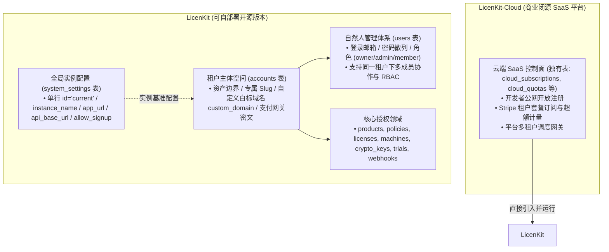
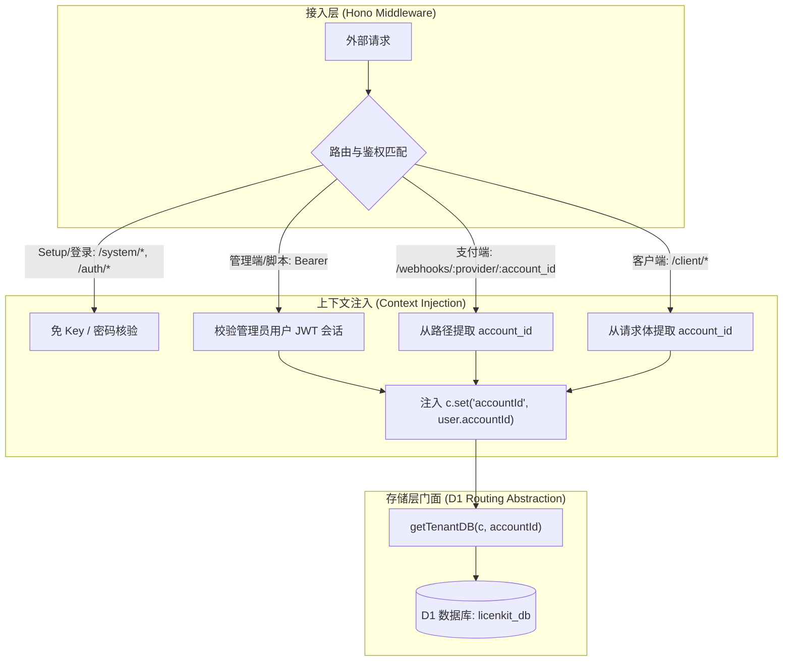
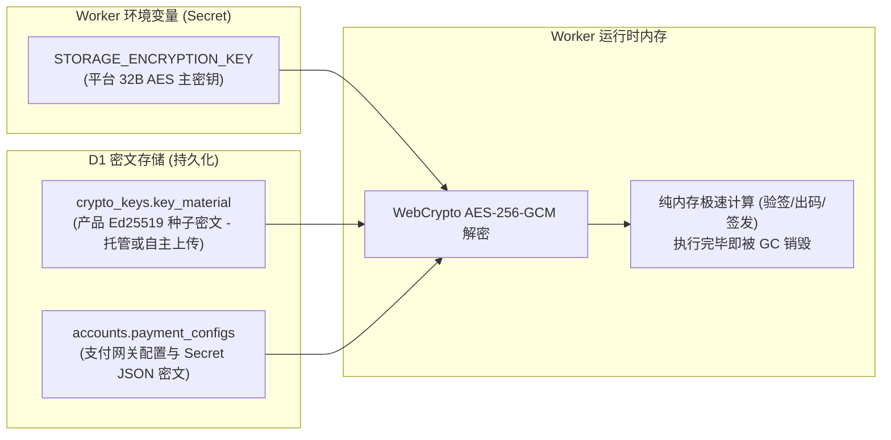
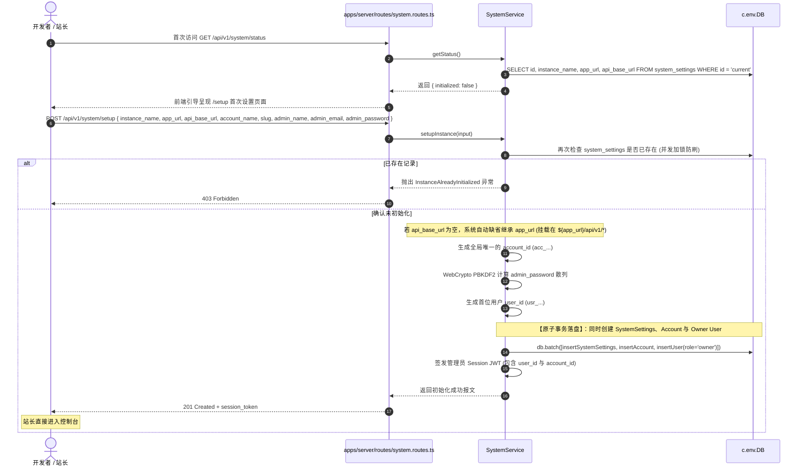
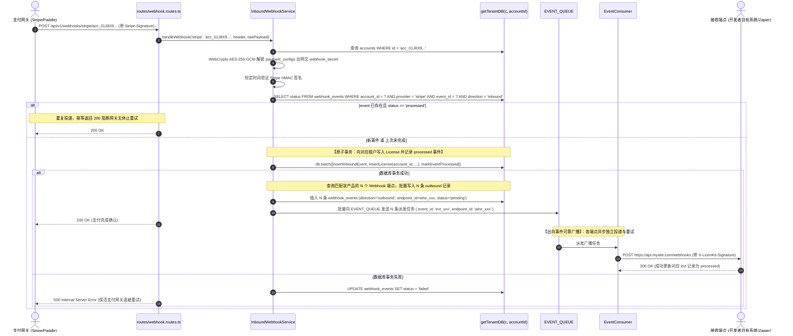
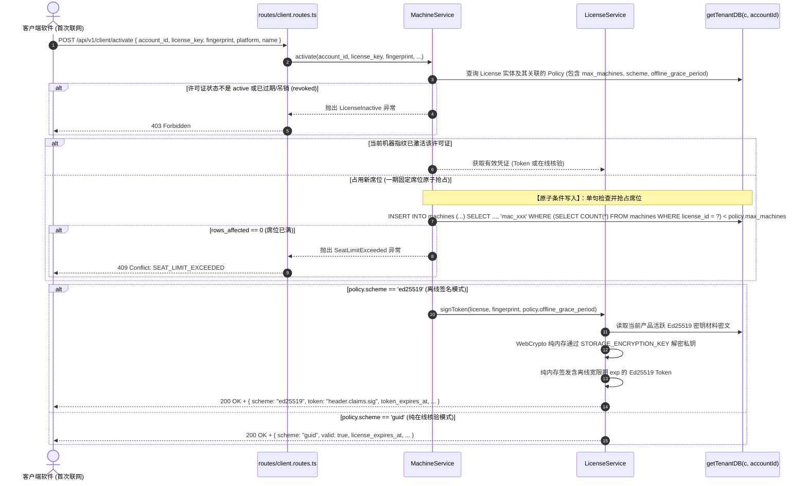

# LicenKit 后端架构与核心系统设计说明书

> **适用技术栈**：TypeScript + Hono + Drizzle ORM + Cloudflare Workers + Cloudflare D1 (SQLite) + Cloudflare KV + Cloudflare Queues  
> **定位**：现代化 API-First 纯授权中枢。可自部署开源版本（LicenKit），开箱即用支持首次 Setup 与多用户协作运行，架构天然支撑未来商业 SaaS（LicenKit-Cloud）直接引入复用。

---

## 一、 系统架构与分层设计 (LicenKit vs LicenKit-Cloud)



### 1. 系统配置、租户与用户分层设计 (System vs Tenant vs User)
- **`system_settings` 表（系统实例配置 - 单行单例 `id = 'current'`）**：
  - 承载自部署实例的全局运行参数：`instance_name`、`app_url`（前端控制台基准 URL）、`api_base_url`（后端 API 基准 URL）、`allow_signup`（是否开放公开注册）；
  - **前后端域名与缺省子路径规则**：
    - **缺省情况 (默认单域名同域部署，90% 场景)**：若 `api_base_url` 为 NULL 或留空，系统自动继承 `app_url`，后端 API 统一挂载在 **`${app_url}/api/v1/*`** 子路径下。前端 SPA 托管在根路径 `/*`，全栈同源，**零 CORS 跨域问题**；
    - **前后端分离情况 (10% 场景)**：若站长将前端（如部署在 Vercel `https://license.example.com`）与后端（部署在 Worker `https://api.license.example.com`）分离，显式配置 `api_base_url`，后端 API 挂载在 **`${api_base_url}/api/v1/*`**，且 Worker 自动将 `app_url` 注入为跨域预检允许的 CORS Origin；
  - **动态基准地址解耦**：系统在生成支付网关回调 URL、邮件跳转链接时动态组装，**站长更换域名无需重新发布 Worker 代码**；
  - **业务通知与邮件解耦**：系统自身零邮件协议与第三方邮件库依赖，所有客户通知与发信事件统一推入异步队列，通过出向 Webhook (`/api/v1/admin/webhooks`) 广播，由外部系统或 Resend 自动化发信；
- **`accounts` 表（租户/团队空间）**：
  - 授权资产的终极所有者，挂载 `products`, `policies`, `licenses`, `machines`, `crypto_keys`, `webhook_*`；
  - 支持租户专属 `custom_domain`（用于云端 SaaS 模式下的 CNAME 租户白标或二级域名路由）；
  - 持有租户级商业凭据：`payment_configs`（AES-256-GCM 密文集合）；
- **`users` 表（自然人管理员）**：
  - 管理后台的登录实体，通过 `account_id` 归属于特定租户；
  - 拥有 `email`、`password_hash`、`role`（`owner`、`admin`、`member`）；
  - 首次运行 `/setup` 时原子生成系统配置、初始 Account 与首个 Owner User；底层天然具备多成员协作与精细化权限管控能力。

---

### 2. 存储层门面设计 (`getTenantDB`)



- **LicenKit 开源自部署**：`getTenantDB(c, accountId)` 直接返回 `c.env.DB`，单库闭环，部署极简；
- **LicenKit-Cloud 商业版**：`getTenantDB` 内部可按 `accountId` 路由至不同的 D1 分片绑定（如 VIP 专属库或水平 Shard），业务代码零修改直接复用。

---

### 3. 凭据信封加密与零明文持久化



- **信封加密**：支付网关配置与 Ed25519 私钥种子统一由 `STORAGE_ENCRYPTION_KEY` 通过 **AES-256-GCM** 加密后持久化；
- **零明文保证**：数据库脱库无法获取任何明文私钥或网关密钥；Worker 仅在处理对应业务时内存即时解密；
- **安全红线**：严禁将私钥明文或密文写入全球分布式 KV 边缘节点，杜绝潜在安全敞口。

---

## 二、 代码目录组织规范 (Monorepo 架构)

为了兼顾“普通用户一键部署”与“进阶用户独立二开前端 UI”，项目采用 **Monorepo** 架构进行分包，核心引擎与控制台彻底解耦：

```text
licenkit/
├── apps/
│   ├── server/                  # 【LicenKit Server】授权核心引擎 (Cloudflare Worker)
│   │   ├── src/
│   │   │   ├── index.ts         # Worker 入口 (装配 Hono 实例与 Queue Consumer)
│   │   │   ├── types.ts         # 全局环境绑定 (DB, KEYS_KV, EVENT_QUEUE, Secrets)
│   │   │   │
│   │   │   ├── domains/         # 核心业务领域
│   │   │   │   ├── system/      # 0. 系统配置与 Setup 向导 (system_settings)
│   │   │   │   ├── auth/        # 1. 用户认证域 (users)
│   │   │   │   ├── account/     # 2. 租户主体与配置域 (accounts, custom_domain)
│   │   │   │   ├── policy/      # 3. 策略域 (policies)
│   │   │   │   ├── licensing/   # 4. 许可证与设备域 (licenses, machines, trials)
│   │   │   │   └── webhook/     # 5. 双向事件流 (webhook_endpoints, webhook_events)
│   │   │   │
│   │   │   ├── queue/           # 异步出向队列派发消费者
│   │   │   ├── infra/           # 基础设施 (WebCrypto 密码学、KV 缓存、D1 门面)
│   │   │   ├── middleware/                  # 中间件 (SetupGuard, SessionAuth, ErrorHandler)
│   │   │   └── routes/          # API 路由 (/api/v1/*)
│   │   ├── wrangler.jsonc       # Worker 配置 (单域名部署时通过 assets 嵌入 apps/web 静态产物)
│   │   └── package.json
│   │
│   └── web/                     # 【LicenKit-Web】管理控制台前端 SPA (React / Tailwind / shadcn)
│       ├── src/
│       │   ├── pages/           # /setup, /login, /dashboard, /licenses, /products...
│       │   ├── components/      # 现代化 UI 组件
│       │   └── lib/api-client.ts# 统一 API 请求封装 (支持读取 VITE_API_BASE_URL)
│       ├── vite.config.ts       # 构建配置
│       └── package.json
```

- **开箱一体交付**：在 Monorepo 根目录下运行 `pnpm build && wrangler deploy`，前端打包至 `apps/web/dist` 并通过 Worker Static Assets 直出。普通用户无需额外购买服务器，**单域名同域直通 `${app_url}/api/v1/*`，零跨域摩擦**；
- **独立二开交付**：用户可单独 Fork `apps/web` 进行主题更换、品牌定制或嵌入企业内部门户，只需配置 `VITE_API_BASE_URL=https://api.yourdomain.com` 即可与 Core 独立通信。

---

## 三、 核心业务时序图

### 1. 首次进入设置密码与原子初始化开户链路 (Setup Wizard)



---

### 2. 专属支付网关回调出码与出向广播链路



---

### 3. 客户端硬件指纹激活抢座链路


