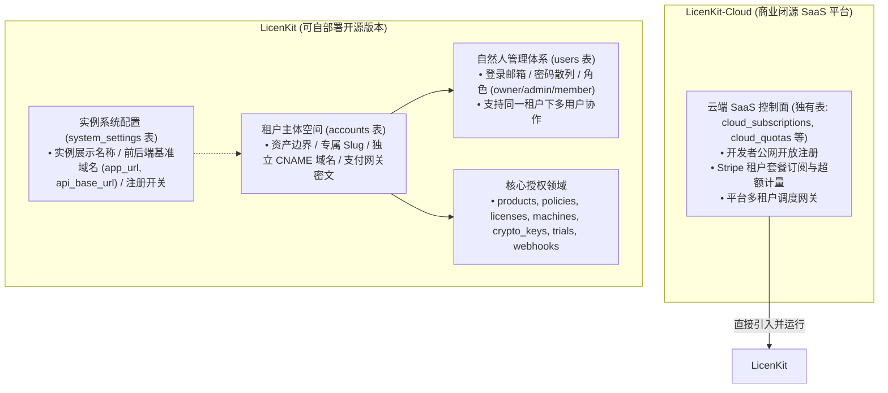
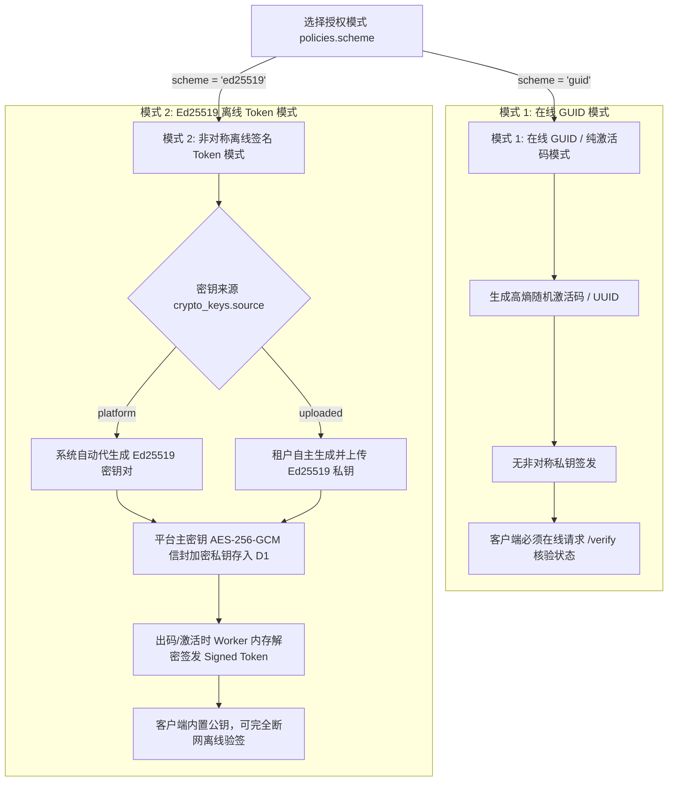
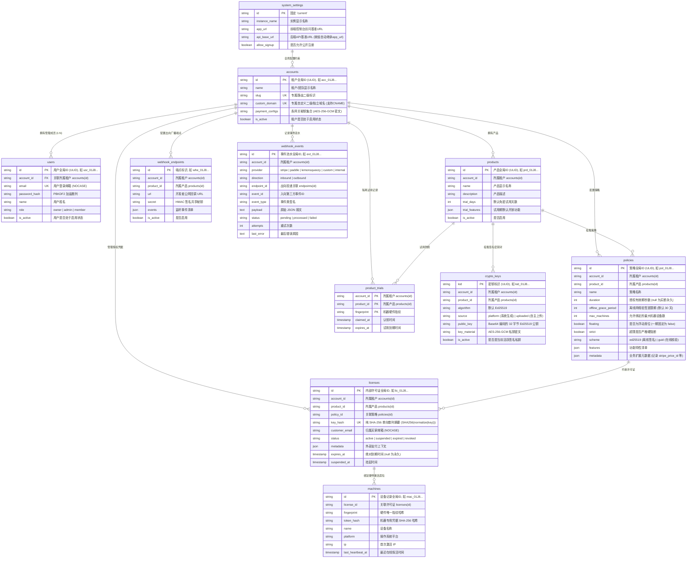

# LicenKit 数据库与核心密码学设计说明书

> **适用底座**：Cloudflare D1 (SQLite) + Cloudflare KV (`KEYS_KV`) + Cloudflare Queues (`EVENT_QUEUE`)  
> **设计目标**：API-First 纯授权中枢，可自部署开源产品（LicenKit），内建系统配置表（`system_settings`）支持前后端域名（`app_url` / `api_base_url`）与开箱即用首次 Setup 向导，架构天然支撑未来商业 SaaS（LicenKit-Cloud）直接引入复用。

---

## 一、 系统定位与架构分层 (LicenKit vs LicenKit-Cloud)

系统在战略与工程上明确划分为两层：



### 1. 概念解耦：系统配置（Settings）vs 租户（Account）vs 用户（User）
- **系统实例配置 (`system_settings`)**：
  - 单行全局配置记录（`id = 'current'`）；
  - 存储实例全局展示名称、前端控制台基准 URL（`app_url`，如 `https://license.screenstudio.com`）、后端 API 基准 URL（`api_base_url`，如 `https://api.screenstudio.com`）、公开注册开关（`allow_signup`，自部署默认 `FALSE`）等；
  - **缺省与分离路径规则**：
    - **缺省情况 (默认单域名部署，90% 场景)**：若 `api_base_url` 为 NULL 或留空，系统自动继承 `app_url`，即全站采用同域部署。API 统一挂载在 `${app_url}/api/v1/*` 子路径下，前端与后端完全同源，免除一切 CORS 跨域配置烦恼；
    - **独立分离情况 (前后端多域名部署，10% 场景)**：若站长将前端与后端分别部署在不同域名或平台（如前端部署在 Vercel `https://license.screenstudio.com`，后端部署在 Cloudflare Workers `https://api.license.screenstudio.com`），显式配置 `api_base_url`，系统将对外 API 挂载在 `${api_base_url}/api/v1/*`，且后端 Worker 自动将 `app_url` 注入为跨域预检允许的 CORS Origin；
  - 允许站长在管理后台随时动态更换域名，无需重新发布 Worker 代码。
  - **邮件与业务通知解耦**：系统自身零邮件依赖，所有客户通知与履约事件（发码、密码找回等）统一通过标准出向 Webhook（Outbound Webhooks）广播，由开发者自有系统、Resend 或自动化平台完成发信。
- **租户 / 团队空间 (`accounts`)**：
  - 代表组织/商业实体，为产品、策略、许可证、设备席位与支付网关配置的最高归属；
  - 持有信封加密的各支付网关参数与 Webhook Secret（AES-256-GCM 密文集合）；
  - **支持独立自定义域名 (`custom_domain`)**：在自部署模式下与系统主域名一致；在未来 SaaS 版中支持大客户绑定白标独立二级域名（CNAME）。
- **自然人用户 (`users`)**：
  - 代表登录后台操作的管理员，归属于特定 `account_id`；
  - 首次运行 `/setup` 时原子生成 1 个 Account 与首个 Owner User，底层天然具备未来扩充“多成员团队协作（Team Members / RBAC）”的能力。

### 2. 初始化状态机 (Setup State Machine)
- 首次部署未初始化时（`accounts` 表为空）：系统处于 `initialized: false`，引导进入 `/api/v1/system/setup`；
- 站长输入前端基准地址 `app_url`（以及可选的 `api_base_url`）、租户名称、管理员姓名、邮箱与密码：系统在事务中**原子创建 system_settings、Account 与首位 Owner User**，并为该自然人用户签发初始管理员 JWT 会话；
- 初始化完成后，自部署模式下关闭向导，后续访问与脚本调用均走 `/api/v1/auth/login` 凭 User 邮箱密码登录获取 Token。

---

## 二、 授权签发与密码学模式 (License Key Modes & Cryptography)

LicenKit 提供两种可配置的商业授权模式，由 `policies.scheme` 决定：



### 1. 模式一：在线 GUID / 纯激活码模式 (`scheme = 'guid'`)
- **适用场景**：SaaS 系统、强联网桌面插件、内部系统。
- **生成规则**：生成高熵随机串或格式化 UUID（如 `LK-7B9A-4C2E-8F1D-3A5B`）。
- **密码学特性**：服务端不执行非对称签名，不占用 Ed25519 密钥资源；
- **验签机制**：客户端启动或运行时必须向 `/api/v1/client/verify` 发起网络请求核验合法性。

### 2. 模式二：非对称离线签名 Token 模式 (`scheme = 'ed25519'`)
- **适用场景**：专业级桌面软件与独立应用程序，要求断网可正常使用，防破解与防反编译。
- **密钥自主可控**：
  1. **系统代生成 (`source = 'platform'`)**：创建产品时由系统自动生成 Ed25519 密钥对；
  2. **自主上传 (`source = 'uploaded'`)**：租户使用自己本地 OpenSSL 生成的 Ed25519 私钥上传至 LicenKit。
- **信封加密安全保证**：无论密钥由系统生成还是自主上传，私钥种子持久化前强制通过平台主密钥 `STORAGE_ENCRYPTION_KEY` 采用 **AES-256-GCM** 加密；Worker 仅在签发瞬间解密进内存，执行完毕即销毁，**绝不将私钥明文或密文写入全球分布式 KV**。

---

## 三、 离线 Token 结构与 Claims 荷载规范

当采用 `scheme = 'ed25519'` 时，服务端签发的离线授权 Token 遵循标准 3 段式封包：
$$\text{SignedToken} = \text{Base64Url}(\text{Header}) \text{ . } \text{Base64Url}(\text{Claims}) \text{ . } \text{Base64Url}(\text{Signature})$$

### 1. Header (头部)
```json
{
  "alg": "Ed25519",
  "kid": "kid_01J8X9N4K1L2M3N4P5Q6R7S8T9"
}
```

### 2. Claims (荷载 Payload)
| 字段 Key | 类型 | 示例值 | 作用说明 |
| :--- | :--- | :--- | :--- |
| `lic_id` | `string` | `"lic_01J8X9N6D1E2F3G4H5I6J7K8L9"` | 内部许可证全局唯一 ID |
| `sub` | `string` | `"SCR-8820-ABCD-9901"` | 许可证对外激活码 (License Key) |
| `acc` | `string` | `"acc_01J8X9N2R4Z7QW8M3P5V1Y6T2C"` | 所属租户 ID |
| `prd` | `string` | `"prd_01J8X9N3A1B2C3D4E5F6G7H8J9"` | 所属产品全局 ID |
| `pol` | `string` | `"pol_01J8X9N5U1V2W3X4Y5Z6A7B8C9"` | 所属授权策略 ID |
| `fp` | `string` | `"sha256:d8e8fca2..."` | **绑定的硬件指纹哈希** (客户端比对本机硬件防串号) |
| `iat` | `number` | `1757923200` | 签发时间戳 (Unix 秒) |
| `exp` | `number` | `1760515200` | **离线网络验签到期时间** (Unix 秒，由 `offline_grace_period` 约束) |
| `fea` | `string[]` | `["4k_export", "unlimited_recording"]` | 授权启用的功能模块清单 |

> **离线验签宽限期约束公式**：  
> $$\text{exp} = \min(\text{license.expires\_at} \text{ ?? } \infty, \; \text{now()} + \text{policy.offline\_grace\_period})$$  
> 买断制（`expires_at = null`）和订阅制均受 `offline_grace_period` 约束。客户端在本地验签通过的前提下，若发现当前时间临近 `exp`，静默联网调用 `/client/verify` 顺延新 Token。

---

## 四、 数据库全景拓扑图 (ER Diagram)

LicenKit 由 **1 张系统配置表、1 张租户表、1 张用户表与 7 张业务资产表** 组成：



---

## 五、 关键索引与约束设计说明

完整 DDL 详见 [`docs/schemas/schema.sql`](../schemas/schema.sql)。

1. **自定义域名唯一性约束**：
   - `CREATE UNIQUE INDEX idx_accounts_custom_domain ON accounts(custom_domain);`
   - **作用**：当请求到达 Worker 时，系统可根据请求头的 `Host` 字段快速命中对应的租户，支持白标独立域名访问。
2. **租户覆盖索引**：
   - 核心业务表强制包含 `account_id` 索引字段；
   - 保证自部署实例的检索性能，同时为未来向 LicenKit-Cloud 商业多租户迁移提供天然的行级物理隔离支持。
3. **入向支付精确去重复合索引**：
   - `CREATE UNIQUE INDEX idx_webhook_events_inbound_dedup ON webhook_events(account_id, provider, event_id) WHERE direction = 'inbound';`
   - **作用**：确保防重逻辑同时约束在“租户 + 来源渠道 + 第三方事件ID”三维空间内，杜绝误判冲突。
4. **单机试用复合主键防刷**：
   - `PRIMARY KEY (account_id, product_id, fingerprint)`
   - **作用**：单机针对单款产品终生只能认领一次，单表单行极速防刷，零写入 `licenses` 表。
5. **席位部分唯一约束**：
   - `CREATE UNIQUE INDEX idx_machines_license_fingerprint ON machines(license_id, fingerprint);`
   - **作用**：同一台机器针对同一张许可证重复调用激活接口时幂等返回，不重复扣减席位。
6. **盲索引与机器凭据索引**：
   - `CREATE UNIQUE INDEX idx_licenses_account_key_hash ON licenses(account_id, key_hash);`
   - `CREATE INDEX idx_machines_token_hash ON machines(token_hash);`
   - **作用**：`key_hash` 用于激活时 O(1) 租户隔离快速定位许可证；`token_hash` 用于日常心跳时毫秒级安全核验机器凭据。

---

## 六、 Cloudflare Workers 配置文件与环境变量 (`wrangler.jsonc`)

### 1. `wrangler.jsonc` 配置规范
```jsonc
{
  "$schema": "node_modules/wrangler/config-schema.json",
  "name": "licenkit-server",
  "main": "src/index.ts",
  "compatibility_date": "2026-09-01",
  "compatibility_flags": ["nodejs_compat"],

  "vars": {
    "APP_ENV": "development",
    "BASE_URL": "http://localhost:8787"
  },

  // 1. D1 数据库主存储绑定 (开箱即用核心库)
  "d1_databases": [
    {
      "binding": "DB",
      "database_name": "licenkit_db",
      "database_id": "local-db-id",
      "migrations_dir": "migrations"
    }
  ],

  // 2. Cloudflare KV 绑定 (活跃公钥与租户 API Key 边缘只读缓存)
  "kv_namespaces": [
    {
      "binding": "KEYS_KV",
      "id": "local-keys-kv-id"
    }
  ],

  // 3. Cloudflare Queues 绑定 (出向 Webhook 异步广播队列)
  "queues": {
    "producers": [
      {
        "binding": "EVENT_QUEUE",
        "queue": "licenkit-event-queue"
      }
    ],
    "consumers": [
      {
        "queue": "licenkit-event-queue",
        "max_batch_size": 10,
        "max_batch_timeout": 5,
        "max_retries": 5,
        "dead_letter_queue": "licenkit-event-dlq"
      }
    ]
  },

  // 定时清理任务
  "triggers": {
    "crons": ["0 3 * * 0"]
  }
}
```

### 2. 敏感 Secret 环境变量清单

| 变量名 | 作用说明 | 本地配置载体 | 生产配置命令 |
| :--- | :--- | :--- | :--- |
| `STORAGE_ENCRYPTION_KEY` | 主密钥 (KEK)：解密 Ed25519 种子与网关秘钥 (32 字节高熵随机串) | `.dev.vars` | `npx wrangler secret put STORAGE_ENCRYPTION_KEY` |
| `JWT_SECRET` | 用户登录控制台时颁发 Session JWT 的签名秘钥 (32 字节高熵串) | `.dev.vars` | `npx wrangler secret put JWT_SECRET` |
