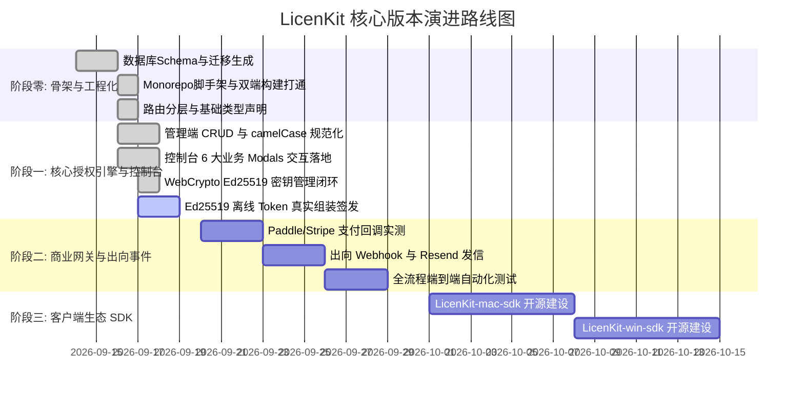

# LicenKit 模块开发计划与任务分解矩阵 (Roadmap & WBS)

> **项目定位**：现代化 API-First 纯授权中枢。  
> **开源自部署版**：`LicenKit`（当前 Monorepo，全栈 TypeScript + Cloudflare Workers + D1 + Queues + React 19 + Tailwind v4）。  
> **商业 SaaS 版**：`LicenKit-Cloud`（未来独立商业托管平台，直接引入并调度 LicenKit 核心引擎）。  
> **客户端生态**：`LicenKit-mac-sdk`、`LicenKit-win-sdk` 等独立客户端开源仓库。

---

## 一、 当前工程阶段说明 (Scaffolding vs Modules)

> [!IMPORTANT]
> **当前状态澄清**：
> - **Phase 0（Monorepo 脚手架与全栈工程链路）**：**100% 完成**（目录规范、Drizzle ORM 11 表建模、构建流水线与双端联动）。
> - **Phase 1（核心授权管理闭环与控制台高保真 UI）**：**大部完成**。已实现产品、策略、许可证全生命周期管理闭环（含高级分页过滤、发码、吊销/挂起/解挂、一键轮换 Key、解绑设备）、WebCrypto Ed25519 原生密钥生成/导入挑战验签/AES-256-GCM 信封加密、出向队列消费与 HMAC 防篡改签名，以及前端 6 个高保真业务模态框（Modals）。
> - **当前焦点（Phase 1 收尾项）**：**M06.2 客户端离线 Ed25519 结构化 Token 组装与真实签发**，随后进入 Phase 2（Paddle/Stripe 真实入向验签与自动发码履约）。

---

## 二、 模块全景与状态矩阵 (Module Inventory)

| 模块编号 | 模块名称 | 核心职责 | 优先级 | 当前状态 | 对应代码与目录 |
| :--- | :--- | :--- | :---: | :---: | :--- |
| **M01** | **系统引导与动态域名 (System & Setup)** | 首次部署 Setup 向导、`system_settings` 单例配置、单域名零 CORS 自动解析、参数热更新 | **P0** | **已完成** | `server/src/routes/system.routes.ts` `server/src/routes/admin/settings.routes.ts` `web/src/pages/SetupPage.tsx` |
| **M02** | **身份认证与权限管理 (Auth & RBAC)** | 自然人账号、WebCrypto PBKDF2 密码散列、Session JWT 签发与 Bearer 中间件、多角色管控 | **P0** | **核心已完成** (待做多成员邀请) | `server/src/routes/auth.routes.ts` `server/src/middleware/auth.ts` `web/src/pages/LoginPage.tsx` |
| **M03** | **产品与离线密码学引擎 (Products & Crypto)** | 软件产品管理、WebCrypto 原生 Ed25519 密钥对生成、AES-256-GCM 私钥信封加密持久化、私钥导入校验与一次性下载 | **P0** | **已完成** | `server/src/infra/crypto/` `server/src/routes/admin/products.routes.ts` `web/src/components/modals/CreateProductModal.tsx` |
| **M04** | **授权策略与席位规则引擎 (Policies Engine)** | 买断/订阅有效期计算、设备席位上限 (`maxMachines`)、离线验签宽限期、`ed25519` 签名 vs `guid` 模式、特性标签 | **P0** | **已完成** | `server/src/routes/admin/policies.routes.ts` `web/src/components/modals/CreatePolicyModal.tsx` `web/src/components/modals/EditPolicyModal.tsx` |
| **M05** | **许可证全生命周期管理 (Licenses Lifecycle)** | 格式化激活码生成 (`LIC-XXXX-XXXX-XXXX-XXXX`)、手动发码、挂起/解挂/吊销、到期判定、一键轮换 Key、席位查看与解绑 | **P0** | **已完成** | `server/src/routes/admin/licenses.routes.ts` `web/src/components/modals/IssueLicenseModal.tsx` `web/src/components/modals/LicenseDetailModal.tsx` |
| **M06** | **客户端激活与试用防刷 (Client Activation & Anti-Abuse)** | 硬件指纹采集绑定、原子席位抢占、在线心跳、Ed25519 签名 Token 签发、单表匿名防刷试用 (`product_trials`) | **P0** | **已完成** | `server/src/routes/client.routes.ts` `server/src/infra/crypto/index.ts` |
| **M07** | **支付网关入向回调与履约 (Inbound Webhooks & Fulfillment)** | Paddle 与 Stripe 网关入向回调、密文解密验签、精确幂等去重、自动发码与绑定 Policy | **P0** | **已完成** | `server/src/routes/webhook.routes.ts` `server/src/routes/admin/settings.routes.ts` |
| **M08** | **纯异步出向事件广播流 (Outbound Queues - Option A)** | 业务事件推入 Cloudflare Queues；异步推至 Resend / Zapier / 自建端点；HMAC 签名防篡改与指数重试、端点管理与日志审计 | **P1** | **已完成** | `server/src/queue/consumer.ts` `server/src/routes/admin/webhooks.routes.ts` |
| **M09** | **管理控制台前端 SPA (Web Dashboard UI)** | 现代化暗色控制台、Paddle/Stripe Tab 切换、6 大全功能业务 Modals、高级搜索与状态筛选、指标卡片与设备解绑 | **P1** | **已完成** | `web/src/pages/DashboardPage.tsx` `web/src/components/modals/*` `web/src/lib/api-client.ts` |
| **M10** | **客户端生态 SDK (Client SDKs)** | 提供各平台原生开发者的接入库（macOS Swift、Windows C#、跨平台 CLI） | **P2** | **规划中** | 独立生态仓库 (`LicenKit-mac-sdk` 等) |

---

## 三、 分模块详细开发任务分解 (WBS)

### 模块 M01：系统引导与动态域名 (System & Setup Wizard)
- [x] **M01.1** `system_settings` 单行单例表设计（主键固定为 `current`）；
- [x] **M01.2** `GET /api/v1/system/status` 状态探活接口；
- [x] **M01.3** `POST /api/v1/system/setup` 原子初始化批处理（同时创建配置、租户与首位 Owner）；
- [x] **M01.4** `setupGuard` 并发加锁防刷机制（已初始化实例严格返回 403）；
- [x] **M01.5** 动态基准域名解析：`api_base_url` 缺省为空时自动继承 `app_url` 并挂载在 `/api/v1/*`（单域名部署零 CORS）；
- [x] **M01.6** 实例参数热更新：支持在控制台动态修改 `instance_name`、`app_url` 与 `api_base_url`（`PUT /api/v1/admin/settings`）；
- [ ] **M01.7** 域名健康检查工具：检测前后端 URL 连通性并在控制台给出配置建议。

---

### 模块 M02：身份认证与权限管理 (Auth & Multi-Member RBAC)
- [x] **M02.1** `users` 自然人管理员表结构与 `COLLATE NOCASE` 唯一邮箱索引；
- [x] **M02.2** WebCrypto PBKDF2-HMAC-SHA256 密码加盐散列与常量时间比对；
- [x] **M02.3** WebCrypto 原生 HMAC-SHA256 Session JWT 签发与解析（7 天有效期）；
- [x] **M02.4** `sessionAuth` 中间件（自动从 `Authorization: Bearer <token>` 提取身份并注入 Context）；
- [ ] **M02.5** 完善团队成员管理（密码重置、多角色权限微调）；
- [ ] **M02.6** 成员邀请机制：通过出向 Webhook 发送邀请链接并在前端设置独立密码；
- [ ] **M02.7** 细粒度操作审计：记录各管理员的操作流水日志。

---

### 模块 M03：产品与离线密码学引擎 (Products & Cryptography Engine)
- [x] **M03.1** `products` 表与 `crypto_keys` 表关系建模；
- [x] **M03.2** WebCrypto 原生 Ed25519 密钥对生成工具函数（导出 32 字节原始公钥与 PKCS#8 私钥）；
- [x] **M03.3** AES-256-GCM 凭据信封加密与零明文持久化（由 `STORAGE_ENCRYPTION_KEY` 保护）；
- [x] **M03.4** 创建产品时自动代生成并激活首套 Ed25519 密钥（事务写入产品与密钥记录）；
- [x] **M03.5** 租户自主上传私钥种子支持（支持 raw 32B seed 或 PKCS#8 格式，挑战验签确保公私钥严格匹配）；
- [x] **M03.6** 私钥一次性安全下载机制（创建产品时返回私钥 PEM，前端带二次确认防误关弹窗）；
- [ ] **M03.7** 密钥轮换与平滑淘汰机制（Key Rotation：支持维护多版本历史公钥，淘汰旧密钥）；
- [x] **M03.8** 客户端公钥公开验证端点（`GET /api/v1/client/products/:id/pubkey`，可缓存在边缘 KV）。

---

### 模块 M04：授权策略与席位规则引擎 (Policies Engine)
- [x] **M04.1** `policies` 表设计（授权策略与席位规则规范）；
- [x] **M04.2** 授权模式双轨支持：`ed25519`（非对称离线签名 Token）与 `guid`（纯在线核验）；
- [x] **M04.3** 商业有效期模式：支持买断制（`duration = null` 永久有效）与周期订阅制（秒数自动推算过期时间）；
- [x] **M04.4** 离线宽限期规则：配置 `offlineGracePeriod`（默认 30 天）；
- [x] **M04.5** 设备席位约束：配置 `maxMachines`（允许同时绑定的最大硬件数量）与 `strict` 严格溢出阻断；
- [x] **M04.6** 功能特性集过滤与支付价格绑定：支持设置 `features` 标签数组与支付网关 price_id；
- [ ] **M04.7** 浮动席位规则引擎（二期规划：`floating: true`，按心跳超时动态释放闲置设备席位）。

---

### 模块 M05：许可证全生命周期管理 (Licenses Lifecycle)
- [x] **M05.1** `licenses` 表设计与 `COLLATE NOCASE` 唯一 Key 索引；
- [x] **M05.2** 16 位格式化激活码自动生成器（生成标准 `LIC-XXXX-XXXX-XXXX-XXXX` 易读防混淆激活码）；
- [x] **M05.3** 控制台手动为买家发码业务闭环（自动校验关联 Product 与 Policy 有效性，支持自定义 Key 与到期日）；
- [x] **M05.4** 许可证状态机流转：`active`（正常）-> `suspended`（挂起）-> `revoked`（吊销清退席位）；
- [x] **M05.5** 许可证列表高级分页与组合过滤（按状态、买家邮箱、Key 模糊搜索、关联设备数实时统计）；
- [x] **M05.6** 许可证一键轮换 Key (`rotate-key`)：更换新 Key 并自动清空旧设备绑定；
- [x] **M05.7** 许可证设备席位查看与管理解绑：`DELETE /api/v1/admin/licenses/:id/machines/:machineId`；
- [ ] **M05.8** 批量发码与导出：支持单次批量生成成百上千张预制激活码并导出为 CSV。

---

### 模块 M06：客户端激活与试用防刷 (Client Activation & Anti-Abuse)
- [x] **M06.1** `machines` 表设计与 `(license_id, fingerprint)` 唯一防重复占座约束；
- [x] **M06.2** 客户端设备激活与席位抢占（`POST /api/v1/client/activate`，并发席位限制检查）；
- [x] **M06.3** 在线核验与探活心跳更新（`POST /api/v1/client/validate` 顺延签发离线 Token 并更新 `lastHeartbeatAt`）；
- [x] **M06.4** 客户端主动注销与席位解绑（`POST /api/v1/client/deactivate`）；
- [x] **M06.5** `product_trials` 单表匿名试用防刷闭环（`POST /api/v1/client/trial` 机器指纹去重，签发离线试用 Token）；
- [x] **M06.6** **核心实现：离线 Ed25519 结构化 Token 真实组装与签发**（将 `{ lic, sub, fpt, exp, pol, fea, iat }` 组装并通过私钥签名返回标准 Base64Url Token，已通过端到端离线数学验签测试）；
- [ ] **M06.7** 异常激活风控标记：同一许可证短期内频繁在跨地域 IP 激活时发出审计告警。

---

### 模块 M07：支付网关入向回调与履约 (Inbound Payment & Fulfillment)
- [x] **M07.1** `accounts.payment_configs` 密文字段支持，统一存储各支付网关密钥（AES-256-GCM 加密）；
- [x] **M07.2** 通用入向回调端点与三维幂等防重：`POST /api/v1/webhooks/:provider/:account_id`（基于 `(account_id, provider, event_id)` 唯一索引去重）；
- [x] **M07.3** **Paddle Billing 签名真实验证算法**（按 Paddle 官方规范校验 `Paddle-Signature` 标头）；
- [x] **M07.4** **Stripe 签名真实验证算法**（按 Stripe 官方规范校验 `Stripe-Signature` 标头）；
- [x] **M07.5** Paddle 交易完成事件解析（`transaction.completed` -> 自动按外部价格 ID 匹配 Policy 并生成 License）；
- [x] **M07.6** Stripe Checkout 事件解析（`checkout.session.completed` -> 自动匹配生成 License）；
- [x] **M07.7** 订阅取消与退费事件处理（`subscription.canceled` -> 自动将关联 License 标记为 `suspended` 或 `revoked`）。

---

### 模块 M08：纯异步出向事件广播流 (Outbound Queues - Option A)
- [x] **M08.1** 纯 Webhook 架构确立，全面清除 raw SMTP 配置与第三方邮件库依赖；
- [x] **M08.2** `webhook_endpoints` 开发者接收端点配置表与管理路由（`POST / GET / DELETE /api/v1/admin/webhooks`）；
- [x] **M08.3** `webhook_events` 双向流水审计表（区分 `inbound` 与 `outbound`）与查询接口（`GET /api/v1/admin/webhooks/events`）；
- [x] **M08.4** Cloudflare `EVENT_QUEUE` 消息绑定与消费处理器架构；
- [x] **M08.5** 出向 HTTP POST 附带 `X-LicenKit-Signature`（HMAC-SHA256）防篡改签名计算；
- [x] **M08.6** 队列投递失败指数退避重试（最大重试 3 次，记录 `lastError`）；
- [x] **M08.7** 核心业务事件全量触发入队（在发码、停用、设备解绑时自动调用 queue.send）；
- [x] **M08.8** 控制台出向 Webhook 管理模态框与测试事件发送交互。

---

### 模块 M09：管理控制台前端 SPA (Web Dashboard UI)
- [x] **M09.1** React 19 + Vite + Tailwind CSS v4 现代前端脚手架与构建流程；
- [x] **M09.2** 统一 API 客户端（标准 camelCase DTO、自动注入 JWT Header、基准路径解析与零 CORS 同域适配）；
- [x] **M09.3** `SetupPage` 首次安装向导页面；
- [x] **M09.4** `LoginPage` 管理员登录页面；
- [x] **M09.5** `DashboardPage` 暗色高保真控制台与 **Paddle / Stripe / Lemon Squeezy** Tab 切换交互；
- [x] **M09.6** **产品管理交互**：`CreateProductModal`（自动生成 / 上传私钥并校验）、`EditProductModal`、公钥复制、一次性私钥防误关下载；
- [x] **M09.7** **策略管理交互**：`CreatePolicyModal`、`EditPolicyModal`（席位上限、有效期、离线宽限期、features 标签、网关价格绑定）；
- [x] **M09.8** **许可证管理交互**：`IssueLicenseModal`（手动发码）、高级筛选栏（模糊搜索、产品/状态筛选）、挂起/恢复快捷操作；
- [x] **M09.9** **设备席位管理交互**：`LicenseDetailModal`（查看已激活设备指纹、操作系统、最后心跳、一键强制解绑席位）；
- [x] **M09.10** **系统设置交互**：保存与更新支付网关 Secret、修改实例名称与基准域名；
- [x] **M09.11** **出向 Webhook 交互弹窗**：添加自定义端点 Modal 与监听事件勾选界面。

---

### 模块 M10：客户端生态 SDK 体系 (Client SDKs & Integration Ecosystem)
- [ ] **M10.1** **`LicenKit-mac-sdk`**（针对 macOS / iOS 平台）：
  - Swift Package Manager (SPM) 交付；
  - IOKit / CorePlatform 原生硬件指纹提取（CPU UUID + MAC + IOPlatformUUID）；
  - CryptoKit 原生 Ed25519 离线验签与本地安全存储（Keychain）；
  - 宽限期本地计时与后台静默探活心跳。
- [ ] **M10.2** **`LicenKit-win-sdk`**（针对 Windows 平台）：
  - C# .NET / C++ DLL 交付；
  - WMI / SMBIOS 提取主板 UUID 与硬盘特征；
  - CNG / BouncyCastle Ed25519 离线验签；
  - 注册表/加密数据文件本地缓存保护。
- [ ] **M10.3** **`LicenKit-cli`**（跨平台命令行核验工具）：
  - Go / Rust / TypeScript 实现的单二进制可执行文件；
  - 提供 `licenkit activate <key>`、`licenkit check` 等命令行接口。

---

## 四、 迭代里程碑与交付路线图 (Roadmap & Milestones)

### 里程碑 0：工程骨架与流水线打通 (Phase 0 - 100% Done)
- **目标**：建立规范、数据库模型、Monorepo 脚手架及本地与生产构建链路。
- **产出**：
  - `docs/schema.sql`、`docs/api_specification.md`、`docs/backend_architecture.md`；
  - `apps/server` (Hono + Drizzle + Workers + D1) + `apps/web` (React 19 + Tailwind v4 + Vite)；
  - 静态检查 `pnpm run typecheck` 0 错误，打包 `pnpm run build` 一键直出。

### 里程碑 1：核心授权业务闭环与控制台高保真交互 (Phase 1 - 100% Done)
- **目标**：实现真正的产品创建、策略配置、许可证全生命周期、离线 Ed25519 Token 签发及客户端指纹核销。
- **已完成交付**：
  - M03：产品 Ed25519 密钥生成、信封加密、自定义私钥导入校验、一次性下载及公开公钥端点；
  - M04 / M05：策略与许可证全生命周期管理（高级过滤、发码、吊销/挂起、一键轮换 Key、设备席位管理）；
  - M06：客户端设备激活与探活顺延返回标准 Ed25519 离线数字凭证（Token）、试用 Token 离线签发；
  - M09：前端控制台 6 个业务弹窗模态框与指标看板。

### 里程碑 2：商业网关实测与异步通知广播 (Phase 2 - Next)
- **目标**：完成真实的 Paddle 与 Stripe 联调，实现买家支付成功后自动发码，并经由出向 Webhook 触发外部发信。
- **重点交付**：
  - M07：Paddle / Stripe 支付事件签名验证与自动发码履约处理器；
  - M08：出向 Webhook 业务事件全量入队触发与前端配置模态框。

### 里程碑 3：客户端 SDK 开源矩阵 (Phase 3)
- **目标**：打造开箱即用的原生客户端接入生态。
- **重点交付**：
  - 启动独立开源仓库 `LicenKit-mac-sdk`（Swift 包）与示例 Demo；
  - 启动独立开源仓库 `LicenKit-win-sdk`（C# / C++）与示例 Demo；
  - 提供跨平台 CLI 核验工具。
